### [LangChain 常用语法梳理](https://www.bilibili.com/video/BV1yjz5BLEoY/?spm_id_from=333.788.player.switch&vd_source=9d75580d0b23d1137d56e03a996ac726&p=47)

- 这份文档基于当前项目目录下的实战代码，梳理 LangChain 核心用法；文首附课程资源链接。
- 使用前在 `.env` 中配置百炼兼容端点：`DASHSCOPE_KEY`（或 `DASHSCOPE_API_KEY`）、`BASE_URL`、`MODEL_CHAT` 等（亦可在系统环境变量中配置）

> **课程资源**：[脑图](https://docs.qq.com/mind/DWkdKVnhQUWtrYmtJ) · [课程首页（p=2）](https://www.bilibili.com/video/BV1yjz5BLEoY?spm_id_from=333.788.player.switch&vd_source=9d75580d0b23d1137d56e03a996ac726&p=2) · [配套资料（百度网盘 1234）](https://pan.baidu.com/s/1kQ-Q7UFWuHEbawQ4SStNSQ?pwd=1234) · [百炼 API Key](https://bailian.console.aliyun.com/cn-beijing/?tab=model#/api-key) · 辅助：[Gemini](https://gemini.google.com/)

## [LangChain 概览](https://www.bilibili.com/video/BV1yjz5BLEoY?spm_id_from=333.788.videopod.episodes&vd_source=9d75580d0b23d1137d56e03a996ac726&p=17)

### 简介
> LLMs是技术范畴的统称，指基于大参数量、海量文本训练的Transformer架构模型，核心能力是理解和生成自语言
- LangChain 由 Harrison Chase 创建于 2022 年 10 月，它是围绕 **LLMs（大语言模型）** 建立的一个框架。
- LangChain 自身并不开发 LLMs，它的核心理念是**为各种 LLMs 实现通用的接口**，把 LLMs 相关的组件「链接」在一起，简化 LLMs 应用的开发难度，方便开发者快速地开发复杂的 LLMs 应用。

### 主要功能模块

| 模块 | 说明 | 本文档章节 |
| :--- | :--- | :--- |
| **Prompts** | 优化提示词（提示词工程） | [§6 提示词模板](#6-提示词模板-prompts) |
| **Models** | 调用各类模型 | [§5 模型类型与接入](#5-模型类型与接入-models) |
| **History** | 管理会话历史记录（记忆） | [§9 会话记忆](#9-会话记忆-memory-context) |
| **Indexes** | 管理和分析各类文档 | [§10](#10-文档加载器-document-loaders)–[§12](#12-向量检索构建提示词-rag-prompt)（文档加载、向量存储、RAG 提示） |
| **Chains** | 构建功能的执行链条 | [§7 LCEL](#7-lcel-chains-composition) |
| **Agent** | 构建智能体 | [§14](#14-agent-智能体)–[§15](#15-agent-项目实战) |

### 依赖安装

```bash
pip install openai langchain langchain-community langchain-ollama langchain-chroma dashscope chromadb bs4 jq -i https://pypi.tuna.tsinghua.edu.cn/simple
```

| 软件包 | 说明 |
| :--- | :--- |
| `openai` | 调用兼容 OpenAI 接口的云端/本地端点（见 [§1.1](#11-安装-openai-sdk)） |
| `langchain` | 核心包 |
| `langchain-community` | 社区支持包，提供更多第三方模型调用（本课程使用的阿里云千问模型需要此包） |
| `langchain-ollama` | Ollama 支持包，用于调用 Ollama 托管部署的本地模型 |
| `dashscope` | 阿里云通义千问的 Python SDK |
| `chromadb` | 轻量向量数据库（后续 RAG 等场景使用） |
| `langchain-chroma` | Chroma 与 LangChain 的集成封装（本仓库向量持久化） |
| `bs4` | BeautifulSoup，部分文档加载与解析示例会用到 |
| `jq` | `JSONLoader` 等加载 JSON 时的依赖 |

文本分块等场景另需 `langchain-text-splitters`。**锁定版本请以仓库根目录 `requirements.txt` 为准**。

---

## 1. 前置准备

本仓库 LangChain 示例默认经 **OpenAI 兼容** `base_url` 调用百炼（`common/dashscope_compat.py`）或 [§2.3 Ollama](#23-ollama-本地运行)；密钥与 `.env` 见 [§2 环境配置](#2-环境配置)。

### 1.1 [安装 OpenAI SDK](https://www.bilibili.com/video/BV1yjz5BLEoY?spm_id_from=333.788.player.switch&vd_source=9d75580d0b23d1137d56e03a996ac726&p=8)

```bash
pip install openai -i https://pypi.tuna.tsinghua.edu.cn/simple
```
### 1.2 使用示例
| 步骤 | 要点 |
| :--- | :--- |
| 1. 创建客户端 | 实例化 `OpenAI`，配置 `api_key`、`base_url`（如 DashScope 兼容端点） |
| 2. 对话补全 | `client.chat.completions.create(model=..., messages=[...])` |
| 3. 读取结果 | 非流式：`response.choices[0].message.content`；流式见 [§1.3](#13-openai-流式输出) |

```python
# 01-basic/03-openai.py

from openai import OpenAI
import os

client = OpenAI(
    api_key=os.getenv("OPENAI_API_KEY"),
    base_url="https://dashscope.aliyuncs.com/compatible-mode/v1",
)

completion = client.chat.completions.create(
    model="qwen3-max",
    messages=[
        {"role": "system", "content": "你是一个Python编程专家，并且不说废话简单回答"},
        {"role": "assistant", "content": "好的，我是编程专家，并且话不多，你要问什么?"},
        {"role": "user", "content": "输出1-10的数字，使用python代码"},
    ],
)

print(completion.choices[0].message.content)
```
- 模型**回复越长，消耗的 tokens 越多**（completion tokens 示意）：

与 [§5.2.1 消息类型](#521-聊天模型的消息类型-messages) 衔接：直连 SDK 时 `messages` 里每条为 `{"role": ..., "content": ...}`，对应 LangChain 消息类如下。

| role | 作用 | LangChain 对应 |
| :--- | :--- | :--- |
| `system` | 设定模型行为与规则 | [SystemMessage](#5211-标准类形式) |
| `assistant` | 模型侧已有回复（多轮上下文或示例） | [AIMessage](#5211-标准类形式) |
| `user` | 用户提问 | [HumanMessage](#5211-标准类形式) |


---

## 2. 环境配置
### 2.1 方式1 在系统环境变量中配置

### 2.2 方式2 env文件配置
通常使用 `.env` 文件管理 API Key，并通过 `dotenv` 加载；聊天模型统一经 [`common/dashscope_compat.py`](../common/dashscope_compat.py) 的 `create_chat_openai()` 创建。
```python
from common.dashscope_compat import create_chat_openai
model = create_chat_openai()  # 读取 MODEL_CHAT、BASE_URL、密钥
```

### 2.3 [Ollama 本地运行](https://www.bilibili.com/video/BV1yjz5BLEoY?spm_id_from=333.788.player.switch&vd_source=9d75580d0b23d1137d56e03a996ac726&p=5)

> **Ollama** 是可在本机拉取并运行大模型的开源工具；与百炼等云端方案相比，数据不出本机，适合离线调试与 LangChain 本地示例（`langchain_ollama`）。

1. **Ollama 部署**：在[官网](https://ollama.com/)下载并安装客户端即可。
2. Ollama 官方模型库：<https://ollama.com/library>
3. **蒸馏模型**：在标准大模型核心能力上做学习与压缩（瘦身），以降低本地运行开销。可理解为「学生版」大模型：学到教师的核心本领，但整体仍弱于教师；**参数量越大**，学到越扎实，效果通常越好。
4. **参数量怎么选（经验值，可按本机实测微调）**：
- 同名系列参数量越大，效果通常更好，也更吃算力; 机器性能越好，生成越快。 
- 参数量越大，对硬件要求越高；算力或显存不足时，推理与吐字速度会明显下降。
| 硬件 | 建议参数量 |
| :--- | :--- |
| 集显 | 约 1.5b |
| 4G 独显 | 8b 以内 |
| 8G 独显 | 14b 以内 |

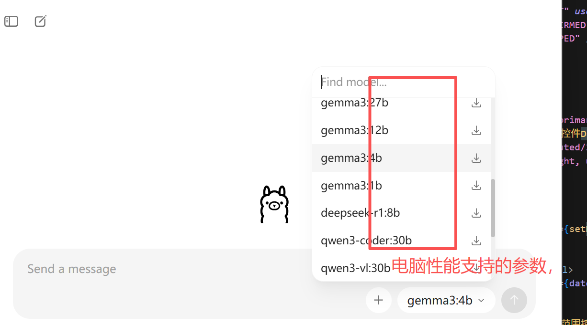

#### 2.3.1 安装与常用命令

1. 安装并**启动** Ollama 服务（系统托盘或命令行均可）。
2. 常用 CLI：

| 操作 | 命令 |
| :--- | :--- |
| 查看已安装模型 | `ollama list` |
| 删除模型 | `ollama rm <模型名称>` |
| 拉取模型 | `ollama pull <模型名称>` |
3. Python 侧接入 LangChain 时需安装 `langchain-ollama`（本仓库 `requirements.txt` 已包含）。

#### 2.3.2 通过 OpenAI 兼容接口调用（与 `01-basic/02-ollama-local.py` 同源）

Ollama 默认提供 OpenAI 兼容端点；`base_url` 一般为 `http://localhost:11434/v1`，`api_key` 可填占位符，`model` 填 `ollama list` 中已有的名称。

```python
# 01-basic/02-ollama-local.py

from openai import OpenAI

client = OpenAI(
    base_url="http://localhost:11434/v1",
    api_key="ollama",  # 本地调用也需非空占位
)

completion = client.chat.completions.create(
    model="gemma3:1b",  # 本机已 pull 的模型名
    messages=[{"role": "user", "content": "你是谁？你能做什么？"}],
    stream=True,
)

for chunk in completion:
    delta = chunk.choices[0].delta
    if hasattr(delta, "content") and delta.content:
        print(delta.content, end="", flush=True)
```

本地联调时可在 `.env` 中配置 `OLLAMA_MODEL_NAME`、`OLLAMA_EMBEDDING_MODEL_NAME`（示例见 `03-LangChain/06LangChain调用Ollama的聊天模型.py`、`09LangChain访问Ollama的本地嵌入模型.py`）。

#### 2.3.3 在 LangChain 中选用 Ollama

云端百炼与本地 Ollama 可并存：业务默认走 `create_chat_openai()`，需要纯本地时改用 `ChatOllama` / `OllamaEmbeddings` 等，见 [§5 模型类型与接入](#5-模型类型与接入-models)。

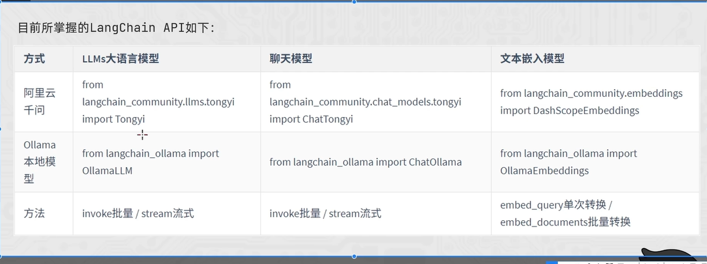

---

## 3. RAG (Retrieval-Augmented Generation) 简介

- **RAG(RetrievaL-Augnented Generation)即检索增强生成** ，是一种通过**从外部知识库中检索相关信息**来增强大语言模型（LLM）回答能力的技术。为大模型提供了**从特定数据源检索到的信息，以此来修正和补充生成的答案**。

- 可以总结为一个公式:`RAG= 检索技术+LLM提示`

- 分为离线和在线流程

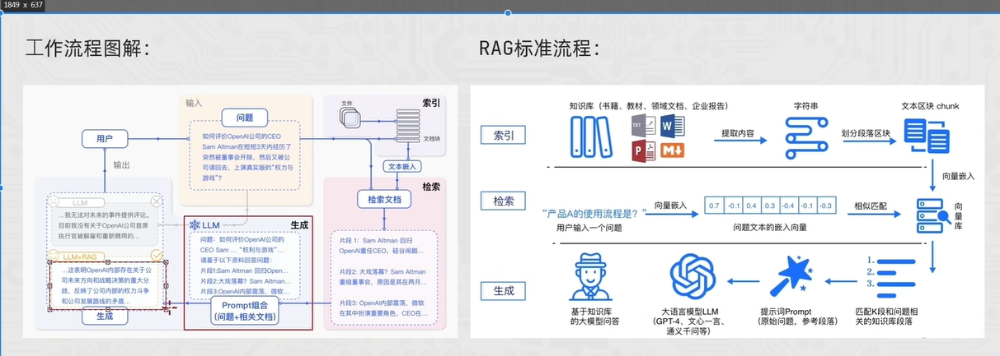
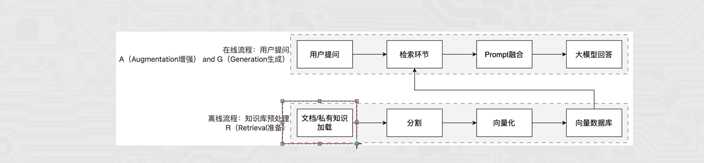

### 3.1 为什么需要 RAG？
1. **降低模型幻觉**：LLM 可能会生成虚假信息，RAG 通过提供真实依据来减少“幻觉”，让模型的回答基于检索到的事实性资料。
2. **知识时效性**：无需重新训练模型，即可让模型**掌握最新的私有数据或实时信息**。
3. **数据隐私**：可以在不公开私有数据的情况下，利用模型处理特定领域的专业知识。

### 3.2 RAG 的核心流程
一个典型的 RAG 系统包含以下几个关键步骤，也是后续章节（§10 - §12）将详细展开的内容：
1. **数据加载 (Loading)**：从不同源（PDF, Web, DB）读取数据。
2. **数据切分 (Splitting)**：将长文档切分为更小的语义块（Chunks）。
3. **向量化 (Embedding)**：将文本块转化为数值向量。
4. **存储 (Storing)**：将向量存入向量数据库（Vector Store）。
5. **检索 (Retrieval)**：根据用户问题，从数据库中找到最相关的文本块。
6. **生成 (Generation)**：将检索到的上下文与用户问题一起交给 LLM 生成回答。

---

## 4. 向量的基础概念（了解）

- 向量(Vector)：即一堆数字的序列，就是文本的“数学身份证”:它把一段文字的**语义信息**，转换成一串固定长度的**数字列表**，让计算机能 “看懂”文字的含义并**做相似度计算**。简单来说，就是让计算机更方便的理解不同的文本内容，是否表述的是一个意思。

- 向量的匹配通过算法实现，如**余弦相似度**；
- 向量的维度表示一段文本在多个抽象语义特征方面的强度
  - 维度数代表模型用多少个抽象语义特征来描述文本
  - 维度越多，做语义匹配越精准
  - 但性能压力也会增大  
### 4.1 **[余弦相似度（了解即可）](https://www.bilibili.com/video/BV1yjz5BLEoY/?spm_id_from=333.788.player.switch&vd_source=9d75580d0b23d1137d56e03a996ac726&p=21)**  ​	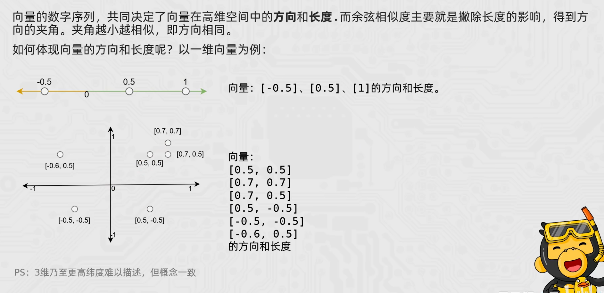

  - 余弦相似度算法：衡量两个向量的核心相似度（衡量方向相似性，剔除长度影响）
  - 越接近1，相似度越高
  - 公式
    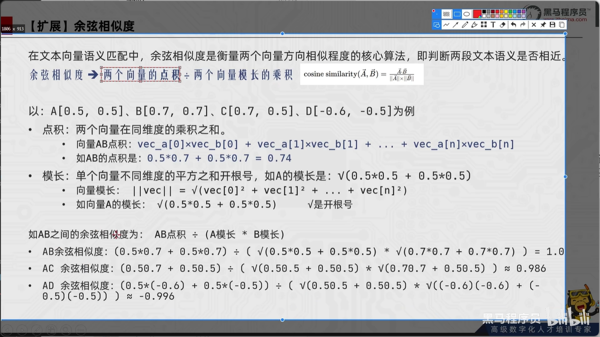
###  4.2 向量运行结果
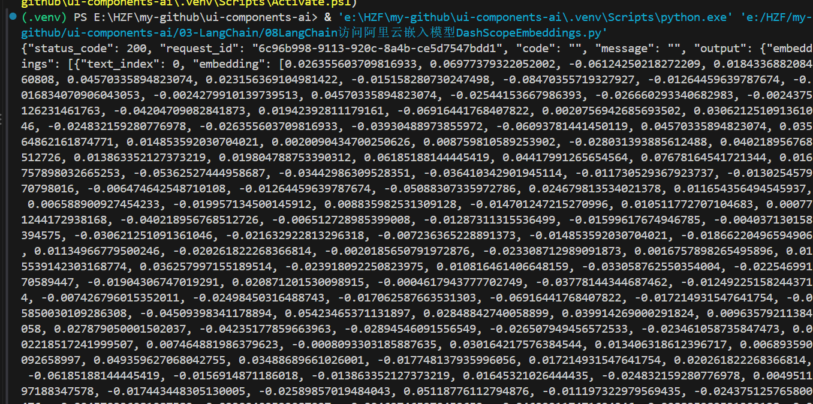 
## 5. 模型类型与接入 (Models)

> **百炼（云端）**与 **Ollama（本地）** 二选一或混用；Ollama 环境与 `base_url` 见 [§2.3](#23-ollama-本地运行)。

### 5.1 大语言模型 (LLM)

适用于简单的文本补全。

- **Ollama (本地)**（须先 [§2.3](#23-ollama-本地运行) 启动服务并 `ollama pull` 对应模型）：
  
  ```python
  from langchain_ollama import OllamaLLM
  model = OllamaLLM(model="qwen3:4b")
  ```

### 5.2 聊天模型 (Chat Model)
适用于**多轮对话**（支持 System/Human/AI 消息序列）。

- **百炼（OpenAI 兼容）**：
  ```python
  from common.dashscope_compat import create_chat_openai # create_chat_openai为二次封装的
  model = create_chat_openai()  # 或 create_chat_openai(model="qwen3-max")
  ```
- **Ollama (本地)**：
  ```python
  from langchain_ollama import ChatOllama
  model = ChatOllama(model="qwen3:4b")
  ```
#### 5.2.1 聊天模型的消息类型 (Messages)
在聊天模型中，对话由不同类型的消息组成。

##### 5.2.1.1 标准类形式
需要从 `langchain_core.messages` 导入。

| 消息类 | 说明 |
| :--- | :--- |
| **SystemMessage** | 系统指令，设定 AI 的角色或行为 |
| **HumanMessage** | 用户发送的消息 |
| **AIMessage** | AI 的回复消息 |

```python
from langchain_core.messages import HumanMessage, AIMessage, SystemMessage

messages = [
    SystemMessage(content="你是一个诗人。"),
    HumanMessage(content="写首诗吧"),
    AIMessage(content="..."),
    HumanMessage(content="再来一首")
]
```

##### 5.2.1.2 简写形式 -元组(推荐)
- **推荐用法**：使用 `(角色, 内容)` 的元组形式，优点是不需要导入消息类，且**支持变量注入**。
- 角色关键字：`"system"`, `"human"`, `"ai"`。

```python
messages = [
    ("system", "你是一个诗人。"),
    ("human", "写一首唐诗。"),
    ("ai", "锄禾日当午..."),
    ("human", "再写一首。")
]
```

---


### 5.3 嵌入模型 (Embeddings)
用于**将文本转化为向量**，常用于**向量搜索**。

- **百炼（OpenAI 兼容）**：
  ```python
  from common.dashscope_compat import create_openai_embeddings # create_openai_embeddings为二次封装的
  model = create_openai_embeddings()  # 默认读取 MODEL_EMBEDDING，推荐 text-embedding-v4
  ```
  
- **Ollama (本地)**：
  ```python
  from langchain_ollama import OllamaEmbeddings
  model = OllamaEmbeddings(model="qwen3-embedding:4b")
  ```

- **方法** 
  嵌入模型**不使用** `invoke` 或 `stream`。
  
  | 方法                    | 作用                                       |
  | ----------------------- | ------------------------------------------ |
  | `embed_query(text)`     | 将**单个**查询字符串转化为向量             |
  | `embed_documents(list)` | 将**一组**文档字符串**批量**转化为向量列表 |

```python
vector = model.embed_query("我喜欢你")
vectors = model.embed_documents(["我喜欢你", "我稀饭你"])
```

### 5.4 调用方式 (invoke&stream)

#### 5.4.1 同步调用 (invoke)
**一次性**获取完整结果。
```python
res = model.invoke(input="你是谁？")
print(res)
```

#### 5.4.2 流式输出 (stream)
**实时获取**模型生成的文本块，逐段流式输出。

- **LLM 模式**：直接迭代 chunk。
  ```python
  res = model.stream(input="你是谁？")
  for chunk in res:
      print(chunk, end="", flush=True)
  ```
- **Chat 模式**：需要通过 `.content` 获取文本内容。
  ```python
  res = model.stream(input=messages)
  for chunk in res:
      print(chunk.content, end="", flush=True)  # end=""：不换行
  ```

---


## 6. 提示词模板 (Prompts)

> 在 LangChain 中，将**变量**注入提示词并调用模型主要有两种常见模式：**手动 format 后 `model.invoke`**（§6.2）或 **LCEL 链**（§7）。通用提示写法见 §6.0；模板类 API 见 §6.1–§6.4。

### 6.0 提示工程基础（前置了解）

> 课程：[提示工程基础（p=11）](https://www.bilibili.com/video/BV1yjz5BLEoY/?spm_id_from=333.788.player.switch&vd_source=9d75580d0b23d1137d56e03a996ac726&p=11)  
> **提示工程**（如何写 effective 提示）与是否使用 LangChain 模板无关；以下为通用写法知识点，与 §6.1 起的 LangChain 封装并行阅读即可。

#### 6.0.1 提示词技巧 / 提问技巧

1. **详细描述**需求与约束  
2. 让模型**充当某个角色**（与 `SystemMessage`、模板中的 system 段同源）  
3. 用**分隔符**区分指令、上下文与用户输入  
4. **指定步骤**，要求按顺序完成  
5. **提供示例**（见 §6.0.2、§6.3 FewShotPromptTemplate）  
6. **使用参考文本**，限定依据范围，降低幻觉（与 RAG 中注入 `{context}` 目的一致）


#### 6.0.2 Zero-shot 与 Few-shot

| 范式 | 含义 | 典型用法 |
| :--- | :--- | :--- |
| **Zero-shot（零样本）** | 不附带示例，依赖模型已有能力做类推 | 直接描述任务与输出要求；<br>见课程 [Zero-shot 片段](https://www.bilibili.com/video/BV1yjz5BLEoY/?spm_id_from=333.788.player.switch&vd_source=9d75580d0b23d1137d56e03a996ac726&p=12) |
| **Few-shot（少样本）** | 在提示中**给出少量输入**—输出示例 | 固定格式、分类、抽取等；<br/>LangChain 封装见 [§6.3](#63-少样本提示词模板-fewshotprompttemplate) |

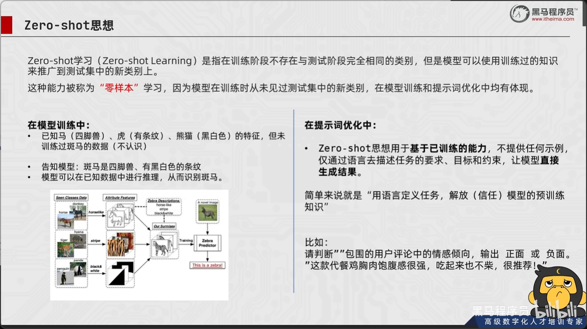

Few-shot 在提示词中嵌入示例的效果示意：

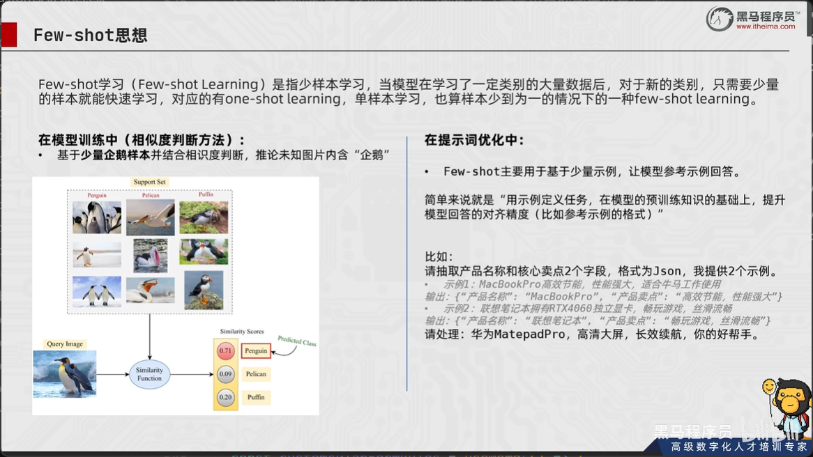

---

### 6.1 定义提示词模板 (PromptTemplate)

使用 `PromptTemplate` 定义包含占位变量（`{}`）的字符串模板，再通过 `.format` / `.invoke` 注入实参。

```python
from langchain_core.prompts import PromptTemplate

# 定义模板：支持 lastname 和 gender 两个变量
prompt_template = PromptTemplate.from_template("我的邻居姓{lastname}, 刚生了{gender}")
```

#### 6.1.1 模板类的方法：`.format` vs `.invoke`

- 都支持解析`{}`占位符

- `PromptTemplate` 继承 `Runnable`，注入变量有两种常用方式：

| 方法 | 输入值类型 | 返回值类型 | 典型用途 |
| :--- | :--- | :--- | :--- |
| `.format(k1=v1,k2=v2,...)` | `str`          | `str`字符串 | 手动生成最终字符串，再传给 `model.invoke(input=prompt_text)` |
| `.invoke({"k1":v1,"k2":v2,...})` | `dict`（字典） | `PromptValue`类对象 | 1.作为 Runnable 调用；<br>2.需字符串使用 `.to_string()`方法或接入 [§7 LCEL](#7-lcel-chains--composition) 链<br>3.**支持 `MessagesPlaceholder`**（详见 [§6.4](#64-聊天提示词模板-chatprompttemplate)） |

##### 方式1：format

```python
# 创建模板，template得到实例对象
template = PromptTemplate.from_template("我的邻居是：{lastname}，最喜欢：{hobby}")

res = template.format(lastname="张大明", hobby="钓鱼")
print(res,"【值类型】", type(res))  
# 输出结果；我的邻居是：张大明，最喜欢：钓鱼 
# 【值类型】 <class 'str'>
```

##### 方式2：invoke

```python
# 创建模板
template = PromptTemplate.from_template("我的邻居是：{lastname}，最喜欢：{hobby}")
# 传入参数
res2 = template.invoke({"lastname": "周杰轮", "hobby": "唱歌"})
print(res2,"【值类型】",type(res2))  # PromptValue（如 StringPromptValue）
# 输出结果；我的邻居是：周杰轮，最喜欢：唱歌 
# 【值类型】 <class 'langchain_core.prompt_values.StringPromptValue'>
```

###### PromptValue 转换

- 对 `.invoke()` 返回的 `PromptValue` 对象，可再转为字符串或消息列表。
- `PromptTemplate` 常用 `to_string()`；`to_messages()` 在 [§6.4 ChatPromptTemplate](#64-聊天提示词模板-chatprompttemplate) 等面向消息的模板中更常见。

| 方法 | 功能 | 使用场景 |
| :--- | :--- | :--- |
| `to_string()` | 转为**纯文本字符串** | 查看最终提示词，或手动 `model.invoke(input=prompt_text)` |
| `to_messages()` | 转为消息列表 `List[BaseMessage]` | 配合 [§6.4 ChatPromptTemplate](#64-聊天提示词模板-chatprompttemplate) 传给 ChatModel |

```python
text = prompt_template.invoke({"var": "value"}).to_string()
print(text)
```

### 6.2 调用方式 1：手动格式化 (Manual Format)

在已定义 `PromptTemplate`（§6.1）的前提下，通过 `.format()` 生成最终字符串，再传给模型。

**流程**：format → `model.invoke(input=prompt_text)`。

- **代码示例**：
  ```python
  # 1. 格式化为最终字符串 (注入变量)
  prompt_text = prompt_template.format(lastname="张", gender="女儿")
  
  # 2. 将字符串直接传给模型 invoke
  res = model.invoke(input=prompt_text)
  ```
- **特点**：逻辑解耦，你可以先打印 `prompt_text` 检查内容是否正确再进行模型调用。

> 方式 2（LCEL 执行链）见 [§7 LCEL](#7-lcel-chains--composition)。

### 6.3 少样本提示词模板 (FewShotPromptTemplate)
适用于通过**提供少量示例**来引导模型生成特定格式或逻辑的回复。

- **核心组件**：
| 属性 | 作用|
| :--- | :--- |
|  `example_prompt` |  单个示例的模板。 |
| `examples`  |示例数据列表（List of Dict）。   |
| `prefix`  |  示例前的引导语。 |
| `suffix`  | 示例后的后缀，通常包含**最终要注入的变量**。  |
|  `input_variables` | 声明在前缀或后缀中需要注入的变量名。  |

- **代码示例**：
  
  ```python
  from langchain_core.prompts import PromptTemplate, FewShotPromptTemplate
  
  # 1. 定义单个示例的模板
  example_template = PromptTemplate.from_template("单词：{word}, 反义词：{antonym}")
  
  # 2. 准备示例数据
  examples_data = [
      {"word": "大", "antonym": "小"},
      {"word": "上", "antonym": "下"},
  ]
  
  # 3. 构建 FewShotPromptTemplate
  few_shot_template = FewShotPromptTemplate(
      example_prompt=example_template,
      examples=examples_data,
      prefix="告知我单词的反义词，我提供如下的示例：",
      suffix="基于前面的示例告知我，{input_word}的反义词是？",
      input_variables=['input_word']
  )
  
  # 4. 生成提示词并调用
  prompt_text = few_shot_template.invoke(input={"input_word": "左"}).to_string()
  res = model.invoke(input=prompt_text)
  ```

### 6.4 聊天提示词模板 (ChatPromptTemplate)

- 面向**聊天模型**的提示词模板，通过 `from_messages` 组装消息序列；
- 输出为消息**列表**，而非 `PromptTemplate` 的纯文本字符串。

```python
from langchain_core.prompts import ChatPromptTemplate, MessagesPlaceholder
from common.dashscope_compat import create_chat_openai

chat_prompt_template = ChatPromptTemplate.from_messages(
    [
        ("system", "你是一个边塞诗人，可以作诗。"),
        MessagesPlaceholder("history"), # 声明参数history
        ("human", "请再来一首唐诗"),
    ]
)

history_data = [
    ("human", "你来写一个唐诗"),
    ("ai", "床前明月光，疑是地上霜，举头望明月，低头思故乡"),
    ("human", "好诗再来一个"),
    ("ai", "锄禾日当午，汗滴禾下锄，谁知盘中餐，粒粒皆辛苦"),
]

# StringPromptValue    to_string()
prompt_text = chat_prompt_template.invoke({"history": history_data}).to_string()# 传入参数history

model = create_chat_openai()
res = model.invoke(prompt_text)
print(res.content, type(res))
```

- **MessagesPlaceholder**：在模板中声明占位变量（如 `"history"`），调用 `.invoke()` 时传入对应消息列表（元组或 `BaseMessage` 均可）。

- **与 PromptTemplate 的区别**：

  `ChatPromptTemplate` 面向 Chat Model，输出消息序列；

  `PromptTemplate` 输出纯文本，见 [§6.1](#61-定义提示词模板-prompttemplate)。

---

## 7. LCEL (Chains & Composition)

> LCEL (LangChain Expression Language) 是 LangChain 推荐的**构建复杂链条**的方式，通过 `|` 管道将 Prompt、Model、Parser 等 **Runnable 组件**串联为可执行链。
- **核心原则**：上一个组件的**输出**必须符合下一个组件的**输入要求**，都满足Runnable接口的子类对象。

### 7.1 管道语法 (`|`)

- **流程**：使用 `|` 管道操作符将组件连接为一个整体；`A | B` 表示 **A 的输出**作为 **B 的输入**。
- **代码示例**（以提示词模板 + 模型为例）：
  ```python
  # 1. 定义执行链 (模板 | 模型)
  chain = prompt_template | model
  
  # 2. 调用链：直接传入变量字典 (自动完成注入与调用)
  # 注意：此时 invoke 的输入是字典，而非字符串！
  res = chain.invoke(input={"lastname": "张", "gender": "女儿"})
  ```

### 7.2 Manual vs LCEL 对比

| 维度 | 方式 1 (Manual) | 方式 2 (LCEL Chain) |
| :--- | :--- | :--- |
| **操作符** | 使用 `.format()` 方法 | 使用 `|` 管道操作符 |
| **invoke 输入** | 必须传入**字符串** (String) | 必须传入**变量字典** (Dict) |
| **代码量** | 较多 (需手动管理中间变量) | 极简 (一行构建链) |
| **可扩展性** | 难。若增加 Parser 需手动嵌套 | 易。可继续拼接 `\| parser` |
| **推荐场景** | 仅用于调试或简单的提示词生成 | **生产环境、复杂逻辑链条** |

### 7.3 链式逻辑与兼容性 (LCEL Compatibility)

在构建 LCEL 链时，必须确保前后组件的**输入和输出类型兼容**。

| 组件 | 输入要求 | 输出类型 |
| :--- | :--- | :--- |
| **提示词模板 (PromptTemplate)** | 字典 (`dict`) | `PromptValue` 对象 |
| **模型 (Model)** | `PromptValue` / 字符串 / 消息序列 (`BaseMessage`, `list`, `tuple`, `str`, `dict`) | `AIMessage` |
| **StrOutputParser** | `AIMessage` | 字符串 (`str`) |
| **JsonOutputParser** | `AIMessage` | 字典 (`dict`) |
| **Retriever（[`as_retriever`](#111-通用-api)）** | 查询字符串 (`str`) | `list[Document]` |
| **并行 dict（`RunnableParallel`）** | 与链 `invoke` 输入相同 | 字典（各分支输出按键合并） |

### 7.4 [LCEL 底层原理：Python 或运算符重写](https://www.bilibili.com/video/BV1yjz5BLEoY?spm_id_from=333.788.player.switch&vd_source=9d75580d0b23d1137d56e03a996ac726&p=32)

LCEL 的 `|` 管道语法之所以能工作，是因为 LangChain 的组件（如 `PromptTemplate`, `Model`, `OutputParser`）都继承自 `Runnable` 类，并重写了 Python 的魔术方法 `__or__`。

- **原理**：在 Python 中，`a | b` 实际上会触发 `a.__or__(b)`。
- **实现逻辑**：**当调用 `a | b` 时，它并不立即执行，而是返回一个新的 `RunnableSequence` 对象，该对象记录了执行顺序。**

**简化版实现示例**：

```python
class Test:
    def __init__(self, name):
        self.name = name

    def __or__(self, other):
        # 当执行 a | b 时，返回一个包含两者的序列对象，self 表示a（发起者），other表示b
        return MySequence(self, other)
    # 原__str__方法的输出的是内存地址，重写__str__使其输出原值
    def __str__(self): 
        return self.name #输出原值 

class MySequence:
    def __init__(self, *args):
        self.sequence = list(args)

    def __or__(self, other):
        # 支持链式拼接：(a | b) | c
        self.sequence.append(other) #将 | 后的数值追加到sequence数组中
        return self

    def run(self):
        # 模拟链式执行
        for item in self.sequence:
            print(f"执行组件: {item.name}")

# 实战：
a, b, c = Test('Prompt'), Test('Model'), Test('Parser')
chain = a | b | c  # 触发 __or__
chain.run()
```

---

### 7.5 自定义逻辑 (RunnableLambda)

> 如果你需要在 LCEL 链中加入自定义的 Python 函数逻辑，可以使用 `RunnableLambda`包裹。

- **核心用法**：
    - **手动封装**：使用 `RunnableLambda(your_function)` 将函数封装为 Runnable 对象。
    - **自动转换（推荐）**：在 `|` 管道中直接使用**函数或 `lambda` 表达式**，LangChain 会自动将其转换为 `RunnableLambda`。
    - **无缝集成**：封装后的函数遵循 `Runnable` 接口，支持 `invoke`, `stream`, `batch` 等方法，并能完美融入 LCEL 管道。
    - **可选：链内打印 Prompt**（多轮对话调试历史是否注入时）：在 `prompt | model` 之间插入「打印后原样返回」的函数即可，会被自动包装为 `RunnableLambda`；完整写法见 [§9.1.4](#914-可选链内调试打印-prompt)。

- **应用场景：类型适配桥梁**：
  ```python
  from langchain_core.runnables import RunnableLambda
  
  # 定义一个简单的 lambda 函数，将 AIMessage 转换为 PromptTemplate 需要的字典
  # 输入：ai_msg (AIMessage)
  # 输出：{"name": ai_msg.content} (dict)
  chain = (
      first_prompt 
      | model 
      | (lambda ai_msg: {"name": ai_msg.content}) # 自动转换为 RunnableLambda
      | second_prompt 
      | model 
      | str_parser
  )
  
  res = chain.invoke({"lastname": "曹", "gender": "女孩"})
  ```

### 7.6 多模型级联 (Multi-step Chain)

若需**将一个模型的输出作为另一个模型的输入**，通常须先通过 Output Parser 将其转换为字符串或字典（各 Parser 用法见 [§8 输出解析器](#8-输出解析器-output-parsers)）。

```python
# 1. 第一个模型生成 JSON 格式的名字
# 2. JsonOutputParser 将其转换为字典 {"name": "..."}
# 3. 第二个提示词模板接收该字典作为输入变量 {name}
# 4. 第二个模型解析名字含义
chain = first_prompt | model | json_parser | second_prompt | model | str_parser

for chunk in chain.stream({"lastname": "张", "gender": "女儿"}):
    print(chunk, end="", flush=True)
```

> 各组件输入/输出类型须匹配，详见 [7.3 链式逻辑与兼容性](#73-链式逻辑与兼容性-lcel-compatibility)。

### 7.7 [RunnablePassthrough（并行分支透传）](https://www.bilibili.com/video/BV1yjz5BLEoY/?spm_id_from=333.788.player.switch&vd_source=9d75580d0b23d1137d56e03a996ac726&p=45)

LCEL 中字典 `{key: runnable, ...}` 表示**并行分支**（`RunnableParallel`）：链的 `invoke` 输入流入各分支，各分支输出按键合并为字典，供下游 [`ChatPromptTemplate`](#64-聊天提示词模板-chatprompttemplate) 等组件使用。

| 组件 | 作用 | 输入 | 输出 |
| :--- | :--- | :--- | :--- |
| **`RunnablePassthrough()`** | 占位透传：原样返回链的 `invoke` 输入 | 与链 `invoke` 输入相同 | 与输入相同 |

**典型场景**：并行分支中一路做检索/变换（如 RAG 的 `{context}`），另一路仍须保留原始用户输入（`{input}`）。若无 `RunnablePassthrough()`，`invoke` 的字符串输入往往只进入检索分支，模板变量 `{input}` 无法自动填充。

```python
from langchain_core.runnables import RunnablePassthrough

# 如果没有RunnablePassthrough：input_text只传给retriever
# RunnablePassthrough：作用：占位符，自动拿到链条的invoke输入值input_text
# 这样RunnablePassthrough和retriever就都能获取到invoke的输入值input_text
chain = (
    {"input": RunnablePassthrough(), "context": retriever | format_func}
    | prompt
    | model
    | StrOutputParser()
)

res = chain.invoke(input_text)  # 直接传入 str，无需手动构造 dict
```

> RAG 完整链路见 [§12.4](#124-提示词模板与-lcel-链)；向量存储须先经 [`as_retriever`](#111-通用-api) 封装为 Runnable 检索器后再入链。

## 8. 输出解析器 (Output Parsers)

输出解析器将模型输出的 `AIMessage` 转换为更易处理的**纯文本或结构化数据**。

### 8.1 StrOutputParser 字符串解析器

- 输入 `AIMessage`，输出 `str`（将`AIMessage`类型转为基础字符串）
- 可以加入chain作为组件存在

- **代码示例**：
  
  ```python
  from langchain_core.output_parsers import StrOutputParser
  
  parser = StrOutputParser() # 将AIMessage的输出转为字符串str
  
  # 在链中使用
  chain = prompt | model | parser
  res:str = chain.invoke({"var": "value"})
  # 此时 res 是 str 类型，而不是 AIMessage
  ```

### 8.2 JsonOutputParser 解析器

输入 `AIMessage`，输出 `dict`。

- **代码示例**：
  ```python
  # 03-LangChain\18JsonOutputParser解析器.py
  from langchain_core.output_parsers import JsonOutputParser
  
  json_parser = JsonOutputParser() # 将AIMessage的输出转为字符串json
  prompt = PromptTemplate.from_template(
        "我邻居姓：{lastname}，刚生了{gender}，请帮忙起名字，"
        "并封装为JSON格式返回给我。要求key是name，value就是你起的名字，请严格遵守格式要求。"  # 定义输出格式
  ) 
  #AIMessage("{name:张若曦}")
  # 在链中使用
  chain = prompt | model | json_parser
  res = chain.invoke({"lastname": "张", "gender": "女儿"})
  # 此时 res 是 dict 类型，例如: {"name": "张若曦"}
  ```

---

## 9. 会话记忆 (Memory & Context)

- 在多轮对话中，模型本身不会记住之前的上下文，需要借助**消息历史**机制，在每次调用时将过往对话注入提示词。
- 实现方式分为两类：**临时记忆**（内存存储，进程结束即丢失）与**长期记忆**（文件持久化，跨重启保留）。
- 两者共享同一套提示词模板与链式封装逻辑，仅在 `get_history` 返回的历史存储实现上不同。

### 9.1 公共知识点

以下配置对临时记忆与长期记忆**完全通用**；切换存储方式时**仅替换 `get_history` 的返回值**（实现见 [§9.2](#92-inmemorychatmessagehistory--临时会话记忆)、[§9.3](#93-长期会话记忆-filechatmessagehistory)），其余不必改动。

| 环节 | 说明 |
| :--- | :--- |
| 提示词 | 在 [§6.4 `ChatPromptTemplate`](#64-聊天提示词模板-chatprompttemplate) 基础上增加 `MessagesPlaceholder` 与本轮 `{input}` |
| 基础链 | `prompt \| model \| str_parser`（模型推荐 `create_chat_openai()`，见 [§2.2](#22-方式2-env文件配置)） |
| 历史链 | 使用 `RunnableWithMessageHistory` 包装 `base_chain` |
| 调用 | `invoke` 时传入 `session_config`，按 `session_id` 隔离多用户 |

#### 9.1.1 Memory 场景的 `MessagesPlaceholder`

`MessagesPlaceholder` 的用法已在 [§6.4](#64-聊天提示词模板-chatprompttemplate) 介绍。多轮对话中须让 **`history_messages_key` 与占位符变量名一致**（本仓库示例统一为 `chat_history`），历史内容由 `RunnableWithMessageHistory` 自动注入，**无需**在 `invoke` 入参里手写 `chat_history`：

```python
from langchain_core.prompts import ChatPromptTemplate, MessagesPlaceholder

prompt = ChatPromptTemplate.from_messages([
    ("system", "你需要根据会话历史回应用户问题。对话历史："),
    MessagesPlaceholder("chat_history"),
    ("human", "请回答如下问题：{input}"),
])
```

#### 9.1.2 RunnableWithMessageHistory

`RunnableWithMessageHistory` 在每次调用前读取历史、调用后将本轮问答写回 `get_history` 返回的存储对象。

```python
# 03-LangChain/20临时会话记忆.py（结构与长期记忆脚本相同，仅 get_history 不同）
from langchain_core.output_parsers import StrOutputParser
from langchain_core.runnables.history import RunnableWithMessageHistory
from common.dashscope_compat import create_chat_openai

model = create_chat_openai()
str_parser = StrOutputParser()

# prompt：见 §9.1.1的定义
base_chain = prompt | model | str_parser

conversation_chain = RunnableWithMessageHistory(
    base_chain,
    get_history, # get_history(session_id) → BaseChatMessageHistory，见 §9.2 或 §9.3
    input_messages_key="input",
    history_messages_key="chat_history",
)
```

| 参数 | 说明 |
| :--- | :--- |
| `get_history` | 工厂函数，接收 `session_id`，返回 `BaseChatMessageHistory` 的具体实现 |
| `input_messages_key` | 用户本轮输入在模板中的变量名（与 `{input}` 一致） |
| `history_messages_key` | 与 `MessagesPlaceholder` 变量名一致（示例为 `chat_history`） |

#### 9.1.3 按 session_id 隔离会话

调用带历史的链时，通过第二个参数传入 `config`；`RunnableWithMessageHistory` 据此调用 `get_history(session_id)`。

```python
session_config = {"configurable": {"session_id": "user_001"}}

res = conversation_chain.invoke({"input": "小明有2个猫"}, session_config)
res = conversation_chain.invoke({"input": "小刚有1只狗"}, session_config)
res = conversation_chain.invoke({"input": "总共有几个宠物"}, session_config)  # 同一session_config可引用前两轮上下文
```

#### 9.1.4 （可选）链内调试：打印 Prompt

非记忆专属逻辑，与 [§7.5 自定义逻辑 (RunnableLambda)](#75-自定义逻辑-runnablelambda) 相同：在链中插入函数，**打印后原样返回**，避免破坏下游输入。

```python
def print_prompt(full_prompt):
    print("=" * 20, full_prompt.to_string(), "-" * 20)
    return full_prompt # 打印后原样返回，避免破坏下游输入。

base_chain = prompt | print_prompt | model | str_parser
```

完整可运行示例见 [`03-LangChain/20临时会话记忆.py`](../03-LangChain/20临时会话记忆.py)。`full_prompt` 为 `PromptValue`，`.to_string()` 可查看合并历史后的提示词（参见 [§6.1 PromptValue 转换](#promptvalue-转换)）。

### 9.2 InMemoryChatMessageHistory — 临时会话记忆

数据保存在进程内存中，**重启后历史丢失**，适合开发调试。在 §9.1 的链上只需实现 **`store` + `get_history`**：

| 要点 | 说明 |
| :--- | :--- |
| `InMemoryChatMessageHistory` | LangChain 内置，无需序列化 |
| `store` | 以 `session_id` 为 key 缓存历史实例，实现多会话隔离 |

```python
from langchain_core.chat_history import InMemoryChatMessageHistory

store = {}  # key: session_id, value: InMemoryChatMessageHistory 实例

def get_history(session_id):
    if session_id not in store:
        store[session_id] = InMemoryChatMessageHistory()
    return store[session_id]

# 与 §9.1.2 的 conversation_chain、§9.1.3 的 session_config 组合使用：
if __name__ == "__main__":
    session_config = {"configurable": {"session_id": "user_001"}}
    print(conversation_chain.invoke({"input": "小明有2个猫"}, session_config))
    print(conversation_chain.invoke({"input": "总共有几个宠物"}, session_config))
```


### 9.3 长期会话记忆 (FileChatMessageHistory)

- 数据序列化后写入**本地 JSON 文件**，**程序重启后历史保留**，适合生产环境与**多用户持久会话**。
- 除 `get_history` 的实现外，其余链式配置（`base_chain`、`input_messages_key`、`history_messages_key`、`session_config`）与临时记忆完全一致。

#### 9.3.1 消息序列化工具

`BaseMessage` 对象无法直接用 `json` 写入文件，需借助官方转换函数：

| 函数 | 作用 |
| :--- | :--- |
| `message_to_dict(message)` | 单个 `BaseMessage` 实例 → 字典 |
| `messages_from_dict(data)` | `[字典, ...]` → `[BaseMessage, ...]` |

`AIMessage`、`HumanMessage`、`SystemMessage` 均为 `BaseMessage` 的子类（类型说明见 [§5.2.1.1 标准类形式](#5211-标准类形式)），均可被上述函数处理。

```python
from langchain_core.messages import message_to_dict, messages_from_dict, BaseMessage
```

#### 9.3.2 自定义 FileChatMessageHistory

继承 `BaseChatMessageHistory` 后，需实现三个核心成员：

- **`add_messages(messages)`**：读取已有历史，合并新消息，序列化后写回文件。
- **`messages`（property）**：从文件读取 JSON，反序列化为消息列表；文件不存在时返回 `[]`。
- **`clear()`**：清空历史（写入空列表）。

```python
import os, json
from typing import Sequence
from langchain_core.chat_history import BaseChatMessageHistory
from langchain_core.messages import message_to_dict, messages_from_dict, BaseMessage

# 长期会话记忆：文件持久化
class FileChatMessageHistory(BaseChatMessageHistory):
    # 初始化
    def __init__(self, session_id, storage_path):
        self.session_id = session_id        # 会话id
        self.storage_path = storage_path    # 不同会话id的存储文件，所在的文件夹路径
        self.file_path = os.path.join(self.storage_path, self.session_id) # 完整的文件路径

        # 确保文件夹是存在的,未存在则创建
        os.makedirs(os.path.dirname(self.file_path), exist_ok=True)
    
    # 定义方法，作用：将新增的消息追加到已有的消息列表
    def add_messages(self, messages: Sequence[BaseMessage]) -> None:
        # Sequence序列 类似list、tuple
        all_messages = list(self.messages)      # 已有的消息列表（self.messages来自BaseMessage）
        all_messages.extend(messages)           # 新的和已有的融合成一个list

        # 将数据同步写入到本地文件中
        new_messages = [message_to_dict(message) for message in all_messages] #等价于上面注释的内容
        # 将数据写入文件：
        # open打开文件，w写入模式，encoding编码，dump：写入文件
        with open(self.file_path, "w", encoding="utf-8") as f:
            json.dump(new_messages, f) # json.dump()：将Python对象编码成JSON字符串，并写入文件

    @property       # @property装饰器将messages方法变成成员属性用
    def messages(self) -> list[BaseMessage]:
        # 当前文件内： list[字典]
        try:
            with open(self.file_path, "r", encoding="utf-8") as f:
                messages_data = json.load(f)    # 返回值就是：list[字典]
                return messages_from_dict(messages_data)
        except FileNotFoundError: # 没有文件
            return []

    # 清空消息列表
    def clear(self) -> None:
        with open(self.file_path, "w", encoding="utf-8") as f:
            json.dump([], f)
```

#### 9.3.3 get_history 接入

每个 `session_id` 对应 `storage_path` 下的一个独立文件。

```python
def get_history(session_id):
    return FileChatMessageHistory(session_id, "./chat_history")
```

### 9.4 临时 vs 长期记忆对比

| 维度 | 临时记忆 (InMemoryChatMessageHistory) | 长期记忆 (FileChatMessageHistory) |
| :--- | :--- | :--- |
| **存储位置** | 内存（`dict` 缓存） | 本地文件（JSON） |
| **程序重启** | 历史丢失 | 历史保留 |
| **实现成本** | 开箱即用 | 需继承 `BaseChatMessageHistory` 自定义 |
| **适用场景** | 开发调试、单次运行 | 生产环境、多用户持久会话 |
| **切换方式** | 仅替换 `get_history` 的返回值 | 仅替换 `get_history` 的返回值 |

---

## 10. 文档加载器 (Document Loaders)

LangChain 内置多种文档加载器，用于将外部数据源（CSV、PDF、网页等）读入为统一的 `Document` 对象，供后续分块、向量化或检索使用。

### 10.1 通用特性 (BaseLoader)

所有文档加载器均继承自 `BaseLoader`，返回类型为 `Document`（含 `page_content` 与 `metadata`）。不同加载器的初始化参数各异，但加载接口统一：

| 方法 | 返回值 | 适用场景 |
| :--- | :--- | :--- |
| **`load()`** | `list[Document]`，一次性全部载入内存 | 小文件、需一次性处理全部文档 |
| **`lazy_load()`** | 生成器，逐条 `yield Document` | 大文件，避免一次性加载导致 OOM |

```python
# 批量加载
documents = loader.load()  # [Document, Document, ...]

# 懒加载（推荐用于大文件）
for document in loader.lazy_load():
    print(document)
```

#### 10.1.1 通用初始化参数

多个加载器共用的初始化参数：

| 参数 | 说明 |
| :--- | :--- |
| `file_path` | 源文件路径（字符串或 `Path`） |
| `encoding` | 文件编码；中文场景常用 `"utf-8"`，避免乱码 |

### 10.2 [CSVLoader(加载 CSV 文件)](https://www.bilibili.com/video/BV1yjz5BLEoY/?spm_id_from=333.788.videopod.episodes&vd_source=9d75580d0b23d1137d56e03a996ac726&p=39)
- `CSVLoader` 用于加载 CSV 文件，底层通过 Python 标准库 `csv.DictReader` 解析，每行 CSV 对应一个 `Document`。

```python
from pathlib import Path
from langchain_community.document_loaders import CSVLoader

DATA_DIR = Path(__file__).resolve().parent / "data"

loader = CSVLoader(
    file_path=str(DATA_DIR / "stu.csv"),
    csv_args={
        "delimiter": ",",       # 列分隔符
        "quotechar": '"',       # 含分隔符字段的引号字符
        # 仅当 CSV 无表头时使用 fieldnames；有表头时勿设，否则首行会被当作数据
        # "fieldnames": ["name", "age", "gender", "hobby"],
    },
    encoding="utf-8"            # 文件编码
)

documents = loader.load()
print(documents) # 结果见10.2.2
```

#### 10.2.1 初始化参数

- **`csv_args`**：传给 `csv.DictReader` 的字典，常用键如下：

| 键 | 作用 |
| :--- | :--- |
| **`delimiter`** | 列分隔符，默认 `","`。 |
| **`quotechar`** | 字段引号字符，默认 `'"'`。 |
| **`fieldnames`** | 列名列表；**仅用于无表头的 CSV**。若文件已有表头行，设置此项会把表头当作第一条数据。 |
| **`source_column`** | 指定 CSV 中哪一列作为 `Document.metadata["source"]`（数据来源标识），便于检索结果溯源。 |

### 10.2.2 示例

- CSV文档内容
  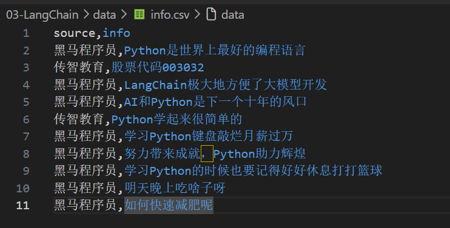
- 输出结果
  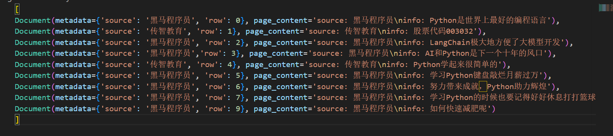

### 10.3 JSONLoader(加载 JSON 数据)

`JSONLoader` 用于加载 JSON 数据并封装为 `Document`。底层依赖跨平台 JSON 解析库 **`jq`**，需先安装：

```bash
# python.exe -m pip install jq
pip install jq
```

信息抽取通过 **`jq_schema`**（jq 语法字符串）指定。 `load()` / `lazy_load()` 用法同 [10.1 通用特性](#101-通用特性-baseloader)。


#### 10.3.1 初始化参数

| 参数 | 作用 |
| :--- | :--- |
| **`file_path`** | （必填）见 [10.1.1 通用初始化参数](#1011-通用初始化参数) |
| **`jq_schema`** | （必填）jq 抽取语法。 |
| **`text_content`** | 抽取结果**是否为字符串**，默认 `True`。抽取对象、数组等非字符串时需设为 `False`。 |
| **`json_lines`** | 是否为 JSONLines 格式（**每行**一个独立 JSON 对象），默认 `False`。 |

#### 10.3.2 jq_schema 常用语法

| 语法 | 含义 | 示例 JSON | 抽取结果 |
| :--- | :--- | :--- | :--- |
| `.` | 根节点（整个 JSON 对象） | `{"name": "周杰伦", ...}` | 整个对象 |
| `.name` | 根对象的 `name` 字段 | 同上 | `"周杰伦"` |
| `.hobby` | 数组字段 | `"hobby": ["唱", "跳", "RAP"]` | `["唱", "跳", "RAP"]` |
| `.hobby[1]` | 数组下标元素 | 同上 | `"跳"` |
| `.other.addr` | 嵌套字段 | `"other": {"addr": "深圳"}` | `"深圳"` |
| `.[]` | 数组中每个对象 | `[{...}, {...}]` | 多个独立对象 |
| `.[].name` | 数组中每个对象的 `name` | 学生数组 | 多个姓名字符串 |

#### 10.3.3 三种常见场景

**单个 JSON 对象**（如 `stu.json`）：用 `.` 取整对象，需 `text_content=False`。

```python
from pathlib import Path
from langchain_community.document_loaders import JSONLoader

DATA_DIR = Path(__file__).resolve().parent / "data"

loader = JSONLoader(
    file_path=str(DATA_DIR / "stu.json"),
    jq_schema=".",           # 获取 JSON 对象本身
    text_content=False,      # 抽取内容不是字符串
)
documents = loader.load()
```

**JSON 数组**（如 `stus.json`）：`.[]` 取每个元素，`.[].name` 取每个元素的 `name` 字段。

```python
loader = JSONLoader(
    file_path=str(DATA_DIR / "stus.json"),
    jq_schema=".[].name",    # 获取数组中每个对象的 name
    text_content=False,
)
documents = loader.load()
```

**JSONLines 文件**（如 `stu_json_lines.json`，每行一个 JSON 对象）：需 `json_lines=True`。

```python
loader = JSONLoader(
    file_path=str(DATA_DIR / "stu_json_lines.json"),
    jq_schema=".name",
    text_content=False,
    json_lines=True,         # 每行是独立的 JSON 对象
)
documents = loader.load()
```

### 10.4 TextLoader
- `TextLoader` 用于加载**纯文本文件**（如 `.txt`），是最简单的文档加载器之一。

- 返回值特点：**`load()`** 返回 `list[Document]`，但**整份文本文件只对应 1 个 `Document`**（`page_content` 为全文，`metadata` 通常含 `source` 路径）。

> 若需将长文本切分为多个小块供向量化或检索，加载后配合 [§10.5.1 RecursiveCharacterTextSplitter](#1051-recursivecharactertextsplitter) 使用。
```python
from pathlib import Path
from langchain_community.document_loaders import TextLoader

DATA_DIR = Path(__file__).resolve().parent / "data"

loader = TextLoader(
    str(DATA_DIR / "Python基础语法.txt"),
    encoding="utf-8"            # 中文场景常用 UTF-8
)

docs = loader.load()            # [Document]，整份文件对应列表中的 1 个 Document
```

### 10.5 文本分割器 (Text Splitters)

- RAG 流程中，加载器读入的 `Document` 往往过长，需先**分块 (Chunking)** 再嵌入或检索。
- LangChain 提供多种文本分割器；其中 **`RecursiveCharacterTextSplitter`** 是官方文档推荐的默认字符分割器，能按自然段落递归切分，在**保持上下文完整**与**控制片段大小**之间取得较好平衡，开箱即用。

- 依赖包安装（与 `langchain_community` 分离）：`pip install langchain_text_splitters`

#### 10.5.1 RecursiveCharacterTextSplitter

按 `separators` 列表**优先级递归**尝试切分：优先在 `\n\n`（段落）处分割，仍超长则尝试 **`\n`、句号、问号**等，最后才按空格或单字符硬切。


##### 10.5.1.1 初始化参数

| 参数 | 作用 |
| :--- | :--- |
| **`chunk_size`** | 每个分块允许的最大长度（由 `length_function` 计量）。 |
| **`chunk_overlap`** | 相邻分块重叠的字符数，避免语义在边界处被截断。 |
| **`separators`** | 分割符列表，**按顺序**尝试；列表末尾的 `""` 表示必要时按单字符硬切。 |
| **`length_function`** | 计算文本长度的函数，默认 `len`；可换为按 token 计数的函数。 |
```python
from langchain_text_splitters import RecursiveCharacterTextSplitter

splitter = RecursiveCharacterTextSplitter(
    chunk_size=500,         # 每段最大字符数
    chunk_overlap=50,       # 相邻段之间的重叠字符数，保留上下文衔接
    separators=["\n\n", "\n", "。", "！", "？", ".", "!", "?", " ", ""],
    length_function=len,    # 统计长度的函数，默认 len（按字符数）
)

split_docs = splitter.split_documents(docs)   # docs 来自 TextLoader 等加载器
print(len(split_docs))
```

#### 10.5.2 常用方法

| 方法 | 说明 |
| :--- | :--- |
| `split_documents(documents)` | 输入 `list[Document]`，输出切分后的 `list[Document]`，**保留原 `metadata`**（如 `source`） |
| `split_text(text)` | 对纯字符串分块，返回 `list[str]`（不涉及 `Document` 封装） |

#### 10.5.3 典型链路

```text
TextLoader.load()  →  [Document]（1 个，全文）
        ↓
RecursiveCharacterTextSplitter.split_documents()
        ↓
[list[Document]]（多个小块）→ [§11 向量存储](#11-向量存储-vector-stores)
```

---

### 10.6 PyPDFLoader

`PyPDFLoader` 用于加载 **PDF 文件**并封装为 `Document`。
#### 10.6.1 初始化参数

- **`mode`**：控制多页 PDF 如何映射为 `Document`，默认 `"page"`。
    | 参数 | 作用 |
    | :--- | :--- |
    | **`"page"`**（默认）| 每一页生成 **1 个** `Document`。 |
    | **`"single"`** | 无论多少页，**合并为 1 个** `Document`（`page_content` 为全文）。 |

- **`password`**：PDF 有密码保护时传入打开密码；无加密时可省略。

---
#### 10.6.2 代码示例
```python
from pathlib import Path
from langchain_community.document_loaders import PyPDFLoader

DATA_DIR = Path(__file__).resolve().parent / "data"

loader = PyPDFLoader(
    file_path=str(DATA_DIR / "pdf2.pdf"),
    mode="single",          # 见 mode 说明
    password="itheima"      # 加密 PDF 的打开密码
)

for doc in loader.lazy_load():
    print(doc)
```


## 11. 向量存储 (Vector Stores)

- 向量存储用于**存储嵌入向量**并执行**相似性检索**，是 RAG 流程的核心环节之一；
- 具体实现分**内存临时**（如 `InMemoryVectorStore`）与**磁盘持久化**（如 `Chroma`）两类，见下表。

**典型 RAG 两阶段流程**：

| 阶段 | 流程 |
| :--- | :--- |
| **索引（存储）** | `Document` → 嵌入模型 → 嵌入向量 → 写入向量存储 |
| **查询（检索）** | 查询文本 → 嵌入模型 → 查询向量 → 相似性搜索 → Top-k 结果 |

LangChain 中常用的向量存储实现：

| 实现 | 导入 | 特点 |
| :--- | :--- | :--- |
| **`InMemoryVectorStore`** | `langchain_core.vectorstores` | 内存存储（**临时的**），进程退出后数据不保留，适合调试 |
| **`Chroma`** | `langchain_chroma` | 轻量级外部向量数据库，数据**持久化**到**磁盘** |

### 11.1 通用 API

| 方法 | 作用 | 主要参数 | 返回值 |
| :--- | :--- | :--- | :--- |
| **`add_documents`** | 将文档写入向量存储（内部自动嵌入） | `documents`：`list[Document]`；<br>`ids`：可选，每条文档的唯一字符串 ID | 写入的 ID 列表 |
| **`add_texts`** | 快速写入纯文本字符串（内部自动嵌入并封装为 `Document`） | `texts`：`list[str]`；<br/>`ids`、`metadatas`：可选 | 写入的 ID 列表 |
| **`delete`** | 按 ID 删除已存储的向量 | `ids`：`list[str]` | — |
| **`similarity_search`** | 按查询文本做**相似性检索**，返回最相关的文档 | 第 1 个参数：查询字符串； <br/>第 2 个参数：`k`，返回条数；<br/>`Chroma` 另支持[`filter` 按 metadata](#1112-similarity_search-扩展参数) 过滤 | `list[Document]` |
| **`as_retriever`** | 将向量存储封装为 `Runnable` 检索器，**可接入 LCEL 链** | `search_kwargs`：如 `{"k": 2}`， 表示每次检索应该返回k个结果，传给底层 [`similarity_search`](#111-通用-api) | `BaseRetriever`（Runnable 子类） |

> 向量存储实例（如 `InMemoryVectorStore`）**本身不是 Runnable**，不能直接用 `|` 入链；须通过 [`as_retriever`](#111-通用-api) 转为检索器后再拼接。

#### 11.1.1 add_texts 快速写入

[`add_texts(list[str])`](#111-通用-api) 无需事先构造 `Document`，直接传入**字符串列表**；可选参数 `metadatas` 为**每个文本块**绑定一条 metadata 字典（列表长度须与 `texts` 一致）。

经 [§10 文档加载器](#10-文档加载器-document-loaders) 写入时，`Document` 常自带 `metadata`（如 `source` 路径）；Web 上传字符串直灌 Chroma 等场景则需**手动**构造 `metadatas`，字段设计与示例见 [§13.2](#132-结构化元数据-metadata)。

```python
from langchain_core.vectorstores import InMemoryVectorStore
from common.dashscope_compat import create_openai_embeddings

vector_store = InMemoryVectorStore(embedding=create_openai_embeddings())
# add_texts 传入一个 list[str]
vector_store.add_texts(["示例文本 A", "示例文本 B"]) # 返回写入的 ID 列表
```

#### 11.1.2 similarity_search 扩展参数

| 参数         | 作用                                                         |
| :----------- | :----------------------------------------------------------- |
| **`filter`** | 按 `Document.metadata` 字段过滤结果，如 `filter={"source": "黑马程序员"}` 仅返回 `metadata["source"]` 匹配的记录。 |

### 11.2 InMemoryVectorStore（临时存储）

- `InMemoryVectorStore` 将向量保存在**进程内存**中，适合本地调试与临时场景；进程退出后数据不保留。

#### 11.2.1 初始化参数

| 参数 | 作用 |
| :--- | :--- |
| **`embedding`** | 嵌入模型实例；索引与检索时均用它将文本转为向量，须与业务侧使用的模型一致。 |

```python
from pathlib import Path
from langchain_core.vectorstores import InMemoryVectorStore
from common.dashscope_compat import create_openai_embeddings
from langchain_community.document_loaders import CSVLoader

DATA_DIR = Path(__file__).resolve().parent / "data"
# 创建vector_store：向量存储对象
# InMemoryVectorStore：内存存储，临时的
vector_store = InMemoryVectorStore(
    embedding=create_openai_embeddings()
)

loader = CSVLoader(
    file_path=str(DATA_DIR / "info.csv"),
    encoding="utf-8",
    source_column="source",     # 指定本条数据的来源是哪里
)

documents = loader.load()
# print(documents[0])

# id1 id2 id3 id4 ...
# 向量存储的 新增、删除、检索
vector_store.add_documents(
    documents=documents,        # 被添加的文档，类型：list[Document]
    ids=["id"+str(i) for i in range(1, len(documents)+1)] # 给添加的文档提供id（字符串）  list[str]
)

# 删除  传入[id, id...]
vector_store.delete(["id1", "id2"])

# 检索 返回类型list[Document]
result = vector_store.similarity_search(
    "Python是不是简单易学", # "瑞达法",
    3       # 检索的结果要几个
)

print(result)
```

#### 11.2.2 典型链路

```text
CSVLoader.load()  →  list[Document]
        ↓
InMemoryVectorStore.add_documents(documents, ids)
        ↓
similarity_search(query, k)  →  list[Document]（Top-k 相关片段）
```

### 11.3 Chroma（持久化存储）

- `Chroma` 是轻量级外部向量数据库，向量数据写入 `persist_directory` 指定目录，重启后仍可检索。

- 依赖包（需提前安装）：`pip install langchain-chroma chromadb`

#### 11.3.1 初始化参数

| 参数 | 作用 |
| :--- | :--- |
| **`collection_name`** | 集合名称，类似数据库中的**表名**；同一目录下可区分多个集合。 |
| **`embedding_function`** | 嵌入模型实例（Chroma 使用此参数名；`InMemoryVectorStore` 对应参数为 `embedding`）。 |
| **`persist_directory`** | 向量数据持久化**目录**；首次写入后会在该路径下生成**数据库文件**。 |

> 首次写入后，后续运行可直接加载同一 `persist_directory` 做检索，无需重复导入文档。
#### 11.3.2 示例代码

```python
from pathlib import Path
from langchain_chroma import Chroma
from common.dashscope_compat import create_openai_embeddings

CHROMA_DIR = Path(__file__).resolve().parent / "chroma_db"

# Chroma 向量数据库（轻量级的）
vector_store = Chroma(
    collection_name="test",     # 当前向量存储起个名字，类似数据库的表名称
    embedding_function=create_openai_embeddings(),
    persist_directory=str(CHROMA_DIR)     # 指定数据存放的文件夹
)

# 检索 返回类型list[Document]
result = vector_store.similarity_search(
    "Python是不是简单易学呀",
    3,        # 检索的结果要几个
    filter={"source": "黑马程序员"} # 根据source的值过滤
)

print(result)
```

---

## 12. [向量检索构建提示词 (RAG Prompt)](https://www.bilibili.com/video/BV1yjz5BLEoY/?spm_id_from=333.788.player.switch&vd_source=9d75580d0b23d1137d56e03a996ac726&p=44)

- 提示词 = 用户的提问 + 向量库中检索到的参考资料。
-  在 [§11 向量存储](#11-向量存储-vector-stores) 完成索引与检索后，将结果拼入聊天提示词模板 [`ChatPromptTemplate`](#64-聊天提示词模板-chatprompttemplate)，
- 再通过 [LCEL 链](#7-lcel-chains--composition) 调用模型，即构成完整的 RAG 生成环节。

### 12.1 流程概览

| 步骤 | 动作 |
| :--- | :--- |
| **1. 写入资料** | [`add_texts(list[str])`](#1111-add_texts-快速写入) 或 [`add_documents`](#111-通用-api) 向向量库添加参考文本 |
| **2. 检索匹配** | 命令式：[`similarity_search(查询文本, k)`](#111-通用-api)；<br>链式：[`as_retriever(search_kwargs={"k": n})`](#111-通用-api) 封装为 Runnable 后入链 |
| **3. 封装提示词** | 将各 `Document.page_content` 拼接为 `{context}`，与用户 `{input}` 注入 [`ChatPromptTemplate`](#64-聊天提示词模板-chatprompttemplate)；<br>链式场景用 [`RunnablePassthrough()`](#77-runnablepassthrough并行分支透传) 透传 `{input}`，经 [LCEL 链](#7-lcel-chains--composition) 调用模型 |

### 12.2 RAG 语料写入

RAG 场景灌入的参考语料示例如下：

```python
# 准备一下资料（向量库的数据）
vector_store.add_texts(
    ["减肥就是要少吃多练", "在减脂期间吃东西很重要,清淡少油控制卡路里摄入并运动起来", "跑步是很好的运动哦"])
```

### 12.3 检索与参考资料拼接（命令式）

以用户提问同时作为相似性检索的查询文本，再将返回文档的 `page_content` 拼成 `{context}` 注入值。

```python
input_text = "怎么减肥？"

# 检索向量库
result = vector_store.similarity_search(input_text, 2)  # input_text:查询字段
# 拼接参考资料
reference_text = "["
for doc in result:
    reference_text += doc.page_content
reference_text += "]"
```

| 键 / 参数 | 含义 |
| :--- | :--- |
| **`input_text`** | 用户提问；同时作为 [`similarity_search`](#111-通用-api) 的查询字符串 |
| **第 2 个参数 `k`** | 返回最相关文档的条数 |
| **`reference_text`** | 拼接后的参考资料，对应模板变量 `{context}` |

### 12.4 提示词模板与 LCEL 链

- 通过 [`as_retriever`](#111-通用-api) 与 [`RunnablePassthrough()`](#77-runnablepassthrough并行分支透传) 将检索、参考资料拼接与提示词注入**合并为一条链**；
- [`add_texts`](#122-rag-语料写入) 写入语料后可直接 `invoke(input_text)`，无需像 [§12.3](#123-检索与参考资料拼接命令式) 那样手动构造变量字典。

```python
from langchain_core.documents import Document
from langchain_core.runnables import RunnablePassthrough
from common.dashscope_compat import create_openai_embeddings

# InMemoryVectorStore不是Runnable对象，不能入链
vector_store = InMemoryVectorStore(embedding=create_openai_embeddings())
# ... add_texts

input_text = "怎么减肥？"

# langchain中向量存储对象，有一个方法：as_retriever，可以返回一个Runnable接口的子类实例对象
retriever = vector_store.as_retriever(search_kwargs={"k": 2})

def format_func(docs: list[Document]):
    if not docs:
        return "无相关参考资料"
    formatted_str = "["
    for doc in docs:
        formatted_str += doc.page_content
    formatted_str += "]"
    return formatted_str

chain = (
    {"input": RunnablePassthrough(), "context": retriever | format_func} # 向量检索入链
    | prompt
    | print_prompt
    | model
    | StrOutputParser()
)

res = chain.invoke(input_text)
print(res)
```

| 环节 | 输入 | 输出 |
| :--- | :--- | :--- |
| **`retriever`** | 用户提问 `str` | 向量库检索结果 `list[Document]` |
| **`format_func`** | `list[Document]` | 拼接后的参考资料 `str`（对应 `{context}`） |
| **并行 dict** | `input_text` | `{"input": str, "context": str}` |
| **`prompt`** | 变量字典 | `PromptValue` |

- 链内 [`print_prompt`](#914-链内调试打印-prompt-的透传函数) 用于透传打印最终提示词；
- [`StrOutputParser`](#81-stroutputparser-字符串解析器) 将模型输出转为字符串。
- 若已按 [§12.3](#123-检索与参考资料拼接命令式) 得到 `reference_text`，也可省略并行分支，直接 `chain.invoke({"input": input_text, "context": reference_text})`。

## 13. RAG 实战优化

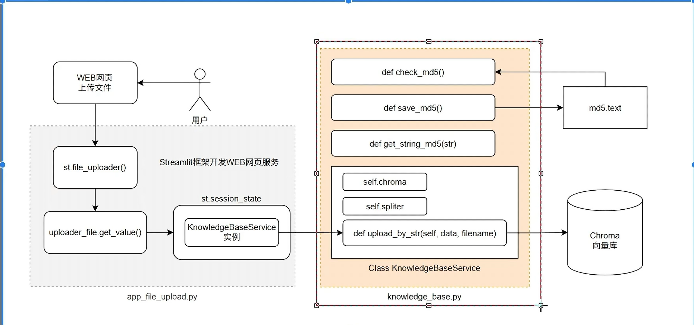在实际 RAG 项目中，为了提高知识库质量和管理效率，通常需要引入**去重校验**与**元数据注入**。

### 13.1 MD5 去重校验
**解决问题**：避免同一份文件或相同内容被重复灌入向量库，造成冗余检索。

```python
# 示例取自 04-RAG项目案例/example1/knowledge_base.py
import hashlib

# 作用:将传入的字符串转换为md5字符串
def get_string_md5(input_str: str, encoding='utf-8'):
    """将传入的字符串转换为md5字符串"""

    # 将字符串转换为bytes字节数组
    str_bytes = input_str.encode(encoding=encoding)

    # 创建md5对象
    md5_obj = hashlib.md5()     # 得到md5对象
    md5_obj.update(str_bytes)   # md5_obj.update：更新内容（传入即将要转换的字节数组）
    md5_hex = md5_obj.hexdigest()       # md5_obj.hexdigest：得到md5的十六进制字符串

    return md5_hex

# 在 upload 前校验
md5_hex = get_string_md5(data)
if check_md5(md5_hex): # check_md5 为自定义持久化校验逻辑
    return "[跳过]内容已经存在知识库中"
```

### 13.2 结构化元数据 (Metadata)

**解决问题**：为检索结果提供溯源信息，便于前端展示，并支持按字段过滤（见 [§11.1.2 `filter`](#1112-similarity_search-扩展参数)）。

| 与 §10 的区别 | 说明 |
| :--- | :--- |
| Loader → `add_documents` | 加载器生成的 `Document` 常**已带 `metadata`**（如文件路径） |
| 字符串直灌 → `add_texts` | 无 `Document` 中间层，须在写入时显式传入 `metadatas` |

本仓库 [`04-RAG项目案例/example1/knowledge_base.py`](../04-RAG项目案例/example1/knowledge_base.py) 在 [§13.1](#131-md5-去重校验) 通过 MD5 后分块写入，每个 chunk 绑定同一份业务 metadata：

| 字段 | 用途 |
| :--- | :--- |
| `source` | 上传文件名或业务来源标识，对应检索溯源与 `filter={"source": ...}` |
| `create_time` | 入库时间（建议格式化为字符串，便于展示） |
| `operator` | 操作人等业务维度（可按项目扩展） |

```python
# 04-RAG项目案例/example1/knowledge_base.py（upload_by_str 片段）
metadata = {
    "source": filename,
    "create_time": datetime.now().strftime("%Y-%m-%d %H:%M:%S"),
    "operator": "小曹",
}

# metadatas 与 knowledge_chunks 等长：每个文本块一条字典
self.chroma.add_texts(
    knowledge_chunks,
    metadatas=[metadata for _ in knowledge_chunks],
)
```

检索阶段可按 metadata 过滤，例如：`similarity_search(query, k=3, filter={"source": filename})`（Chroma 支持情况见 [§11.1.2](#1112-similarity_search-扩展参数)）。

---

### 13.3 Web 集成 (Streamlit-UI框架)
在实战中，常使用 Streamlit 快速构建 LangChain 的 Web 交互界面。

#### 13.3.1 基础特性与运行

- **核心机制**：Streamlit 采用“脚本式”运行逻辑，当WEB页面元素**发生任何变化**时（如附件上传），整个 Python 代码会**从头到尾重新执行一遍**。
- **安装**：
  ```bash
  pip install streamlit
  ```
- **启动服务**：
  ```bash
  # 在当前文件所在的目录下运行
  streamlit run app_file_uploader.py
  # 若上述命令报错，可尝试
  python -m streamlit run app_file_uploader.py
  ```

#### 13.3.2 状态持久化与资源缓存
- 由于 Streamlit 的重新执行机制，对于模型实例、数据库连接等重型资源，必须进行**持久化或缓存**，避免重复初始化。

##### 13.3.2.1 资源缓存 (`@st.cache_resource`)
**推荐用法**：用于全局共享的资源（如 LangChain 服务类、模型实例）。

```python
# 示例取自 04-RAG项目案例/app_file_uploader.py
@st.cache_resource
def get_kb_service():
    return KnowledgeBaseService()

service = get_kb_service() # 仅在首次运行时初始化，后续重跑直接取缓存
```

##### 13.3.2.2 会话状态 (`st.session_state`)
- Streamlit：当WEB页面元素发生变化，则代码**重新执行一遍**
- session_state用于存储与单个用户会话相关的临时数据（如对话历史、用户输入）。
- session_state就是一个字典，用来保存数据状态（不然页面变化每次都会刷新），
- 通过 Web 界面上传文件并将其内容同步到知识库，配合 `spinner` （加载状态）提供良好的交互体验。
```python
# 04-RAG项目案例\example1\app_file_uploader.py
import streamlit as st #起别名：st
from knowledge_base import KnowledgeBaseService

# 1.添加网页标题
st.title("知识库更新服务")

# 2.添加文件上传服务
# file_uploader：获取文件上传框
uploader_file = st.file_uploader(
    "请上传TXT文件",
    type=['txt'],#上传控件所支持的文件类型
    accept_multiple_files=False,    # False表示仅接受一个文件的上传
)

# 避免WEB页面元素发生变化时的数据清空
if "service" not in st.session_state: # 如果没有service字段，则添加
    st.session_state["service"] = KnowledgeBaseService() # 只创建一次

# 若文件不为空
if uploader_file is not None:
    # 提取文件的信息
    file_name = uploader_file.name
    file_type = uploader_file.type
    file_size = uploader_file.size / 1024    # KB

    st.subheader(f"文件名：{file_name}") # 设置子标题
    # .2f设置精度
    st.write(f"格式：{file_type} | 大小：{file_size:.2f} KB")
    
    # 提取文件的内容
#     # get_value -> bytes -> decode('utf-8')
    text = uploader_file.getvalue().decode("utf-8") #decode("utf-8")
    st.write(text) #输出文件内容

    with st.spinner("载入知识库中。。。"):       # 在spinner内的代码执行过程中，会有一个转圈动画
        result = st.session_state["service"].upload_by_str(text, file_name)
        st.write(result)


```

#### 13.3.3 文件上传与交互反馈


```python
# 示例取自 04-RAG项目案例/app_file_uploader.py
uploader_file = st.file_uploader("请上传 TXT 知识文档", type=['txt'])

if uploader_file is not None:
    # 提取文件内容
    text_content = uploader_file.getvalue().decode("utf-8")
    
    # 执行上传并显示进度
    if st.button("确认导入知识库"):
        with st.spinner("正在处理并导入向量库..."):
            result = service.upload_by_str(text_content, uploader_file.name)
            st.success(result) # 使用 st.success/st.warning/st.error 提供彩色反馈
```
### 13.4 [聊天页面开发](https://www.bilibili.com/video/BV1yjz5BLEoY/?spm_id_from=333.788.videopod.episodes&vd_source=9d75580d0b23d1137d56e03a996ac726&p=54)
- yield 表达式
- 聊天界面开发：04-RAG项目案例\example2\app_qa.py

## 14. Agent 智能体

智能体（Agent）在 LangChain 中用于让大模型语言（LLM）根据任务**自主选择并调用工具**，完成单靠生成无法解决的步骤（实时数据、计算、外部系统等）。

### 14.1 架构与工作流程

- 无 Agent 时，模型主要依赖训练知识作答；需要工具或实时数据时容易失败。
- 有 Agent 时，模型充当「指挥者」：规划步骤 → 选工具 → 执行调用 → 根据结果迭代，直至给出最终回复。

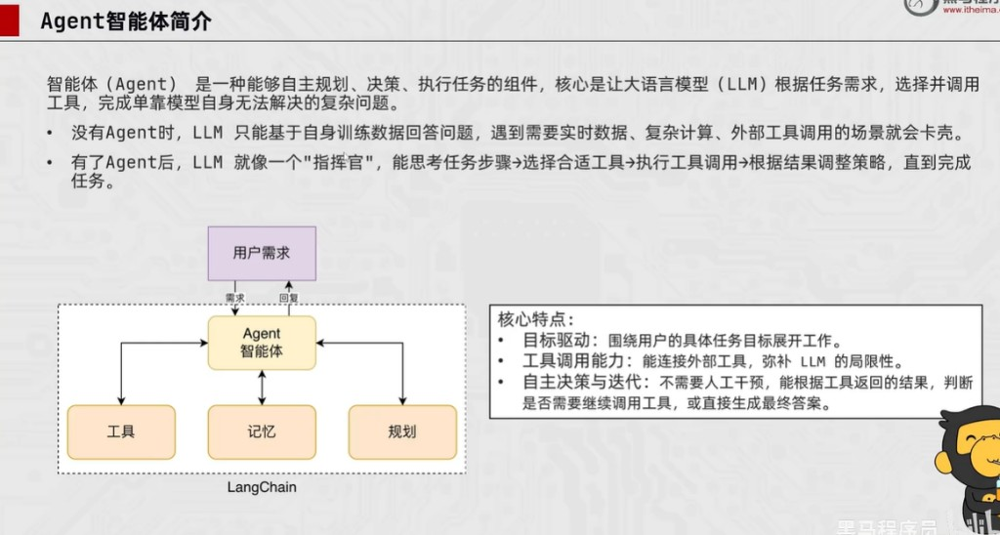

| 组件 | 作用 |
| :--- | :--- |
| **用户需求** | 向 Agent 提交任务并接收最终回复 |
| **Agent** | 统筹规划、工具调用与结果整合 |
| **工具 (Tools)** | 补足模型能力（查询、计算、API 等） |
| **记忆 (Memory)** | 保留会话或任务上下文 |
| **规划 (Planning)** | 拆解任务、决定下一步动作 |

核心特点：**目标驱动**、**可调用外部工具**、**自主决策与迭代**（根据工具返回决定是否继续调用或输出答案）。

以电商商品问答为例，典型链路为：用户提问 → Agent 判断需查库 → 调用数据库工具 → 工具返回结构化数据 → Agent 组织自然语言答复。

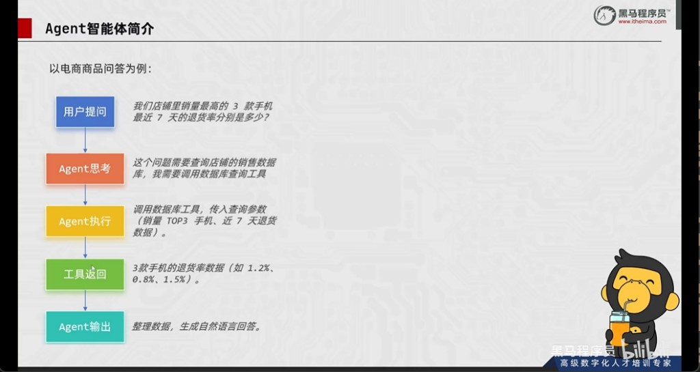

### 14.2 概念小结

- **Agent 智能体 = 大语言模型（大脑）+ 工具集（手脚）+ 决策逻辑（思维)**，使 LLM 从「只会回答」升级为「能执行动作、影响现实世界」的助手。
- 外部工具让模型具备感知与作用于外界的能力；工具越丰富，Agent 可覆盖的场景（客服问答、库存管理、自动化运营等）越广。

### 14.3 `create_agent` 初体验

`create_agent` 用于一次性装配「聊天模型 + 工具列表 + 系统提示」。

| 参数 | 作用 |
| :--- | :--- |
| **`model`** | 智能体使用的**聊天模型**（大脑），推荐 `common/dashscope_compat.create_chat_openai()`（读取 `BASE_URL`、`MODEL_CHAT`、密钥） |
| **`tools`** | 可供模型调用的工具列表（`@tool` 装饰的函数或其它 Tool 实例） |
| **`system_prompt`** | **系统级**角色与行为说明 |
| **`middleware`** | 可选，中间件函数列表；钩子含义与示例见 [§14.5](#145-middleware-中间件) |

工具函数使用 `langchain_core.tools` 的 `@tool` 注册；`description` 会写入工具元数据，供模型选择是否调用。

#### 14.3.1 `@tool` 装饰器

| 参数 / 属性 | 作用 |
| :--- | :--- |
| **`description`** | 工具用途说明，供模型在规划阶段匹配任务 |
| **函数 docstring** | 与 `description` 一并作为工具说明（示例中为「查询天气」） |

#### 14.3.2 Runnable 执行：`invoke` 与 `stream`

通过 `create_agent` 得到的 **Agent 图**同样是 [Runnable](#7-lcel-chains--composition) 实现，因此具备与其它 Runnable 一致的调用方式（聊天模型侧 [`invoke` / `stream`](#54-调用方式-invokestream) 见 §5.4）。

| 方法 | 作用 |
| :--- | :--- |
| **`invoke`** | 一次性执行，返回**完整**终态（如 `res["messages"]` 全量轨迹） |
| **`stream`** | 流式执行，按步产出中间状态；见 [§14.3.3](#1433-agent-流式输出-stream_modevalues) |

**`invoke` 入参**：包含 `messages` 的字典；每条为 `{"role": ..., "content": ...}`（本例 `role` 为 `user`，对应 [HumanMessage](#5211-标准类形式)）。

| 键 / 用法 | 含义 |
| :--- | :--- |
| **`messages`** | 本轮对话消息列表 |
| **返回值 `res["messages"]`** | 完整消息轨迹（含工具调用与模型回复），可遍历 `type(msg).__name__` 与 `msg.content` 调试 |
| **`type(msg).__name__`** | 查看消息类型 |

```python
# 示例取自 05-Agent智能体/01Agent智能体初体验.py
# 模型装配见 common/dashscope_compat.py（兼容端点 + 环境变量）

import sys
from pathlib import Path

ROOT = Path(__file__).resolve().parents[1]
if str(ROOT) not in sys.path:
    sys.path.insert(0, str(ROOT))

if hasattr(sys.stdout, "reconfigure"):
    sys.stdout.reconfigure(encoding="utf-8")

from common.dashscope_compat import create_chat_openai
from langchain.agents import create_agent
from langchain_core.tools import tool

model = create_chat_openai()  # 读取 MODEL_CHAT、DASHSCOPE_KEY、BASE_URL

# 定义工具
@tool(description="查询天气")
def get_weather() -> str:
    return "晴天"


agent = create_agent(
    model=model,
    tools=[get_weather],
    system_prompt="你是一个聊天助手，可以回答用户问题。",
)

res = agent.invoke(
    {
        "messages": [
            {"role": "user", "content": "明天深圳的天气如何？"},
        ]
    }
)

for msg in res["messages"]:
    # `type(msg).__name__`：输出消息类型
    print(type(msg).__name__, msg.content)
```

#### 14.3.3 Agent 流式输出 (`stream_mode="values"`)

示例取自 `05-Agent智能体/02Agent的stream流式输出.py`。Agent 装配与 [§14.3](#143-create_agent-初体验) 相同；下列仅展示**多工具**与 **`agent.stream`** 增量逻辑。

| 参数 | 作用 |
| :--- | :--- |
| **`stream_mode="values"`** | 每个流式块 `chunk` 为 Agent **当前完整状态**（字典）；<br>其中 `chunk["messages"]` 为**截至该步**的消息列表 |
| **`chunk["messages"][-1]`** | 取列表**最后一条**，即该步**最新**消息（文本回复或工具调用意图） |

- 流式块包含该时刻的完整状态，因此用 `[-1]` 即可跟踪最新进展；
- 若 `latest_message.content` 非空则打印模型输出，若存在 `tool_calls` 则打印工具名列表。

```python
# 示例取自 05-Agent智能体/02Agent的stream流式输出.py
# 项目根路径加入 sys.path、create_chat_openai 等同 §14.3，此处从工具定义起

from common.dashscope_compat import create_chat_openai
from langchain.agents import create_agent
from langchain_core.tools import tool

@tool(description="获取股价，传入股票名称，返回字符串信息")
def get_price(name: str) -> str:
    return f"股票{name}的价格是20元"

@tool(description="获取股票信息，传入股票名称，返回字符串信息")
def get_info(name: str) -> str:
    return f"股票{name}，是一家A股上市公司，专注于IT职业教育。"

agent = create_agent(
    model=create_chat_openai(),
    tools=[get_price, get_info], # 传入工具
    system_prompt="你是一个智能助手，可以回答股票相关问题，记住请告知我思考过程，让我知道你为什么调用某个工具"
)

for chunk in agent.stream(
    {"messages": [{"role": "user", "content": "传智教育股价多少，并介绍一下"}]},
    stream_mode="values" # 流式输出，values 是返回值，messages 是消息
):
    latest_message = chunk['messages'][-1] # 获取最新消息，最后一条

    if latest_message.content:
        print(type(latest_message).__name__, latest_message.content)

    try:
        if latest_message.tool_calls: #打印工具调用，工具名称
            print("【",type(latest_message).__name__,"】", latest_message.content)
    except AttributeError as e: # 处理 AttributeError 异常，即 latest_message 没有 tool_calls 属性
        pass # 什么都不做
```

| 分支 | 含义 |
| :--- | :--- |
| **`latest_message.content`** | 该步模型已生成的文本（可边流式边 `print`） |
| **`latest_message.tool_calls`** | 该步模型拟调用的工具；用 `tc['name']` 打印工具名 |
| **`try` / `except AttributeError`** | 部分消息类型无 `tool_calls` 属性时忽略，避免中断流式循环 |

#### 14.3.4 执行结果
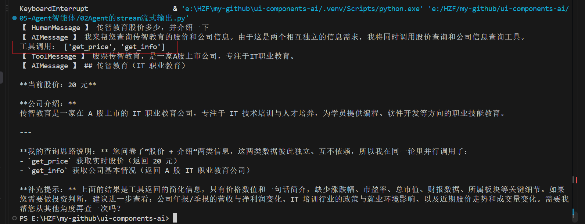

### 14.4 ReAct 工作范式

**ReAct（Reasoning + Acting）** 是 LLM Agent 常用的**思考 + 行动**框架：像人一样「先想清问题 → 定策略 → 执行动作 → 核对结果」，用语义化的推理驱动工具调用，适合客服、报表、多步规划等任务。

| 阶段 | 含义 | Agent 中的表现 |
| :--- | :--- | :--- |
| **思考（Reasoning）** | 分析需求、判断信息是否足够、规划下一步 | 模型在 `content` 中输出推理；决定是否发起 `tool_calls` |
| **行动（Action）** | 按策略执行 | 调用 `tools` 中某一工具，传入参数 |
| **观察（Observation）** | 读取行动结果、抽取有用信息 | 工具返回值写入对话轨迹（通常为 `ToolMessage`），供下一轮思考 |
| **结束** | 信息已足、可回答用户 | 不再调用工具，输出最终 `AIMessage` |

典型闭环：**思考 → 行动 → 观察 → 思考 → … → 结束**。LangChain 中经 [`create_agent`](#143-create_agent-初体验) 装配的 Agent 图，底层即按此循环运行（模型节点与工具节点交替，直至无更多 `tool_calls`）。

#### 14.4.1 案例：BMI 计算

- 在 `system_prompt` 中**显式约束** ReAct 结构与「每轮仅调用 1 个工具」，便于观察思考、行动、观察分段；流式消费方式同 [§14.3.3](#1433-agent-流式输出-stream_modevalues)。

| 约束 / 工具 | 作用 |
| :--- | :--- |
| **`system_prompt`** | 要求按「思考→行动→观察→再思考」叙述，并限制每轮 1 次工具调用(方便演示学习) |
| **`get_weight` / `get_height`** | 分步获取体重（kg）、身高（cm），再推导 BMI |

```python
# 示例取自 05-Agent智能体/03ReAct案例.py
from common.dashscope_compat import create_chat_openai
from langchain.agents import create_agent
from langchain_core.tools import tool

# 定义工具，获取体重，返回值是整数，单位千克
@tool(description="获取体重，返回值是整数，单位千克")
def get_weight() -> int:
    return 90

# 定义工具，获取身高，返回值是整数，单位厘米
@tool(description="获取身高，返回值是整数，单位厘米")
def get_height() -> int:
    return 172

agent = create_agent(
    model=create_chat_openai(),
    tools=[get_weight, get_height],
    # 为了演示方便才禁止单次调用多个工具，实际使用时可以调用多个工具
    system_prompt="""你是严格遵循ReAct框架的智能体，必须按「思考→行动→观察→再思考」的流程解决问题，
    且**每轮仅能思考并调用1个工具**，禁止单次调用多个工具。 
    并告知我你的思考过程，工具的调用原因，按思考、行动、观察三个结构告知我""",
)

for chunk in agent.stream(
    {"messages": [{"role": "user", "content": "计算我的BMI"}]},
    stream_mode="values"
):
    latest_message = chunk['messages'][-1]

    if latest_message.content:
        print(type(latest_message).__name__, latest_message.content)

    try:
        if latest_message.tool_calls:
            print(f"工具调用： { [tc['name'] for tc in latest_message.tool_calls]  }")
    except AttributeError as e:
        pass
```
#### 14.4.2 执行结果

运行后可在控制台依次看到：模型**思考**与说明、**行动**阶段的 `工具调用`、工具返回后的**观察**与再思考，直至给出 BMI 结论。

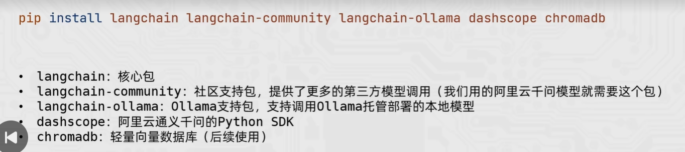
### 14.5 Middleware 中间件

- 中间件用于在 Agent **每一步**前后插入自定义逻辑：日志与调试、提示词或工具选择改写、重试/降级/提前结束，以及安全与鉴权等。
- 无中间件时为「请求 → 模型 ⇄ 工具 → 结果」；挂载中间件后，在 Agent / 模型 / 工具调用链路上增加 Hook 拦截点。

| 典型场景 |
| :--- |
| 日志记录、链路分析与调试 |
| 转换提示词、筛选或改写工具调用 |
| 重试、备用模型、提前终止等控制 |
| 安全防护、敏感信息检测等 |

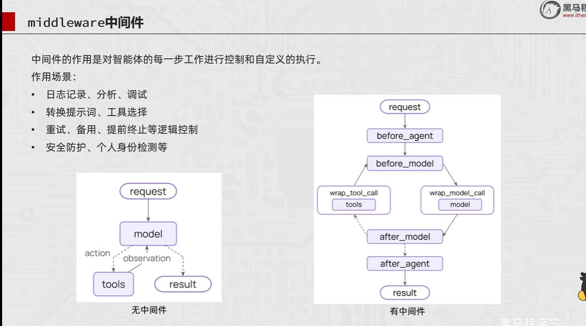

LangChain 提供**内置中间件**，亦可通过装饰器定义自定义 Hook（官方列表见 [Built-in middleware](https://docs.langchain.com/oss/python/langchain/middleware/built-in)）。

#### 14.5.1 Hook 类型

| 类型 | 装饰器 | 拦截时机 |
| :--- | :--- | :--- |
| **节点式** | `@before_agent` | 整段 Agent 运行开始前 |
| | `@after_agent` | 整段 Agent 运行结束后 |
| | `@before_model` | 单次模型调用前 |
| | `@after_model` | 单次模型调用后 |
| **包裹式** | `@wrap_model_call` | 包裹每一次模型请求（可打印、改写或短路） |
| | `@wrap_tool_call` | 包裹每一次工具执行（可打印工具名与参数） |

节点式 Hook 接收 `AgentState` 与 `Runtime`，用于读写在途消息数量等状态；包裹式 Hook 接收 `request` 与 `handler`，在 `return handler(request)` 前后织入逻辑。

#### 14.5.2 注册方式

[`create_agent`](#143-create_agent-初体验) 增加 **`middleware`** 参数，传入由上述装饰器标记的函数列表即可（顺序即组合顺序，先定义的更靠外层）。

| 参数 | 作用 |
| :--- | :--- |
| **`middleware`** | 中间件函数列表，与 `model`、`tools` 一并装配进 Agent 图 |

示例取自 `05-Agent智能体/04middleware中间件.py`（项目根 `sys.path` 与 `create_chat_openai` 同 §14.3）。

```python
# 示例取自 05-Agent智能体/04middleware中间件.py

from common.dashscope_compat import create_chat_openai
from langchain.agents import create_agent, AgentState
from langchain.agents.middleware import before_agent, after_agent, before_model, after_model, wrap_model_call, \
    wrap_tool_call
from langchain_core.tools import tool
from langgraph.runtime import Runtime


@tool(description="查询天气，传入城市名称字符串，返回字符串天气信息")
def get_weather(city: str) -> str:
    return f"{city}天气：晴天"


"""
1. agent执行前
2. agent执行后
3. model执行前
4. model执行后
5. 工具执行中
6. 模型执行中
"""

# 中间件，在agent执行前调用
@before_agent
def log_before_agent(state: AgentState, runtime: Runtime) -> None:
    # agent执行前会调用这个函数并传入state和runtime两个对象
    print(f"[before agent]agent启动，并附带{len(state['messages'])}消息")


# 中间件，在agent执行后调用
@after_agent
def log_after_agent(state: AgentState, runtime: Runtime) -> None:
    print(f"[after agent]agent结束，并附带{len(state['messages'])}消息")

# 中间件，在model执行前调用
@before_model
def log_before_model(state: AgentState, runtime: Runtime) -> None:
    print(f"[before_model]模型即将调用，并附带{len(state['messages'])}消息")

# 中间件，在model执行后调用
@after_model
def log_after_model(state: AgentState, runtime: Runtime) -> None:
    print(f"[after_model]模型调用结束，并附带{len(state['messages'])}消息")

# 中间件，在model执行中调用
@wrap_model_call
def model_call_hook(request, handler):
    print("模型调用啦")
    return handler(request)

# 中间件，在工具执行中调用（monitor_tool：监控工具执行）
@wrap_tool_call
def monitor_tool(request, handler):
    print(f"工具执行：{request.tool_call['name']}")
    print(f"工具执行传入参数：{request.tool_call['args']}")

    return handler(request)


agent = create_agent(
    model=create_chat_openai(),
    tools=[get_weather],
    # 加入中间件列表
    middleware=[log_before_agent, log_after_agent, log_before_model, log_after_model, model_call_hook, monitor_tool]
)

res = agent.invoke({"messages": [{"role": "user", "content": "深圳今天的天气如何呀，如何穿衣"}]})
print("**********\n", res)
```

运行 `04middleware中间件.py` 时，控制台将按 Hook 顺序打印 Agent / 模型 / 工具各阶段的日志，便于对照上图理解拦截点。
## 15. Agent 项目实战
 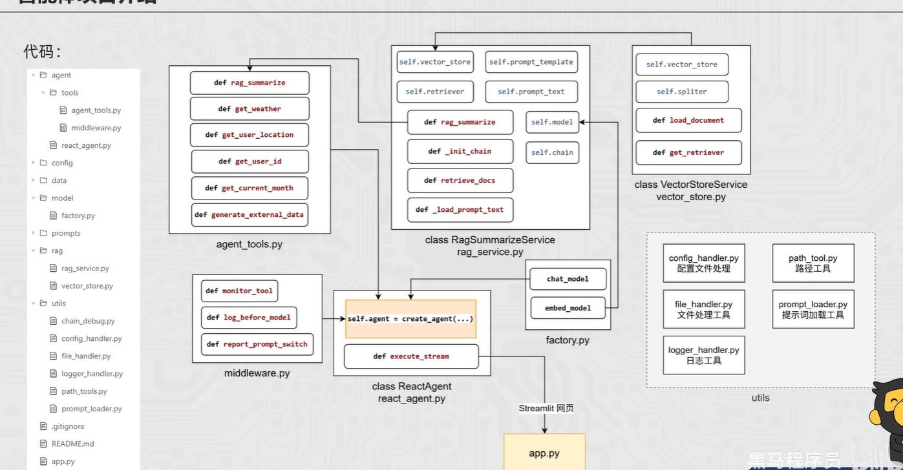