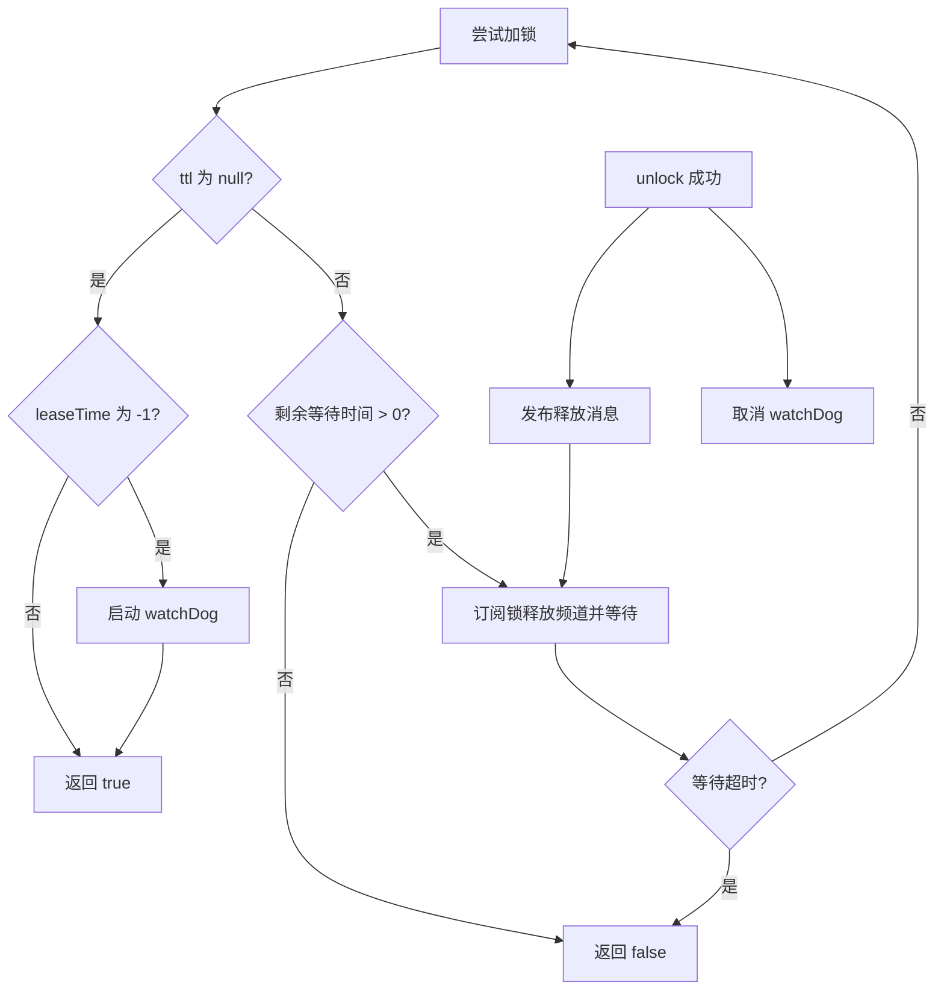
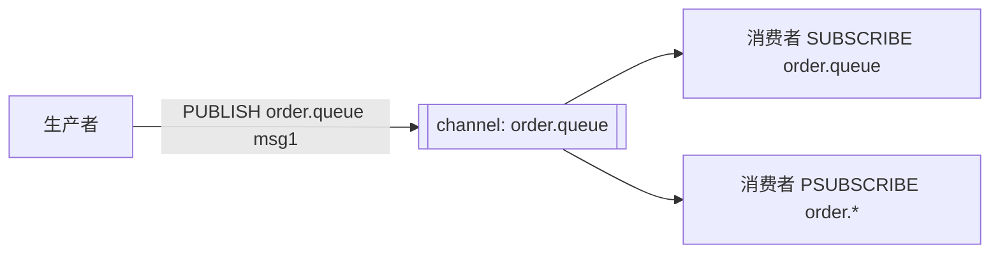

>  [Redis 知识梳理](https://www.bilibili.com/video/BV1cr4y1671t/?spm_id_from=333.337.search-card.all.click)
> Redis (Remote Dictionary Server) 诞生于 2009 年，是一个**基于内存**的键值型 NoSQL 数据库。

# 一、 SQL vs NoSQL 核心对比

在选择数据库时，需要根据业务场景在传统关系型数据库（SQL）与非关系型数据库（NoSQL）之间进行权衡。


| 特性       | SQL (关系型数据库)             | NoSQL (非关系型数据库)             |
| -------- | ------------------------ | --------------------------- |
| **数据结构** | 结构化 (Structured)，表格式     | 非结构化/半结构化，格式灵活              |
| **数据关联** | 关联的 (Relational)，支持强外键约束 | 无关联的 (Non-relational)       |
| **查询方式** | SQL 查询 (标准语法)            | 非 SQL 查询 (API 或特定语法)        |
| **事务特性** | ACID (原子性、一致性、隔离性、持久性)   | BASE (基本可用、软状态、最终一致性)       |
| **存储方式** | 磁盘存储 (Disk)              | 内存存储 (Memory)               |
| **扩展性**  | 垂直扩展 (提高单机性能)            | 水平扩展 (通过集群增加节点)             |
| **使用场景** | 数据结构固定、相关业务对安全性/一致性要求高   | 数据结构不固定、对一致性/安全性要求不高、对性能要求高 |


# 二、 Redis 核心特征 {#redis-core-features}

- Redis 以其极高的**读写速度**和丰富的数据类型成为最受欢迎的**键值存储系统**。
- 查询Redis缓存比查询SQL的速度更快

| 特性             | 说明                                                         |
| ---------------- | ------------------------------------------------------------ |
| **键值型**       | 以 `Key-Value` 形式存储，Value 支持 **String, List, Set, Hash, ZSet** 等多种数据结构 |
| **单线程**       | 核心网络 IO 与键值读写由单线程完成，每个命令**具备原子性，避免了多线程竞争** |
| **低延迟/快**    | 基于内存操作，使用 IO 多路复用模型，具备良好的底层数据结构编码优化 |
| **持久化**       | 支持 RDB (内存快照) 和 AOF (追加文件) 两种方式，平衡性能与数据安全性 |
| **高可用与扩展** | 支持主从集群、分片集群，可实现高可用与水平扩展               |
| **多语言支持**   | 提供丰富的多语言客户端 SDK，方便各类应用集成                 |

---

# 三、 Redis 安装

- 先安装linux
- 安装redis
- 修改启动配置文件；开机自启

# 四、 Redis 通用命令

- 与具体 Value 类型无关、多数场景均可使用的命令。
- 在 `redis-cli` 中可用 `help [command]` 查看用法摘要，例如 `help keys` 会输出 `KEYS pattern` 及说明。


| 命令       | 作用                                    | 示例 / 注意                                                  |
| ---------- | --------------------------------------- | ------------------------------------------------------------ |
| **KEYS**   | 按模式列出匹配的 key                    | `KEYS` * 列出全部；`KEYS a`* 匹配前缀；<br/> **生产环境不建议使用**（全库扫描可能阻塞） |
| **DEL**    | 删除指定 key                            | `DEL key [key ...]`；`help del` 可查语法                     |
| **EXISTS** | 判断 key 是否存在                       | `EXISTS key`                                                 |
| **EXPIRE** | 为 key 设置过期时间（秒），到期自动删除 | `EXPIRE key seconds`                                         |
| **TTL(Time To Live)**    | 查看 key **剩余存活时间**（秒）             | 无过期或 key 不存在时返回值语义以 `help ttl` 为准            |


```text
127.0.0.1:6379> help keys
KEYS pattern
summary: Find all keys matching the given pattern

<!-- 列出全部 -->
127.0.0.1:6379> KEYS *
1) "age"
2) "name"

<!-- 匹配前缀a开头的key值 -->
127.0.0.1:6379> KEYS a*
1) "age"
```


# 五、 Redis 数据类型与 key 规范

- Redis 中最基础的 Value 类型；value 虽为字符串，按内容可分为三类。
- 无论哪种形态，底层均以**字节数组**存储（编码方式不同）；单个 String 值最大 **512MB**。


| 形态         | 说明            | 示例（key → value）       |
| ---------- | ------------- | --------------------- |
| **string** | 普通字符串         | `msg` → `hello world` |
| **int**    | 整数，可做自增、自减    | `num` → `10`          |
| **float**  | 浮点数，可按步长自增、自减 | `score` → `92.5`      |

## 5.1 key 的结构

- key 可由**多段英文单词**组成，段间用冒号 `:` 分隔，形成**层级**，便于区分业务。
- 推荐形态为 `项目名:业务名:类型:id`，段数可按需要增减。


| KEY               | VALUE                                     |
| ----------------- | ----------------------------------------- |
| `heima:user:1`    | `{"id":1, "name": "Jack", "age": 21}`     |
| `heima:product:1` | `{"id":1, "name": "小米11", "price": 4999}` |


值为 Java 对象时，先序列化为 **JSON 字符串**再写入 Redis；应用侧存取见 [Spring Boot 整合 Redis](#spring-boot-redis) 中的 `StringRedisTemplate`。

## 5.2 String 常见命令


| 命令            | 作用                                                    | 语法                             | 示例                                                         |
| --------------- | ------------------------------------------------------- | -------------------------------- | ------------------------------------------------------------ |
| **SET**         | 添加或修改 String 键值对                                | `SET key value`                  | `SET msg "hello world"`                                      |
| **GET**         | 按 key 获取 value                                       | `GET key`                        | `GET msg`                                                    |
| **MSET**        | 批量添加多个键值对                                      | `MSET key value [key value ...]` | `MSET name Jack age 21`                                      |
| **MGET**        | 按多个 key 批量获取 value                               | `MGET key [key ...]`             | `MGET name age`                                              |
| **INCR**        | 整型 value 自增 1                                       | `INCR key`                       | `INCR num`（value 须为整数形态）                             |
| **INCRBY**      | 整型 value 按步长自增                                   | `INCRBY key increment`           | `INCRBY num 2`                                               |
| **INCRBYFLOAT** | 浮点 value 按步长自增                                   | `INCRBYFLOAT key increment`      | `INCRBYFLOAT score 0.5`                                      |
| **SETNX**       | 仅当 key **不存在时写入**，否则不执行(常用于实现互斥锁) | `SETNX key value`                | `SETNX lock 1`                                               |
| **SETEX**       | 写入 String 并指定过期时间（秒）                        | `SETEX key seconds value`        | `SETEX token 3600 abc`；等价于 SET 后配合 [EXPIRE](#redis-generic-commands) |


## 5.3 Hash 类型与常见命令

- Hash（哈希）在**单个 key 下保存多组 `field-value`**，**适合同一实体的多个属性**；
- field 与 value 均为字符串。
- key 命名仍遵循 [key 结构](#redis-key-structure)，例如 `heima:user:1`、`heima:user:2` 各自包含 `name`、`age` 等 field（与 [String](#redis-string) 存整段 JSON 是不同建模方式）。


| 命令        | 作用                                    | 语法                                      | 示例                                    |
| ----------- | --------------------------------------- | ----------------------------------------- | --------------------------------------- |
| **HSET**    | 添加或修改指定 field                    | `HSET key field value`                    | `HSET heima:user:1 `**`name Jack`**     |
| **HGET**    | 获取指定 field 的 value                 | `HGET key field`                          | `HGET heima:user:1 name`                |
| **HMSET**   | 批量设置多个 field                      | `HMSET key field value [field value ...]` | `HMSET heima:user:1 name Jack age 21`   |
| **HMGET**   | 批量获取多个 field                      | `HMGET key field [field ...]`             | `HMGET heima:user:1 name age`           |
| **HGETALL** | 获取 key 下全部 field 与 value          | `HGETALL key`                             | `HGETALL heima:user:1`                  |
| **HKEYS**   | 获取 key 下**全部 field**               | `HKEYS key`                               | `HKEYS heima:user:1`                    |
| **HVALS**   | 获取 key 下**全部 value**               | `HVALS key`                               | `HVALS heima:user:1`                    |
| **HINCRBY** | 指定 field 按步长自增（整型）           | `HINCRBY key field increment`             | `HINCRBY heima:user:1 age 1`            |
| **HSETNX**  | 仅当 field **不存在时写入**，否则不执行 | `HSETNX key field value`                  | `HSETNX heima:user:1 phone 13800000000` |


## 5.4 List 类型与常见命令 {#redis-list-commands}

- List（列表）可视为双向链表结构（类似 Java 的 `LinkedList`），支持从两端插入与弹出，也可按索引区间读取。
- 特征：**有序**、**元素可重复**、**头尾插入/删除快**、**按位置查询需遍历，速度一般**。


| 命令       | 作用                                                   | 语法                              | 示例                                                     |
| ---------- | ------------------------------------------------------ | --------------------------------- | -------------------------------------------------------- |
| **LPUSH**  | 从列表**左侧**插入一个或多个元素                       | `LPUSH key element [element ...]` | `LPUSH heima:queue:msg` **`a b`**                        |
| **LPOP**   | 移除并返回**左侧**第一个元素；**列表为空时返回 `nil`** | `LPOP key`                        | `LPOP heima:queue:msg`                                   |
| **RPUSH**  | 从列表**右侧**插入一个或多个元素                       | `RPUSH key element [element ...]` | `RPUSH heima:queue:msg `**`c`**                          |
| **RPOP**   | 移除并返回**右侧**第一个元素                           | `RPOP key`                        | `RPOP heima:queue:msg`                                   |
| **LRANGE** | 返回下标区间内全部元素（含两端）                       | `LRANGE key start stop`           | `LRANGE heima:queue:msg `**`0 -1`**（`-1` 表示最后一个） |
| **BLPOP**  | 同 LPOP，列表为空时阻塞等待，超时仍无元素则返回 nil    | `BLPOP key [key ...] timeout`     | `BLPOP heima:queue:msg 10`（最多等待 10 秒）             |
| **BRPOP**  | 同 RPOP，**但列表为空时阻塞等待**                            | `BRPOP key [key ...] timeout`     | `BRPOP heima:queue:msg 10`                               |


## 5.5 Set 类型与常见命令

- Set（集合）结构与 Java 的 `HashSet` 类似，可看作 value 恒为 null 的 HashMap；底层为哈希表。
- 特征：**无序**、**元素不可重复**、**查找快**、支持**交集、并集、差集**等集合运算。


| 命令          | 作用                                                  | 语法                           | 示例                               |
| ------------- | ----------------------------------------------------- | ------------------------------ | ---------------------------------- |
| **SADD**      | 向 set 添加一个或多个 member                          | `SADD key member [member ...]` | `SADD heima:tags:1 java redis`     |
| **SREM**      | 移除 set 中的指定 member                              | `SREM key member [member ...]` | `SREM heima:tags:1 redis`          |
| **SCARD**     | 返回 set 中 member 个数                               | `SCARD key`                    | `SCARD heima:tags:1`               |
| **SISMEMBER** | 判断 member 是否在 set 中                             | `SISMEMBER key member`         | `SISMEMBER heima:tags:1 java`      |
| **SMEMBERS**  | 返回 set 中全部 member                                | `SMEMBERS key`                 | `SMEMBERS heima:tags:1`            |
| **SINTER**    | 求多个 key 对应 set 的**交集**                        | `SINTER key [key ...]`         | `SINTER heima:set:s1 heima:set:s2` |
| **SDIFF**     | 求多个 key 对应 set 的**差集**（以第一个 key 为基准） | `SDIFF key [key ...]`          | `SDIFF heima:set:s1 heima:set:s2`  |
| **SUNION**    | 求多个 key 对应 set 的**并集**                        | `SUNION key [key ...]`         | `SUNION heima:set:s1 heima:set:s2` |

<!-- ## 5.6 Stream 类型与常见命令 {#redis-stream-commands} -->

## 5.7 SortedSet（ZSet）类型与常见命令

- SortedSet（有序集合，Redis 中常称 **ZSet**）是带 **score** 的**有序** set：每个 member 唯一，按 score 排序。概念上类似 Java 的 `TreeSet`，但底层一般为 **跳表 + 哈希表** 组合实现。
- 特征：**可排序**、**member 不重复**、**查询快**；常用于**排行榜**等场景。


| 命令                        | 作用                                         | 语法                                       | 示例                                    |
| --------------------------- | -------------------------------------------- | ------------------------------------------ | --------------------------------------- |
| **ZADD**                    | 添加 member 并指定 score；已存在则更新 score | `ZADD key score member [score member ...]` | `ZADD heima:rank:game 100 jack 95 rose` |
| **ZREM**                    | 删除指定 member                              | `ZREM key member [member ...]`             | `ZREM heima:rank:game rose`             |
| **ZSCORE**                  | 获取 member 的 score                         | `ZSCORE key member`                        | `ZSCORE heima:rank:game jack`           |
| **ZRANK**                   | 获取 member 按 score 升序的排名（从 0 起）   | `ZRANK key member`                         | `ZRANK heima:rank:game jack`            |
| **ZCARD**                   | 返回 member 个数                             | `ZCARD key`                                | `ZCARD heima:rank:game`                 |
| **ZCOUNT**                  | 统计 score 落在闭区间内的 member 个数        | `ZCOUNT key min max`                       | `ZCOUNT heima:rank:game 90 100`         |
| **ZINCRBY**                 | 将 member 的 score 增加指定步长              | `ZINCRBY key increment member`             | `ZINCRBY heima:rank:game 5 jack`        |
| **ZRANGE**                  | 按 score 升序，取下标区间内的 member         | `ZRANGE key start stop`                    | `ZRANGE heima:rank:game 0 2`            |
| **ZRANGEBYSCORE**           | 按 score 升序，取 score 区间内的 member      | `ZRANGEBYSCORE key min max`                | `ZRANGEBYSCORE heima:rank:game 90 100`  |
| **ZDIFF / ZINTER / ZUNION** | 对多个 ZSet 求差集、交集、并集               | `ZDIFF numkeys key [key ...]` 等           | `ZINTER 2 heima:zset:s1 heima:zset:s2`  |


默认按 score **升序**排名与区间；需要**降序**时在命令的 `Z` 后插入 `REV`（如 `ZREVRANK`、`ZREVRANGE`），例如 `ZREVRANGE heima:rank:game 0 0` 可取排行榜第一名。

# 六、 Java 客户端：Jedis（了解）

- [Jedis](https://github.com/redis/jedis) 是常用的 Java Redis 客户端：创建 `Jedis` 实例后，**方法名与 Redis 命令一致**（如 `set` 对应 SET、`get` 对应 GET），便于对照 [String 常见命令](#redis-string-commands) 等 CLI 小节。
- 基本步骤：**引入依赖 → 建立连接 → 调用 API → 释放资源**；
- 生产环境更推荐 [连接池](#redis-jedis-pool) 替代频繁直连。

## 6.1 Maven 依赖

```xml
<dependency>
    <groupId>redis.clients</groupId>
    <artifactId>jedis</artifactId>
    <version>3.7.0</version>
</dependency>
```

## 6.2 连接、操作与释放


| 步骤         | 语法                      | 示例                                                   |
| ---------- | ----------------------- | ---------------------------------------------------- |
| 建立连接       | `new Jedis(host, port)` | `jedis = new Jedis("192.168.150.101", 6379);`        |
| 认证（若服务端开启） | `jedis.auth(password)`  | `jedis.auth("123321");`                              |
| 选择逻辑库      | `jedis.select(index)`   | `jedis.select(0);`                                   |
| 写入 String  | `jedis.set(key, value)` | `jedis.set("name", "张三");`                           |
| 读取 String  | `jedis.get(key)`        | `jedis.get("name");`                                 |
| 释放连接(物理断开)       | `jedis.close()`         | 在 `@AfterEach` 中 `if (jedis != null) jedis.close();` |


```java
private Jedis jedis;

@BeforeEach
void setUp() {
    jedis = new Jedis("192.168.150.101", 6379); // 连接虚拟机中的redis库
    jedis.auth("123321");
    jedis.select(0);//选择逻辑库
}

@Test
void testString() {
    String result = jedis.set("name", "张三"); // 存到redis
    System.out.println("result = " + result);
    String name = jedis.get("name"); // 从redis取
    System.out.println("name = " + name);
}

@AfterEach
void tearDown() {
    if (jedis != null) {
        jedis.close(); //关闭redis连接
    }
}
```


## 6.3 Jedis 连接池
> 连接池可以理解为：应用和 Redis 之间**预先建好一批 TCP 连接**，放在“池子”里复用，而不是每次访问都 new Jedis、用完再真正断开。

- ` Jedis` 实例**线程不安全**，频繁 `new Jedis` / `close` 也有性能损耗，推荐使用 **JedisPool** 连接池统一管理连接。
- 从池中 `getResource()` 得到的 `Jedis`，用完后仍调用 `close()`，连接会**归还池**而非物理断开，不是每次都拆掉 TCP。


| 配置项          | 语法                                 | 示例                                       |
| ------------ | ---------------------------------- | ---------------------------------------- |
| 最大连接数        | `JedisPoolConfig#setMaxTotal(int)` | `jedisPoolConfig.setMaxTotal(8);`        |
| 最大空闲连接       | `setMaxIdle(int)`                  | `jedisPoolConfig.setMaxIdle(8);`         |
| 最小空闲连接       | `setMinIdle(int)`                  | `jedisPoolConfig.setMinIdle(0);`         |
| 获取连接最大等待（毫秒） | `setMaxWaitMillis(long)`           | `jedisPoolConfig.setMaxWaitMillis(200);` |

- 步骤：

| 步骤    | 语法                                                     | 示例                                                                         |
| ----- | ------------------------------------------------------ | -------------------------------------------------------------------------- |
| 创建连接池 | `new JedisPool(config, host, port, timeout, password)` | `new JedisPool(jedisPoolConfig, "192.168.150.101", 6379, 1000, "123321");` |
| 借用连接  | `jedisPool.getResource()`                              | `Jedis jedis = JedisConnectionFactory.getJedis();`                         |
| 归还连接  | `jedis.close()`                                        | 在 `finally` 或 `@AfterEach` 中关闭                                             |


```java
public class JedisConnectionFactory {
    private static final JedisPool jedisPool;

    static {
        JedisPoolConfig jedisPoolConfig = new JedisPoolConfig();
        jedisPoolConfig.setMaxTotal(8);
        jedisPoolConfig.setMaxIdle(8);
        jedisPoolConfig.setMinIdle(0);
        jedisPoolConfig.setMaxWaitMillis(200);
        jedisPool = new JedisPool(jedisPoolConfig, "192.168.150.101", 6379,
                1000, "123321");
    }

    public static Jedis getJedis() {
        return jedisPool.getResource();
    }
}
```

## 和 6.2「直连」对比

> 像 共享单车停车点：车（连接）停在那，你扫码骑走（getResource()），骑完停回桩（close() 归还），而不是每骑一次都买一辆新车、骑完报废.

| 方式| 每次请求大致做什么 |
| ----- | ------------------------------------------------------ |
|6.2 直连|new Jedis → 建连、认证 → 执行命令 → close() → 物理断开|
|6.3 连接池|getResource() → 从池里借一条已有连接 → 执行命令 → close() → 还回池里，连接通常不断开|

> 本仓库业务模块采用 Spring Data Redis，见下一节；Jedis 多用于学习或对连接生命周期的直接控制。

# 七、 Spring Boot 整合 Redis（RedisTemplate ）

- [Spring Data Redis](https://spring.io/projects/spring-data-redis) 是 Spring Data 中面向 Redis 的集成模块：默认基于 **Lettuce** 客户端（亦可选 Jedis），通过 **RedisTemplate** 统一 API，并支持发布订阅、Sentinel/Cluster、序列化等能力。
- Java 侧整合步骤：**引入依赖 → 配置 `application.yaml` → 注入 Template 使用**（本仓库 **hm-dianping** 模块）。

## 7.1 Maven 依赖

本仓库 **hm-dianping** 模块已引入：

```xml
<!-- Redis/hm-dianping/pom.xml -->
<!--redis坐标-->
<dependency>
    <groupId>org.springframework.boot</groupId>
    <artifactId>spring-boot-starter-data-redis</artifactId>
</dependency>
```

启用 **Lettuce 连接池**时还需 `commons-pool2`（课件示例；本仓库 **hm-dianping** 已声明）：

```xml
<!-- Redis/hm-dianping/pom.xml -->
<!--连接池依赖-->
<dependency>
    <groupId>org.apache.commons</groupId>
    <artifactId>commons-pool2</artifactId>
</dependency>
```

## 7.2 环境配置

- Boot 2.x  使用 `spring.redis` 前缀，片段如下：

> 下列为本仓库 **hm-dianping** 配置片段（Boot **2.x**）。

```yaml
# Redis/hm-dianping/src/main/resources/application.yaml
# Boot 2.x，使用 `spring.redis` 前缀
spring:
  redis: 
    host: 192.168.150.101
    port: 6379 #redis的默认端口号
    password: 123321
    lettuce:
      pool:
        max-active: 10
        max-idle: 10
        min-idle: 1
```

- Spring Boot **3.x** 使用 `spring.data.redis` 前缀。即将同级项移到 `spring.data.redis` 下）含密码与 Lettuce 连接池，与 [Jedis 连接池](#redis-jedis-pool) 中 `maxTotal` / `maxIdle` / `minIdle` / `maxWaitMillis` 含义对应：


| 配置项                       | 作用                | 课件示例值 |
| ------------------------- | ----------------- | ----- |
| `lettuce.pool.max-active` | 连接池最大连接数（在用 + 空闲） | `8`   |
| `lettuce.pool.max-idle`   | 池中最多保留的空闲连接数      | `8`   |
| `lettuce.pool.min-idle`   | 池中至少维持的空闲连接数      | `0`   |
| `lettuce.pool.max-wait`   | 获取连接的最大等待时间（毫秒）   | `100` |


```yaml
# Boot 3.x，使用 `spring.data.redis` 前缀
spring:
  data: ## 多一层data
    redis:
      host: 192.168.150.101
      port: 6379
      password: 123321
      lettuce:
        pool:
          max-active: 8
          max-idle: 8
          min-idle: 0
          max-wait: 100
```

## 7.3 RedisTemplate 与数据类型 API

`RedisTemplate` 封装各类 Redis 命令；不同 Value 类型的 API 分属不同 `Operations`，与第五节的数据类型对应关系如下。


| API                           | 返回值类型        | 说明                             |
| ----------------------------- | ----------------- | -------------------------------- |
| `redisTemplate.opsForValue()` | `ValueOperations` | [String](#redis-string-commands) |
| `redisTemplate.opsForHash()`  | `HashOperations`  | [Hash](#redis-hash-commands)     |
| `redisTemplate.opsForList()`  | `ListOperations`  | [List](#redis-list-commands)     |
| `redisTemplate.opsForSet()`   | `SetOperations`   | [Set](#redis-set-commands)       |
| `redisTemplate.opsForStream()` | `StreamOperations` | [Stream](#redis-stream-commands) |
| `redisTemplate.opsForZSet()`  | `ZSetOperations`  | [ZSet](#redis-zset-commands)     |
| `redisTemplate` 自身          | —                 | 通用命令（如 `delete`）          |


注入与 String 测试（课件写法）：

```java
@Autowired
private RedisTemplate redisTemplate;

@Test
void testString() {
    redisTemplate.opsForValue().set("name", "李四");
    Object name = redisTemplate.opsForValue().get("name");
    System.out.println("name = " + name);
}
```

## 7.4 StringRedisTemplate 与序列化
> - 序列化：把内存里的数据（尤其是 Java 对象）转换成一种可以 **存储或传输** 的格式。
> - 反序列化：把那种格式再 **还原** 成程序能用的对象或数据结构。
> Redis 里存的是 **字节或字符串**，不能直接塞一个 User 对象进去，所以要先「变成 Redis 能存的形态」，取出来时再变回 User。

为节省空间、避免默认 JSON 序列化带来的可读性与工具兼容问题，本仓库业务与测试统一使用 `StringRedisTemplate`：

- key、value 默认均为 **String 序列化**；
- 存 Java 对象时需**手动** JSON 序列化/反序列化（与 [key 结构](#redis-key-structure) 中 JSON 字符串建模一致）。


| 方法              | 作用                    | 示例                                           |
| --------------- | --------------------- | -------------------------------------------- |
| `opsForValue()` | 操作 String 类型          | `ops.set(key, value, timeout, unit)`         |
| `setIfAbsent`   | 仅当 key 不存在时写入（可选 TTL） | `ops.setIfAbsent(key, value, timeout, unit)` |
| `opsForHash()`  | 操作 Hash 类型            | `ops.put(key, hashKey, value)`               |
| `delete(key)`   | 删除 key                | `stringRedisTemplate.delete(key)`            |


- `opsForValue()` 的 `set` / `get` 及带过期参数的 `set` 分别对应 [String 常见命令](#redis-string-commands) 中的 SET、GET、SETEX（或 SET + EXPIRE）；

#### `setIfAbsent` 重载与 Redis 命令 {#redis-set-if-absent}

`setIfAbsent(key, value)` 对应 **SETNX**；`setIfAbsent(key, value, timeout, unit)` 在 Redis 侧等价于 **SET key value NX** 并带上 **EX/PX** 过期（一次命令完成「不存在才写 + 过期」，避免 SETNX 后再 EXPIRE 的非原子窗口）。互斥锁、分布式锁等场景通常使用 **带 TTL** 的重载。

| 重载 | 说明 |
| --- | --- |
| `setIfAbsent(K key, V value)` | key 不存在则写入 value，无过期时间 |
| `setIfAbsent(K key, V value, long timeout, TimeUnit unit)` | key 不存在则写入 value，并设置 TTL |

- 返回 `Boolean`：`true` 表示本次写入成功（原 key 不存在），`false` 表示 key 已存在未写入；
- 连接异常等场景可能为 `null`，判断成功须用 `Boolean.TRUE.equals(flag)` 或 Hutool `BooleanUtil.isTrue(flag)`，勿直接 `if (flag)`。

- `opsForHash()` 的 `put` / `get` 对应 [Hash 常见命令](#redis-hash-commands) 中的 HSET、HGET。

**RedisTemplate 序列化常见两种做法**（二选一，勿混用同一 key）：


| 方案           | 做法                                                                       |
| ------------ | ------------------------------------------------------------------------ |
| **方案一**      | 自定义 `RedisTemplate`，将序列化器改为 `GenericJackson2JsonRedisSerializer`，由框架读写对象 |
| **方案二（本仓库）** | 使用 `StringRedisTemplate`，写入前 `ObjectMapper` 等转为 JSON 字符串，读取后再反序列化为对象     |


### 7.4.1 实战示例：存取与过期控制

```java
// Redis/hm-dianping/src/main/java/com/hmdp/service/impl/UserServiceImpl.java

ValueOperations<String, String> operations = stringRedisTemplate.opsForValue();
operations.set("username","zhangsan"); // 存数据
operations.set("id","1",15, TimeUnit.SECONDS); //15秒后过期,过期后会被redis删除，就无法获取到了

System.out.println(operations.get("id")); // 取数据
```

# 八、 业务实战：基于 Redis 的 Token 会话管控
> JWT（JSON Web Token）: 是一种把「谁登录了、有哪些声明信息」打成 **一串可校验的字符串** 的开放标准，常在前后端分离里当 登录凭证 用
在无状态的 JWT 架构中，Redis 常用于实现 Token 的主动失效（如退出登录、改密）。

## 8.1 核心流程

1. **登录成功**：生成 JWT 后，将其作为 Key（或 Value）存入 Redis，并设置与 JWT 一致的过期时间。
2. **拦截校验**：[登录拦截器](#login-interceptor) 从请求头获取 Token 后，需在 Redis 中查询是否存在，不存在则视为已失效。
3. **状态变更**：用户退出登录或修改密码时，从 Redis 中删除对应的 Token，实现强制下线。

## 8.2 拦截器逻辑实现

 通过 Redis 校验 Token 有效性（课件 `big-event` 为 JWT + `LoginInterceptor` 写法，本模块为 Hash 存用户 + 拦截器刷新 TTL）：

```java
// Redis/hm-dianping/src/main/java/com/hmdp/utils/RefreshTokenInterceptor.java

@Override
public boolean preHandle(HttpServletRequest request, HttpServletResponse response, Object handler) throws Exception {
    String token = request.getHeader("Authorization"); // 从请求头中获取token
    try {
        // 从 Redis 获取相同 Token
        ValueOperations<String, String> operations = stringRedisTemplate.opsForValue();
        String redisToken = operations.get(token);
        if (redisToken == null) {
            throw new RuntimeException(); // Redis 中无记录，说明 Token 已失效
        }
        
        Map<String, Object> claims = JwtUtil.parseToken(token); // 解析出用户信息
        ThreadLocalUtil.set(claims);
        return true;
    } catch (Exception e) {
        response.setStatus(401);
        return false;
    }
}
```


## 8.3 登录与登出管理

管理 Token 的生命周期：
> \hm-dianping\src\main\java\com\hmdp\service\impl\UserServiceImpl.java

| 动作        | 核心代码片段                                            | 业务目的          |
| --------- | ------------------------------------------------- | ------------- |
| **登录**    | `operations.set(token, token, 1, TimeUnit.HOURS)` | 记录在线会话，同步过期时间 |
| **改密/退出** | `operations.getOperations().delete(token)`        | 强制失效当前 Token  |
# [九、Redis 缓存实战 {#redis-cache-chapter}](https://www.bilibili.com/video/BV1cr4y1671t/?spm_id_from=333.788.player.switch&vd_source=9d75580d0b23d1137d56e03a996ac726&p=47)

- 应用侧将热点数据放入 Redis，用 `StringRedisTemplate` 读写 JSON 字符串，是典型的 **Cache-Aside（旁路缓存）**：读时先查缓存，未命中再查库并回写；
- 写库后通过删缓存或更新缓存保持与数据库一致。商铺查询与更新见本节 [CacheClient](#redis-cache-client) 与 [缓存更新](#redis-cache-update)。

## 9.1 认识缓存与读路径模型 {#redis-cache-model}

### 9.1.1 缓存
缓存指具备高效读写能力的 **数据暂存区域**（本实战以 Redis 承载）。
- **作用**：降低后端（如数据库）负载；提高服务读写响应速度             
- **成本**：开发与封装成本；部署与监控等运维成本；缓存与持久化数据源之间的 **一致性问题**（更新策略见 [9.3](#redis-cache-update)，异常场景见 [9.4](#redis-cache-penetration)～[9.6](#redis-cache-breakdown)）

### 9.1.2 读路径（Cache-Aside 查询）

| 步骤       | 说明                                                         |
| ---------- | ------------------------------------------------------------ |
| **请求**   | 客户端先访问 Redis                                           |
| **命中**   | key 存在且为有效数据，直接返回                               |
| **未命中** | **Redis 无数据，查询数据库**                                 |
| **写缓存** | 将库中结果写入 Redis（常配合 [EXPIRE / SETEX](#redis-string-commands) 设置 TTL） |
| **响应**   | 将数据返回客户端                                             |


## 9.2 概念与问题汇总 {#redis-cache-concepts}
>回源： 是缓存场景里的说法：读请求在 缓存里没有命中（或认为缓存无效）时，再去访问真正的数据源 拿数据——在本仓库 Redis 实战里，数据源通常是 MySQL。

| 主题             | 含义                                                        | 本仓库实战要点                                               |
| ---------------- | ----------------------------------------------------------- | ------------------------------------------------------------ |
| **缓存**         | 将高频访问数据放在内存型存储，降低数据库压力、缩短响应时间  | 与第二节「低延迟」一致；key 形态见 [key 结构](#redis-key-structure) |
| **Cache-Aside**  | 业务代码负责读缓存、回写缓存、写库后维护缓存                | `ShopServiceImpl#queryById` 经 `CacheClient` 查询；`update` 后 `delete` 商铺 key |
| **缓存更新策略** | 写库与写/删缓存的先后顺序                                   | 商铺更新采用 **先更新数据库，再删除缓存**（见 [9.3](#redis-cache-update)） |
| **缓存穿透**     | 查询**不存在的数据**，缓存与库均无，请求反复打到 DB         | **空值缓存**：`CACHE_NULL_TTL` + 空字符串占位（见 [9.4](#redis-cache-penetration)） |
| **缓存雪崩**     | **大量 key 在同一时刻过期**，或 Redis 不可用，请求集中打 DB | 课件手段见 [9.5](#redis-cache-avalanche)；本仓库 **hm-dianping** 未单独演示 |
| **缓存击穿**     | 热点 key 过期瞬间，并发同时查库                             | **互斥锁重建**或**逻辑过期 + 异步重建**（见 [9.6](#redis-cache-breakdown)） |
| **工具封装**     | 将「查缓存 → 回源 → 写缓存」与治理逻辑收敛到组件            | `CacheClient` 提供三种查询模板（见 [9.7](#redis-cache-client)） |


## 9.3 缓存更新策略 {#redis-cache-update}

[9.2](#redis-cache-concepts) 汇总表已说明本仓库写路径采用 **先更新数据库、再删除缓存**；本节从「如何维护缓存与库的一致性」展开，并落到 **hm-dianping** 商铺更新代码。

### 9.3.1 三种维护方式（按一致性需求选型）


| 方式       | 机制                                                              | 一致性 | 维护成本 | 典型场景                                                   |
| -------- | --------------------------------------------------------------- | --- | ---- | ------------------------------------------------------ |
| **内存淘汰** | 不主动维护；内存紧张时由 Redis 淘汰 key，下次读再回源建缓存                             | 差   | 无    | 低一致性，如店铺类型等变更不频繁、可容忍短暂旧数据                              |
| **超时剔除** | 写入缓存时设置 TTL（见 [EXPIRE / SETEX](#redis-string-commands)），到期自动删除  | 一般  | 低    | 作兜底：即使主动删缓存失败，过期后仍会回源                                  |
| **主动更新** | 业务在写库时同步删缓存或更新缓存（见下文 [Cache-Aside](#redis-cache-aside-pattern)） | 好   | 高    | 高一致性，如商铺详情（本仓库 `CACHE_SHOP_TTL` 与 `update` 删 key 组合使用） |


高一致性场景常见组合：**主动更新 + TTL 兜底**（读路径回写时带过期时间，见 [9.1](#redis-cache-model) 与 `RedisConstants.CACHE_SHOP_TTL`）。

### 9.3.2 主动更新：三种架构模式 {#redis-cache-aside-pattern}


| 模式                        | 谁维护一致性                                        | 特点                                                     |
| --------------------------- | --------------------------------------------------- | -------------------------------------------------------- |
| **Cache-Aside（旁路缓存）** | 调用方（业务代码）读缓存、回写缓存，写库后删/改缓存 | **本仓库采用**                                           |
| **Read/Write Through**      | 缓存组件作为统一入口，内部同步写库与缓存            | 对调用方透明，需专用缓存中间件或封装层                   |
| **Write Behind**            | 调用方只写缓存，异步线程批量落库                    | 吞吐高，库与缓存为最终一致，适合日志、计数等非强一致场景 |


### 9.3.3 Cache-Aside 写路径的三点取舍

- **删缓存还是改缓存？**  
  写库后 **删除缓存**（让下次读触发回源再写入），而不是每次把新值写入缓存。直接「更新缓存」会产生大量无效写，且并发下容易写入中间态。

- **库与缓存如何一起成功或失败？**  
  单体可在同一 **本地事务** 内**先写库再删缓存**（删缓存失败可重试或依赖 TTL）；

  跨服务需分布式事务或补偿（如 TCC），本仓库 `ShopServiceImpl#update` 使用 `@Transactional` 保证库更新在同一事务边界内。

- **先删缓存还是先写库？**
  - **先删缓存、再写库**：另一线程可能在库未更新前回源，把 **旧值** 写回缓存，随后写库完成，导致缓存长期为旧数据（不一致窗口大）。
  
  - **先写库、再删缓存（推荐）**：仍可能出现「写库并删缓存之后，另有读请求把旧值写回缓存」的极小概率竞态，
  
    但写库通常远慢于写缓存，该窗口极短；课件与生产实践均优先此顺序。
  
- 读路径（同 [9.1.2](#redis-cache-model) 一致）：命中则返回；未命中则查库、写入缓存并设置 TTL（`CacheClient#queryWithPassThrough` 使用 `CACHE_SHOP_TTL`）。

- 写路径（本仓库）：`updateById` 后 `stringRedisTemplate.delete(CACHE_SHOP_KEY + id)`。

```java
// Redis/hm-dianping/src/main/java/com/hmdp/service/impl/ShopServiceImpl.java
    @Override
    @Transactional // 事务注解，保证数据库和缓存的一致性
    public Result update(Shop shop) {
        Long id = shop.getId(); // 店铺id   
        if (id == null) {
            return Result.fail("店铺id不能为空");
        }
        // 1.更新数据库
        updateById(shop); // 更新数据库
        // 2.删除缓存
        stringRedisTemplate.delete(CACHE_SHOP_KEY + id); // 更新数据后，删除缓存防止缓存与数据库不一致
        return Result.ok();
    }
```


## 9.4 缓存穿透 {#redis-cache-penetration}

**缓存穿透** 指：请求的数据在 **缓存与数据库都不存在**，持续发起此类请求会反复绕过缓存访问 DB。治理通常 **缓存层 + 接口/风控层** 组合；本仓库读路径以 `CacheClient#queryWithPassThrough` 为主（`ShopServiceImpl#queryById`）。

### 9.4.1 解决方案归纳

| 手段            | 要点                     | 本仓库实践        |
| ------------- | ---------------------- | ------------------------------------------------ |
| **缓存 null 值** | 库无结果时写入短 TTL 占位，后续不再打库 | **采用**（见 [9.4.2](#redis-cache-penetration-null)） |
| **布隆过滤**      | 先判 key 是否可能存在，不存在则直接拒绝 | 未实现                                              |
| **增强 id 复杂度** | 降低遍历、猜测 id 规律的风险       | 商铺 `id` 为自增 `Long`，未单独做雪花等改造                     |
| **基础格式校验**    | 入口拒绝非法参数，减少无效回源        | `ShopController`：`@PathVariable Long id`         |
| **用户权限校验**    | 读接口鉴权，缩小可被滥用的访问面       | 商铺详情查询未单独演示                                      |
| **热点参数限流**    | 限制异常或高频访问，保护 DB        | 未单独演示                                            |


上图两种 **纯缓存层** 手段对比如下（与表中前两行对应）：


| 方案        | 优点               | 缺点                                  |
| --------- | ---------------- | ----------------------------------- |
| **缓存空对象** | 实现简单、易维护         | 占少量内存；占位期内新建同 id 可能短暂读不到（删缓存或等 TTL） |
| **布隆过滤器** | 内存占用低、不产生大量空 key | 需与数据同步；存在「可能存在」误判                   |


### 9.4.2 本仓库：缓存空对象读路径 {#redis-cache-penetration-null}

流程与 [9.1](#redis-cache-model) 类似，差异在 **库也无数据时仍写缓存**，避免恶意或高频的非法 id 打穿 DB：

1. 读 Redis：`get` 到非空 JSON → 反序列化返回。
2. `get` 到 **空字符串**（`""`）→ 视为已缓存的「不存在」，**不再查库**，返回 `null`（业务层转失败提示）。
3. `get` 为 `null`（真正未命中）→ 查库；若仍为 `null`，`set(key, "", CACHE_NULL_TTL, MINUTES)` 后返回 `null`；若有数据则按正常 TTL 回写（`CACHE_SHOP_TTL`）。

空值与有效 JSON 的区分依赖：`StrUtil.isNotBlank(json)` 为真才当命中；`json != null` 且非 blank 时即为空值占位（Redis 中存的是 `""`，`get` 非 `null`）。

```java
// Redis/hm-dianping/src/main/java/com/hmdp/service/impl/ShopServiceImpl.java

@Override
public Result queryById(Long id) {
    // 解决缓存穿透
    Shop shop = cacheClient
            .queryWithPassThrough(CACHE_SHOP_KEY, id, Shop.class, this::getById, CACHE_SHOP_TTL, TimeUnit.MINUTES);
    if (shop == null) {
        return Result.fail("店铺不存在！");
    }
    return Result.ok(shop);
}
```

```java
// Redis/hm-dianping/src/main/java/com/hmdp/utils/CacheClient.java（queryWithPassThrough 核心片段）

public <R,ID> R queryWithPassThrough(
        String keyPrefix, ID id, Class<R> type, Function<ID, R> dbFallback, Long time, TimeUnit unit){
    String key = keyPrefix + id;
    // 1.从redis查询商铺缓存
    String json = stringRedisTemplate.opsForValue().get(key);
    // 2.判断缓存是否存在
    if (StrUtil.isNotBlank(json)) {
        // 3.存在，直接返回
        return JSONUtil.toBean(json, type);
    }
    // 判断命中的是否是空值
    if (json != null) {
        // 返回一个错误信息
        return null;
    }

    // 4.不存在，根据id查询数据库
    R r = dbFallback.apply(id); //apply:调用数据库查询回调函数
    // 5.不存在，返回错误
    if (r == null) {
        // 将空值""写入redis
        stringRedisTemplate.opsForValue().set(key, "", CACHE_NULL_TTL, TimeUnit.MINUTES);
        // 返回错误信息
        return null;
    }
    // 6.存在，写入redis
    this.set(key, r, time, unit);
    return r;
}
```

- `RedisConstants.CACHE_NULL_TTL` 为 **2**（分钟），故意短于商铺正常缓存 TTL，减轻「后来新增了该 id 却仍被空值挡住」的时间窗口；
- 商铺 **更新/删除** 时仍应删 `cache:shop:{id}`（见 [9.3](#redis-cache-update)）。互斥锁、逻辑过期模板中的空值处理与上一致，见 [9.6](#redis-cache-breakdown)、[9.7](#redis-cache-client)。

## 9.5 缓存雪崩 {#redis-cache-avalanche}

- **缓存雪崩** 指：在同一时段内，**大量缓存 key 同时过期** ，导致读请求集体未命中，或 **Redis 服务宕机/不可用** 导致请求绕过缓存，**数据库在短时间内承受极高并发**。
- 与 [9.6 缓存击穿](#redis-cache-breakdown) 不同：击穿针对 **单个热点 key** 过期瞬间的并发回源，雪崩强调 **规模性失效** 或 **缓存层整体故障**。

alt text

### 9.5.1 常见解决方案


| 手段                | 要点                                            | 本仓库实践                           |
| ----------------- | --------------------------------------------- | ------------------------------------------------------------------- |
| **TTL 加随机值**      | 写入缓存时在基础过期时间上**叠加随机偏移**，避免批量预热/同时写入的 key 同一时刻集体过期 | `CacheClient#set` 使用入参固定 TTL（如 `CACHE_SHOP_TTL = 30` 分钟），**未**做随机偏移 |
| **Redis 集群提高可用性** | 主从、哨兵或分片集群，降低单点宕机导致全量打库的概率                    | 第二节特性表 **高可用与扩展**；工程为单机 Redis 接入，**未**配置集群                          |
| **降级与限流**         | 缓存不可用或回源压力过大时，接口限流、熔断或返回兜底数据，保护 DB            | **未**单独演示                                                           |
| **多级缓存**          | 业务侧增加本地缓存（如 Caffeine）再访问 Redis，分担热点与故障流量      | **未**单独演示                                                           |

读路径仍依赖 [9.1](#redis-cache-model) 的 TTL 兜底；写路径删缓存见 [9.3](#redis-cache-update)。

## 9.6 缓存击穿 {#redis-cache-breakdown}

- **缓存击穿**（热点 key 问题）：**高并发访问** 的 key 在 **物理过期或逻辑过期** 且 **回源重建成本较高（查询需要等待的时间较久）** 时，大量线程同时未命中并查库，DB 瞬时承压。
- 与 [9.5 雪崩](#redis-cache-avalanche) 不同，击穿强调 **单个热点**；
  与 [9.4 穿透](#redis-cache-penetration) 不同，穿透是 **数据本身不存在**。

常见两类方案对比如下；`CacheClient` 分别提供 `queryWithMutex`、`queryWithLogicalExpire`（空值防穿透逻辑与 [9.4.2](#redis-cache-penetration-null) 一致）。`ShopServiceImpl#queryById` 默认仍用 `queryWithPassThrough`，击穿方案在源码中为 **注释切换**。


| 方案         | 优点                                                         | 缺点                                                         |
| ------------ | ------------------------------------------------------------ | ------------------------------------------------------------ |
| **互斥锁**   | 无额外包装结构、实现相对简单、回源后写入的缓存与 DB 一致     | 未抢到锁的线程需等待重试，吞吐受影响；<br>锁超时与重试策略需设计，否则存在长时间自旋或异常场景 |
| **逻辑过期** | 命中后 **直接返回**（过期则返回旧数据），线程无需同步等待回源，性能好 | 短期内可能读到过期数据；需 `RedisData` 等包装与线程池异步重建，实现更复杂、占一定内存；逻辑过期的本质是永久有效，自行根据保存的时间判断 |

- 锁 key 前缀：`RedisConstants.LOCK_SHOP_KEY`（`lock:shop:` + id）；

  `CacheClient#tryLock`、`SimpleRedisLock#tryLock` 均通过 [带 TTL 的 `setIfAbsent`](#redis-set-if-absent) 抢锁，过期时间分别为 `LOCK_SHOP_TTL`（**10 秒**）与调用方传入的 lease，避免进程异常未释放导致死锁。

- **互斥场景 value**：`CacheClient` 占位写 `"1"`，释放时 `delete` 即可；跨 JVM 见 `SimpleRedisLock`，value 为 **线程唯一标识**（`UUID + threadId`），释放时用 [unlock.lua](#redis-lua-unlock) 校验后再删（见 [3.5](#seckill-lock-release)）。

### 9.6.1 互斥锁：`queryWithMutex` {#redis-cache-breakdown-mutex}

1. 读缓存：有有效 JSON → 返回；空字符串占位 → 按穿透处理返回 `null`。
2. 未命中 → `tryLock(lock:shop:{id})`；**失败**则 `Thread.sleep(50)` 后 **递归重试** 整个查询。
3. **成功** → 查库；无数据则写空值缓存；有数据则 `set` 带 TTL 回写，最后在 `finally` 中 `delete` 释放锁。
- tryLock: 实现互斥锁
```java
// Redis/hm-dianping/src/main/java/com/hmdp/utils/CacheClient.java
// 添加锁
private boolean tryLock(String key) {
    // setIfAbsent：key 不存在则写入 "1" 并设 10s TTL，返回 true；已存在则返回 false
    Boolean flag = stringRedisTemplate.opsForValue().setIfAbsent(key, "1", 10, TimeUnit.SECONDS);
    return BooleanUtil.isTrue(flag);
}
// 释放锁
private void unlock(String key) {
    stringRedisTemplate.delete(key);
}
```
- 调用
```java
// Redis/hm-dianping/src/main/java/com/hmdp/utils/CacheClient.java（互斥锁核心）

boolean isLock = tryLock(lockKey);
if (!isLock) {
    Thread.sleep(50);
    return queryWithMutex(keyPrefix, id, type, dbFallback, time, unit); // 递归重新执行
}
r = dbFallback.apply(id);
// ... 空值 / 写缓存 ...
```

```java
// Redis/hm-dianping/src/main/java/com/hmdp/service/impl/ShopServiceImpl.java（切换示例，默认未启用）

Shop shop = cacheClient.queryWithMutex(CACHE_SHOP_KEY, id, Shop.class, this::getById, CACHE_SHOP_TTL, TimeUnit.MINUTES);
```

### 9.6.2 逻辑过期：`queryWithLogicalExpire` {#redis-cache-breakdown-logical}

Redis 中 **不设 key 的 TTL**（或长期存在），在 value 内嵌 **逻辑过期时间**：

```java
// Redis/hm-dianping/src/main/java/com/hmdp/utils/RedisData.java

@Data
public class RedisData {
    private LocalDateTime expireTime; // 逻辑过期时间
    private Object data; // 业务数据
}
```

`setWithLogicalExpire` 将 `{ data, expireTime }` 序列化写入；读路径 `queryWithLogicalExpire`：

1. 无缓存 → 返回 `null`（需 **预热**，见下）。
2. 反序列化为 `RedisData`，若 `expireTime` **未过期** → 返回业务对象。
3. 若 **已过期** → 尝试 `tryLock`；抢到锁则在 `CACHE_REBUILD_EXECUTOR` 中异步查库并 `setWithLogicalExpire` 重建，**当前请求仍返回过期数据**；未抢到锁同样返回过期数据，避免集体等待。

- 逻辑过期-实现
```java
// Redis/hm-dianping/src/main/java/com/hmdp/utils/CacheClient.java

// 查询逻辑过期
public <R, ID> R queryWithLogicalExpire(
        String keyPrefix, ID id, Class<R> type, Function<ID, R> dbFallback, Long time, TimeUnit unit) {
    String key = keyPrefix + id;
    // 1.从redis查询商铺缓存
    String json = stringRedisTemplate.opsForValue().get(key);
    // 2.判断是否存在，不存在，返回空值
    if (StrUtil.isBlank(json)) {// 不存在，返回空值
        // 3.存在，直接返回
        return null;
    }
    // 4.命中，需要先把json反序列化为对象
    RedisData redisData = JSONUtil.toBean(json, RedisData.class);
    R r = JSONUtil.toBean((JSONObject) redisData.getData(), type);
    LocalDateTime expireTime = redisData.getExpireTime();
    // 5.判断是否过期 (isAfter：判断当前时间是否在过期时间之后)
    if(expireTime.isAfter(LocalDateTime.now())) {
        // 5.1.未过期，直接返回店铺信息
        return r;
    }
    // 5.2.已过期，需要缓存重建
    // 6.缓存重建
    // 6.1.获取互斥锁
    String lockKey = LOCK_SHOP_KEY + id;
    boolean isLock = tryLock(lockKey);//true：获取锁成功，false：获取锁失败
    // 6.2.判断是否获取锁成功
    if (isLock){
        // 6.3.成功，开启独立线程，实现缓存重建
        CACHE_REBUILD_EXECUTOR.submit(() -> { // 提交一个任务到线程池
            try {
                // 查询数据库
                R newR = dbFallback.apply(id);
                // 重建缓存
                this.setWithLogicalExpire(key, newR, time, unit);
            } catch (Exception e) {
                throw new RuntimeException(e);
            }finally {
                // 释放锁
                unlock(lockKey);
            }
        });
    }
    // 6.4.返回过期的商铺信息
    return r;
}
```

- 缓存-设置
```java
// Redis/hm-dianping/src/test/java/com/hmdp/HmDianPingApplicationTests.java

Shop shop = shopService.getById(1L);
cacheClient.setWithLogicalExpire(CACHE_SHOP_KEY + 1L, shop, 10L, TimeUnit.SECONDS);
```
- 缓存-查询
```java
// Redis/hm-dianping/src/main/java/com/hmdp/service/impl/ShopServiceImpl.java（queryById 切换示例）

Shop shop = cacheClient.queryWithLogicalExpire(CACHE_SHOP_KEY, id, Shop.class, this::getById, 20L, TimeUnit.SECONDS);
```

测试常用 **JMeter软件** 对商铺查询接口做高并发压测，对比穿透/击穿方案下 DB 压力；本仓库未提交 `.jmx` 文件。三种读模板的方法签名与选用场景见 [9.7](#redis-cache-client)。

## 9.7 缓存工具封装 {#redis-cache-client}
- `Redis/hm-dianping/src/main/java/com/hmdp/utils/CacheClient.java`

# 十、Redis 实战

## 优惠券秒杀实战 {#seckill-chapter}

### 0. 什么是分布式 {#distributed-system}

**分布式**（常指 **分布式系统** 或 **集群部署**）指：
- 同一套业务由 **多台机器、多个独立进程** 共同承载，对外仍表现为一个服务。
- 各节点 **不共享 JVM 堆内存**，只能通过 **网络** 访问彼此与共享中间件（如 Redis、MySQL）。

与 **单机单体**（一个应用进程、一台服务器跑到底）对比如下：


| 维度 | 单机单体 | 分布式 / 多实例 |
| ---- | -------- | --------------- |
| **部署** | 单进程、单节点 | 同一份应用包部署多份（如 8081、8082），前接 Nginx 等负载均衡 |
| **内存与锁** | `synchronized`、`Lock` 只在本 JVM 内互斥 | 各节点各有锁对象，**单机锁无法挡住其他节点上的线程**（见 [3.2 单机锁与集群问题](#seckill-one-order)） |
| **主键发号** | 数据库 `AUTO_INCREMENT` 往往够用 | 分库分表、多库写订单时，需要 **跨节点唯一** 的 id（见下文 [全局 ID 生成器](#redis-id-worker)） |
| **扩展方式** | 主要 **垂直扩展**（升配单机） | **水平扩展**（加机器、加实例），与开篇 SQL vs NoSQL 表中 NoSQL 的扩展性、以及 [Redis 核心特征](#redis-core-features) 中的高可用与扩展同一思路 |
| **一致性** | 本地 `@Transactional` 常能包住「库 + 本机缓存」 | 跨服务、跨节点时要靠 **共享存储**（Redis）、**分布式锁**、消息或分布式事务/补偿（缓存章 [9.3.3](#redis-cache-aside-pattern) 已提及 TCC） |

典型拓扑（与本仓库秒杀压测叙述一致）：

```text
客户端 → Nginx（负载均衡）→ 应用实例 A / 应用实例 B / … → 共享 Redis、MySQL
```

> 因此本章后续问题——**全局订单 id**、**一人一单的互斥**——本质都是：在 **多进程、多机** 环境下，原来「默认只有一份内存、一个序列」的假设不再成立，需要把 **互斥、发号、会话** 等能力放到 **所有节点都能访问** 的组件上（Redis 即课件中的核心选型之一）。

### 1. Redis实现订单自增id

用户抢购优惠券时会生成订单并写入 `tb_voucher_order`（`id` 为 `bigint` 主键，DDL 未使用自增）：

```sql
-- Redis/hm-dianping/src/main/resources/db/hmdp.sql（tb_voucher_order 片段）

  `id` bigint(20) NOT NULL COMMENT '主键',
```

若订单主键仍依赖数据库自增，在秒杀等高并发场景下常见问题是：

- **id 规律明显**：连续递增易被猜测，暴露业务量或带来爬取风险。
- **受单表容量与单点序列限制**：分库分表后难以保证全局唯一，扩展性差。

[分布式](#distributed-system) 场景下通常引入 **全局 ID 生成器**：在多台应用实例、甚至分库分表后，仍能生成 **全局唯一** 的 id，一般需满足下列特性：


| 特性      | 含义            | `RedisIdWorker` 中的体现                              |
| ------- | ------------- | ------------------------------------------------- |
| **唯一性** | 任意两次生成不重复     | 时间戳 + Redis `INCR` 序列拼接                           |
| **高可用** | 发号服务持续可用      | 依赖 Redis；Redis 故障会影响发号（需集群/哨兵等保障，见第二节 **高可用与扩展**） |
| **高性能** | 高并发下快速发号      | `INCR` 原子递增；测试见下文 `testIdWorker`                  |
| **递增性** | 整体趋势递增，利于索引   | 高位为相对时间戳，低位为当日递增序列                                |
| **安全性** | 不易被简单猜中下一单 id | 非连续自增 1、2、3，含时间戳与按日隔离的序列                          |


#### 1.1 全局 ID 生成器：`RedisIdWorker` {#redis-id-worker}

发号逻辑（`nextId(String keyPrefix)`）：

1. **时间戳**：当前秒级时间减去固定起点 `BEGIN_TIMESTAMP`（`1640995200L`，即 2022-01-01 00:00:00 UTC）。
2. **序列号**：Redis key `icr:{keyPrefix}:{yyyy:MM:dd}` 上执行 `INCR`，按 **天** 分 key，避免单 key 计数无限增大。
3. **拼接**：`timestamp << 32 | count`（序列占 **32** 位，`COUNT_BITS = 32`）。

业务发订单号示例：`VoucherOrderServiceImpl` 中 `redisIdWorker.nextId("order")`。

```java
// Redis/hm-dianping/src/main/java/com/hmdp/utils/RedisIdWorker.java

public long nextId(String keyPrefix) {
    // 1.生成时间戳
    LocalDateTime now = LocalDateTime.now();
    long nowSecond = now.toEpochSecond(ZoneOffset.UTC); // 当前时间戳
    long timestamp = nowSecond - BEGIN_TIMESTAMP; // 时间戳

    // 2.生成序列号
    // 2.1.获取当前日期，精确到天
    String date = now.format(DateTimeFormatter.ofPattern("yyyy:MM:dd"));
    // 2.2.自增长
    long count = stringRedisTemplate.opsForValue().increment("icr:" + keyPrefix + ":" + date);// 自增长:拼上日期，避免超过key的自增长范围

    // 3.拼接并返回
    return timestamp << COUNT_BITS | count; // 拼接:时间戳左移32位，然后与序列号进行或运算
}
```


#### 1.2 并发压测：`testIdWorker`

`HmDianPingApplicationTests#testIdWorker` 使用 **500** 线程池提交 **300** 个任务，每个任务循环 **100** 次调用 `nextId("order")`（合计 **3 万** 次发号），`CountDownLatch` 等待全部结束后打印耗时，用于观察 Redis 发号在高并发下的性能。

```java
// Redis/hm-dianping/src/test/java/com/hmdp/HmDianPingApplicationTests.java

@Test
void testIdWorker() throws InterruptedException {
    CountDownLatch latch = new CountDownLatch(300); // 创建一个计数器，用于等待所有线程完成
    // Runnable: 一个接口，用于定义一个任务，run方法中定义任务的内容。无返回值，无参数。
    Runnable task = () -> {
        for (int i = 0; i < 100; i++) {
            long id = redisIdWorker.nextId("order"); // 生成id
            System.out.println("id = " + id);
        }
        latch.countDown(); // 计数器减1
    };
    long begin = System.currentTimeMillis(); // 开始时间
    for (int i = 0; i < 300; i++) {
        es.submit(task); // 提交任务到线程池
    }
    latch.await(); // 等待所有线程完成
    long end = System.currentTimeMillis(); // 结束时间
    System.out.println("time = " + (end - begin)); // 打印时间差
}
```


### 2. 库存超卖问题-乐观锁 {#seckill-oversell}

- 秒杀扣减 `tb_seckill_voucher.stock` 时，若多个线程 **先查库存再写回**（见 `VoucherOrderServiceImpl` 注释掉的 `getById` + `if (stock < 1)` 流程），,用提前读出来的值去判断再写库，会出现「**都同时读到 stock=1、都通过校验、最终扣成负数**」的 **超卖**。
- 这是典型的多线程安全问题，常见思路是 **加锁** 或在 **更新时校验数据是否仍满足条件**。

#### 2.1 悲观锁与乐观锁

| 类型      | 思路                             | 代表实现                                                                             | 优点         | 缺点                                 |
| ------- | ------------------------------ | -------------------------------------------------------------------------------- | ---------- | ---------------------------------- |
| **悲观锁** | 认为冲突一定会发生，**先加锁** 再读写，线程串行     | `synchronized`、`Lock`；分布式场景下 Redis 锁（如 [SimpleRedisLock](#seckill-lock-simple)、[Redisson `RLock`](#redisson-usage)） | 思路直接       | 性能一般，锁粒度不当易成为瓶颈                    |
| **乐观锁** | 认为冲突不必然发生，**更新时** 再判断是否被别的线程改过 | 版本号法、`CAS` 条件更新                                                                  | 不加互斥等待，性能好 | 冲突时更新失败，需重试或返回失败，高并发下 **成功率** 可能偏低 |


归纳：**悲观锁** = 同步锁让线程串行，简单粗暴；**乐观锁** = 更新时判断是否被修改，性能好但存在失败重试问题。

#### 2.2 乐观锁：版本号法与 CAS 法
> CAS 常见全称是 Compare-And-Swap（比较并交换）

- 两者核心都是：**以更新时的条件判断，真正决定能不能扣减的是 执行 UPDATE 那一刻数据库里的 stock**，替代「读—改—写」之间的裸奔窗口。
- 旧写法是用提前读出来的值去写库，只发一条带条件的 UPDATE，会出现的同时都读到一样值的情况。

| 方式        | 更新条件（示例）                                                                               | 本仓库                                                               |
| --------- | -------------------------------------------------------------------------------------- | ----------------------------------------------------------------- |
| **版本号法**  | `UPDATE ... SET stock = stock - 1, version = version + 1 WHERE id = ? AND version = ?` | `tb_seckill_voucher` **无** `version` 字段，未采用                       |
| **CAS 法** | `UPDATE ... SET stock = stock - 1 WHERE voucher_id = ? AND stock > 0`                  | **采用**：MyBatis-Plus `update().setSql(...).eq(...).gt("stock", 0)` |


并发下两线程均读到 `stock = 1` 时，只有第一条 `WHERE stock > 0` 能成功；第二条影响行数为 0，`update()` 返回 `false`，从而避免超卖。

```java
// Redis/hm-dianping/src/main/java/com/hmdp/service/impl/VoucherOrderServiceImpl.java（createVoucherOrder 扣库存）

boolean success = seckillVoucherService.update()
        .setSql("stock = stock - 1") // set stock = stock - 1
        .eq("voucher_id", voucherId) // where id = ?
        .gt("stock", 0) // and stock > 0 // 库存>0,
        .update(); // 真正决定能不能扣减的是 执行 UPDATE 那一刻数据库里的 stock
if (!success) {
    log.error("库存不足！");
    return;
}
```


### 3. 一人一单-分布式锁 {#seckill-one-order}

> 课件：[黑马 Redis 实战 P56](https://www.bilibili.com/video/BV1cr4y1671t/?spm_id_from=333.788.player.switch&vd_source=9d75580d0b23d1137d56e03a996ac726&p=56)。需求：**同一优惠券，同一用户只能下一单**。
>
> 在 [库存 CAS](#seckill-oversell) 之外，还要在「查是否已下单 → 扣库存 → 建单」链路上保证 **按用户互斥**，避免并发下重复插入 `tb_voucher_order`。

#### 3.1 业务流程要点

1. 提交 `voucherId`，校验秒杀时间、库存（注释版 `seckillVoucher`）。
2. 按 `user_id` + `voucher_id` 查询订单；**已存在**则失败。
3. 扣减库存、创建订单、返回订单 id（`redisIdWorker.nextId("order")`）。

锁应包住 **查单 + 扣库存 + 写订单** 中需要串行的部分（至少包住「一人一单」校验与写库），粒度常用 **每个用户一把锁**（`order:{userId}`），而不是锁整券。

#### 3.2 单机锁与集群问题

- `synchronized (userId.toString().intern())`（见 `VoucherOrderServiceImpl` 注释）依赖 **JVM 内** 的锁监视器：**同一进程**内两线程可互斥，
- 但 **多实例部署**（如 8081、8082 双进程 + Nginx `upstream` 负载均衡）时，各 JVM 各有监视器，**不同节点上的线程可同时通过「订单不存在」判断**，仍会出现一人一单被打破。

#### 3.3 分布式锁

- **分布式锁**：在 [分布式](#distributed-system) 环境（多实例、多 JVM）下，由 **所有节点共同遵守** 的互斥约定；
    锁状态存放在 Redis 等共享中间件中，因而多进程 **可见** 且 **互斥**。
    常见要求包括互斥、多进程可见、高可用、高性能、防死锁（超时释放）等。

- 原理
    分布式锁 = 在**共享存储**里用 「**仅当 key 不存在时写入 + 过期时间**」 实现全局互斥，用 持有者标识 + 原子比对删除 安全释放；
    
    单机锁管不了一整群 JVM，所以要把锁「抬」到 Redis 这一层。


| 方案            | 互斥思路                            | 高可用 | 高性能 | 安全性（释放）    |
| ------------- | ------------------------------- | --- | --- | ---------- |
| **MySQL**     | 内置互斥 / 行锁                       | 好   | 一般  | 连接断开可释放    |
| **Redis**     | `SETNX` / `SET key value NX EX` | 好   | 好   | 过期时间自动释放   |
| **Zookeeper** | 临时顺序节点                          | 好   | 一般  | 会话结束释放临时节点 |

**基于 Redis 的两类操作**：

- **获取锁**：互斥 + **非阻塞**（尝试一次，成功 `true`、失败 `false`）。推荐原子写法：`SET lockKey threadId NX EX seconds`（等价于 `setIfAbsent` 带过期）。
- **释放锁**：业务结束 **手动删除**；或依赖 **超时** 自动过期（防止宕机死锁）。

#### 3.4 本仓库：`ILock` 与 `SimpleRedisLock` {#seckill-lock-simple}

- `ILock` 定义 `tryLock(timeoutSec)`、`unlock()`。`SimpleRedisLock` 以 `lock:{name}` 为 key，`setIfAbsent` 写入 **线程标识**（UUID 前缀 + `threadId`），并设置持有超时。

> 和前面 [#9.6.1 互斥锁] 的tryLock的区别：前面是 缓存互斥、占位 value为1、固定 TTL、失败重试；
> 这里是 分布式业务锁、线程标识 value、可配 lease、一次尝试、配合 Lua 安全释放
```java
// Redis/hm-dianping/src/main/java/com/hmdp/utils/SimpleRedisLock.java

@Override
public boolean tryLock(long timeoutSec) {
    // 获取线程标识
    String threadId = ID_PREFIX + Thread.currentThread().getId();
    // 获取锁
    Boolean success = stringRedisTemplate.opsForValue()
            .setIfAbsent(KEY_PREFIX + name, threadId, timeoutSec, TimeUnit.SECONDS);// threadId线程标识 value
    return Boolean.TRUE.equals(success); // 判断是否获取锁成功
}
```

调用方式（一人一单 + [CAS 扣库存](#seckill-oversell)）：

```java
// VoucherOrderServiceImpl（注释演进：SimpleRedisLock）

SimpleRedisLock redisLock = new SimpleRedisLock("order:" + userId, stringRedisTemplate);
boolean isLock = redisLock.tryLock(1200);
if (!isLock) {
    return Result.fail("不允许重复下单！");
}
try {
    int count = query().eq("user_id", userId).eq("voucher_id", voucherId).count();
    if (count > 0) {
        return Result.fail("用户已经购买过一次！");
    }
    // ... CAS 扣库存、save 订单 ...
} finally {
    redisLock.unlock(); // 释放锁
}
```

#### 3.5 释放锁与线程标识（此法存在误删风险） {#seckill-lock-release}

加锁时须把 **线程标识** 写入 `setIfAbsent` 的 value（见 [3.4](#seckill-lock-simple)）；释锁规则：**仅当 Redis 中 value 仍是当前线程时才 `DEL`**，否则不操作。

> 本节只说明 **错误释锁方式带来的风险**；满足上述规则的原子释锁见 [§4](#redis-lua)（[4.3](#redis-lua-unlock)、[4.4](#redis-template-execute)）；加锁与释锁对照表见 [4.5 小结](#seckill-lock-summary)。

##### 未使用 Lua（或未原子「比对 + 删除」）时的问题

| 释锁方式 | 典型问题 |
| --- | --- |
| 无条件 `delete(key)` | 锁已因 **TTL 过期** 被 Redis 删掉且 **已被他人抢到** 后，仍会删掉他人的锁，互斥失效（如重复下单）。 |
| Java 内先 `get` 再 `delete` | `get` 与 `delete` 是 **两次独立请求**，「判断」与「删除」之间可被插队，高并发下仍可能误删他人锁。 |

锁带过期时间时的 **误删他人锁** 时间线（两类错误方式都会踩中，后者在边界时刻仍可能失败）：

1. 线程 1 抢到锁，value 为线程 1 的标识；
2. 线程 1 业务超过 TTL，锁被 Redis **超时自动释放**；
3. 线程 2 抢到 **同一把锁**，value 变为线程 2 的标识；
4. 线程 1 结束释锁：若「见 key 就删」或两步式 `get` + `delete` 在错误时刻执行 → 线程 2 的锁被删掉。

本仓库注释掉的 `unlock` 即两步式写法（非原子）：

```java
// Redis/hm-dianping/src/main/java/com/hmdp/utils/SimpleRedisLock.java（已注释）
    // 先 `get` 再 `delete`在 JVM 侧分两步，仍非原子，高并发下存在竞态。
/*
@Override
public void unlock() {
    String threadId = ID_PREFIX + Thread.currentThread().getId();// 获取线程标示
    // 下面的get和delete 是两次独立请求，中间没有原子性：
    String id = stringRedisTemplate.opsForValue().get(KEY_PREFIX + name); // 第1步：获取锁中的标示
    // 判断标示是否一致，是否是同一个线程 （「判断」和「删除」之间存在被插队的窗口。）
    if(threadId.equals(id)) {
        stringRedisTemplate.delete(KEY_PREFIX + name);// 第2步：释放锁
    }
}
*/
```

### 4. Redis Lua 脚本 {#redis-lua}

#### 4.1 为何用 Lua {#redis-lua-why}

[3.5](#seckill-lock-release) 说明了无条件 `delete` 与 Java 内 `get` + `delete` 为何不安全。本仓库用 Lua 做 **带条件的释锁** 及秒杀等多步写操作：

- 单条 `DEL` 做不到「带条件删」，Redis 也没有 `DEL IF VALUE EQ`；须把 **GET → 比较 → DEL** 等组合合成 **一次原子操作**。
- Redis 在服务端执行 Lua 时，脚本内多条 `redis.call` **不穿插** 其他客户端命令，适合「判断 + 写」类逻辑（释锁、[§5](#seckill-lua) 秒杀等）。

#### 4.2 Lua 语法 {#redis-lua-syntax}

脚本内通过 `redis.call` 调用 Redis 命令（错误时可用 `redis.pcall`，本课未用）：

```lua
redis.call('命令名', 'key', '其它参数', ...)
-- 示例：
redis.call('get', 'key') -- 获取key
redis.call('sismember', orderKey, userId) == 1 -- 判断 member 是否在 set 中 

```

命令行用 **`EVAL`** 提交脚本（Redis 2.6+）：

```text
EVAL script numkeys key [key ...] arg [arg ...]
```

- `numkeys`：其后前 N 个参数进入 Lua 的 **`KEYS[1]`…`KEYS[N]`**，其余进入 **`ARGV[1]`…**（Lua 下标从 **1** 开始）。
- 脚本可用 `return` 把结果返回给调用方（Java 侧由 `DefaultRedisScript#setResultType` 映射类型）。

```text
# 脚本内写死 key，numkeys=0
EVAL "return redis.call('set','name','jack')" 0

# 动态 key / value：KEYS[1]=name，ARGV[1]=Rose
EVAL "return redis.call('set', KEYS[1], ARGV[1])" 1 name Rose
```

#### 4.3 Spring 调用Lua脚本：`StringRedisTemplate#execute` {#redis-template-execute}

- `stringRedisTemplate.execute(...)`：用于 **把 Lua 脚本发到 Redis 执行并取回返回值**
- （与 `opsForValue().get()`、`delete()` 等单条命令 API 并列，但一次对应整段脚本）。

**常用重载（本仓库）**

```text
<T> T execute(RedisScript<T> script, List<K> keys, Object... args)
```

| 参数 | 含义 |
| --- | --- |
| `script` | `DefaultRedisScript`：脚本内容或 `classpath:*.lua`，`setResultType` 指定脚本 `return` 在 Java 中的类型（如 `Long.class`） |
| `keys` | 映射为 Lua 的 **`KEYS[]`**，个数即 Redis `EVAL` 的 `numkeys` |
| `args`（可变参数） | 依次映射为 **`ARGV[1]`、`ARGV[2]`…**（Lua 下标从 1 开始） |

底层对应 Redis **`EVAL` / `EVALSHA`**：首次执行传脚本体，之后可用 SHA 缓存；对业务代码透明。

**Lua脚本加载（与释锁、秒杀共用模式）**

```java
// SimpleRedisLock / VoucherOrderServiceImpl 静态块
DefaultRedisScript<Long> script = new DefaultRedisScript<>();
script.setLocation(new ClassPathResource("unlock.lua")); // 设置lua脚本路径
script.setResultType(Long.class); // 设置返回类型
```

#### 4.4 释放分布式锁：`unlock.lua` {#redis-lua-unlock}

> 本仓库将脚本放在 `resources/*.lua`，用 `DefaultRedisScript` 加载后，经 `execute` 在 Redis 执行（`KEYS` / `ARGV` 与 [4.2](#redis-lua-syntax) 的 `EVAL` 规则一致）。

**流程**：`GET` 读 `KEYS[1]` → 与 `ARGV[1]` 比较 → 一致则 `DEL` 并返回，否则返回 `0`（[4.2](#redis-lua-syntax) 中的 `KEYS` / `ARGV` 约定）。
- 编写Lua脚本
```lua
-- Redis/hm-dianping/src/main/resources/unlock.lua
-- KEYS[1] 锁 key；ARGV[1] 当前线程标识
-- 比较线程标示与锁中的标示是否一致

if (redis.call('get', KEYS[1]) == ARGV[1]) then
    return redis.call('del', KEYS[1])
end
return 0
```
- 执行Lua
```java
// Redis/hm-dianping/src/main/java/com/hmdp/utils/SimpleRedisLock.java
@Override
public void unlock() {
    stringRedisTemplate.execute(
            UNLOCK_SCRIPT,
            Collections.singletonList(KEY_PREFIX + name),
            ID_PREFIX + Thread.currentThread().getId());
}
```

#### 4.5 基于 Redis 的分布式锁小结 {#seckill-lock-summary}

收束 [3.4](#seckill-lock-simple) 加锁、[3.5](#seckill-lock-release) 释锁风险、[4.3](#redis-lua-unlock) 脚本与 [4.4](#redis-template-execute) 调用，`SimpleRedisLock` 完整链路如下：

- **加锁**：`SET key 线程标示 NX EX ttl`（Spring 中为 `setIfAbsent(key, threadId, timeoutSec, SECONDS)`），`NX` 保证互斥，`EX` 防止宕机死锁；value 必须能区分持有者。
- **释放**：比对 key 中的标示与当前线程标示，**一致才删除**；由 `unlock.lua` + `execute` 在 Redis 侧一次完成「比对 + `DEL`」，避免 [3.5](#seckill-lock-release) 中的非原子释锁。

| 特性 | 机制 | `SimpleRedisLock` |
| --- | --- | --- |
| **互斥性** | `SET NX`，仅 key 不存在时可写入 | `setIfAbsent` |
| **安全性** | `EX` 超时自动释放，避免永久占锁 | `tryLock(timeoutSec)` 传入 TTL |
| **高可用 / 高并发** | 依赖 Redis 集群或哨兵等，锁服务与业务一起水平扩展 | 工程为单机 Redis；能力说明见第二节 **高可用与扩展** |

#### 4.6  Lua 秒杀下单优化 {#seckill-lua}
> 同步下单优化为异步下单:
> - 同步下单：先判断有没有下单资格，有资格则立即执行后续的下单操作，一系列操作执行完耗时较久；
> - 异步下单：利用redis实现下单资格的判断，有资格则结束，返回下单成功的响应，下单等后续操作放到异步线程操作


接口侧通过 [`stringRedisTemplate.execute`](#redis-template-execute) 执行 `seckill.lua`。当前 `seckillVoucher` 在 Redis 内 **原子** 完成：判库存、判一人一单、扣库存、记录用户、投递 Stream 消息；返回码 `0` 成功，`1` 库存不足，`2` 重复下单。库存 key `seckill:stock:{voucherId}` 在 `VoucherServiceImpl#addSeckillVoucher` 写入（`SECKILL_STOCK_KEY`）。

```lua
-- Redis/hm-dianping/src/main/resources/seckill.lua（结构摘要）

-- 1.参数列表
-- 1.1.优惠券id
local voucherId = ARGV[1]
-- 1.2.用户id
local userId = ARGV[2]
-- 1.3.订单id
local orderId = ARGV[3]

-- 2.数据key
-- 2.1.库存key
local stockKey = 'seckill:stock:' .. voucherId
-- 2.2.订单key
local orderKey = 'seckill:order:' .. voucherId

-- 3.脚本业务
-- 3.1.判断库存是否充足 get stockKey
if(tonumber(redis.call('get', stockKey)) <= 0) then
    -- 3.2.库存不足，返回1
    return 1
end

-- 3.2. sismember：判断 member 是否在 set 中
-- ismember判断用户userId是否在orderKey的集合中，如果存在，说明是重复下单，返回2
if(redis.call('sismember', orderKey, userId) == 1) then
    -- 3.3.存在，说明是重复下单，返回2
    return 2
end

-- 3.4.扣库存 incrby stockKey -1,将stockKey的值减1
redis.call('incrby', stockKey, -1)  
-- 3.5.下单（保存用户）sadd orderKey userId,将用户userId添加到orderKey的集合中
redis.call('sadd', orderKey, userId) 
-- 3.6.发送消息到队列中， XADD stream.orders * k1 v1 k2 v2 ...
-- 将用户userId、优惠券voucherId、订单id orderId添加到stream.orders的流中
redis.call('xadd', 'stream.orders', '*', 'userId', userId, 'voucherId', voucherId, 'id', orderId) 
return 0
```

```java
// Redis/hm-dianping/src/main/java/com/hmdp/service/impl/VoucherOrderServiceImpl.java

Long result = stringRedisTemplate.execute(
        SECKILL_SCRIPT,
        Collections.emptyList(),
        voucherId.toString(), userId.toString(), String.valueOf(orderId));
if (result.intValue() != 0) {
    return Result.fail(result.intValue() == 1 ? "库存不足" : "不能重复下单");
}
return Result.ok(orderId);
```

落库由 `VoucherOrderHandler` 消费 `stream.orders` 后调用 `createVoucherOrder`（[Redisson 锁](#redisson-usage) + DB [CAS 扣库存](#seckill-oversell) 与写订单），与接口侧 Lua 预校验形成 **Redis 挡流 + 异步写库** 两段式架构；Stream 命令与消费模型见 [11.4](#redis-mq-stream)。

### 5. [Redisson 分布式锁 {#redisson}](https://www.bilibili.com/video/BV1cr4y1671t/?spm_id_from=333.788.player.switch&vd_source=9d75580d0b23d1137d56e03a996ac726&p=68)

- **Redisson** 是在 Redis 之上的 Java 客户端，内置**可重入锁**、**`RLock`** 及看门狗等实现。
- [4.5](#seckill-lock-summary) 中 `SimpleRedisLock` 已用 `SET NX EX` + [unlock.lua](#redis-lua-unlock) 解决 **互斥** 与 **安全释锁**，相对生产级分布式锁仍缺下列归纳的四类能力；


#### 5.1 自研 SETNX 锁的局限 {#redisson-setnx-limits}

| 问题 | 含义 | 本仓库 `SimpleRedisLock` 中的表现 |
| --- | --- | --- |
| **不可重入** | 同一线程无法在同一把锁上连续 `tryLock` 成功 | value 为线程标识，key 已存在则第二次 `setIfAbsent` 失败（见 [3.4](#seckill-lock-simple)） |
| **不可重试** | 抢锁失败即返回，无等待/唤醒 | `tryLock` 只尝试一次 |
| **超时释放** | 固定 TTL 防死锁，但业务执行超过 lease 会提前丢锁 | `tryLock(timeoutSec)` 的 lease 由调用方一次给定，**无自动续约** |
| **主从一致性** | 主从复制有延迟时，主宕机可能导致锁记录未同步到从节点，极端下互斥失效 | 与课件一致：依赖 Redis 部署形态；更强保证需 **RedLock** 等（Redisson 提供 `RedissonRedLock`，本课未展开） |

#### 5.2 Redisson 是什么 {#redisson-intro}

- 基于 Redis 的 **Java 内存数据网格（In-Memory Data Grid）** 客户端，除数据结构封装外，提供一系列分布式 Java 对象与服务；
- 与锁相关的常见类型包括：**可重入锁**、公平锁、联锁（MultiLock）、红锁（RedLock）、读写锁、信号量、可过期信号量、闭锁（CountDownLatch）等（官方：[redisson.org](https://redisson.org)、[GitHub](https://github.com/redisson/redisson)）。
- 下文只展开本仓库用到的 **可重入锁 `RLock`**。

#### 5.3 依赖与 `RedissonClient` {#redisson-config}

```xml
<!-- Redis/hm-dianping/pom.xml -->

<!--redisson：分布式锁-->
<dependency>
    <groupId>org.redisson</groupId>
    <artifactId>redisson</artifactId>
    <version>3.13.6</version>
</dependency>
```

```java
// Redis/hm-dianping/src/main/java/com/hmdp/config/RedissonConfig.java

@Configuration
public class RedissonConfig {

    @Bean
    public RedissonClient redissonClient(){
        // 配置
        Config config = new Config();
        // useSingleServer：单节点模式
        // setAddress：设置地址
        // setPassword：设置密码
        // setDatabase：设置数据库
        // setTimeout：设置超时时间
        // setConnectionMinimumIdleSize：设置连接池最小空闲连接数
        // setConnectionPoolSize：设置连接池最大连接数
        // setConnectionTimeout：设置连接超时时间
        // setIdleTimeout：设置连接空闲时间
        // setPingTimeout：设置心跳超时时间
        config.useSingleServer().setAddress("redis://192.168.150.101:6379").setPassword("123321");
        // 创建RedissonClient对象
        return Redisson.create(config);
    }
}
```

- 单节点用 `useSingleServer()`；
- 集群可改为 `useClusterServers()` 并配置多个地址。
- 本模块 **Spring Data Redis** 地址在 `application.yaml` 的 `spring.redis`，**Redisson** 当前在 `RedissonConfig` 中单独配置，部署时需与 Redis 实例一致。

#### 5.4 本仓库用法 {#redisson-usage}

一人一单：锁粒度仍为 **按用户**（`lock:order:{userId}`），包住查单 + CAS 扣库存 + 写订单，与 [3.4](#seckill-lock-simple) 注释版 `SimpleRedisLock` 一致，仅换为 `RLock`。

```java
// Redis/hm-dianping/src/main/java/com/hmdp/service/impl/VoucherOrderServiceImpl.java

        RLock redisLock = redissonClient.getLock("lock:order:" + userId);
        boolean isLock = redisLock.tryLock(); // 尝试锁
        if (!isLock) {
            return Result.fail("不允许重复下单！");
        }
        try {
            int count = query().eq("user_id", userId).eq("voucher_id", voucherId).count();
            if (count > 0) {
                return Result.fail("用户已经购买过一次！");
            }
            boolean success = seckillVoucherService.update()
                    .setSql("stock = stock - 1")
                    .eq("voucher_id", voucherId).gt("stock", 0)
                    .update();
            // ... 创建订单 ...
        } finally {
            redisLock.unlock(); // 释放锁
        }
```

**可重入**：同一 `RLock` 实例在同一线程内嵌套加锁时，内层仍可成功（计数递增），与 [5.1](#redisson-setnx-limits) 对比见单测：

```java
// Redis/hm-dianping/src/test/java/com/hmdp/RedissonTest.java

    @Test
    void method1() throws InterruptedException {
        boolean isLock = lock.tryLock(1L, TimeUnit.SECONDS);
        if (!isLock) {
            log.error("获取锁失败 .... 1");
            return;
        }
        try {
            log.info("获取锁成功 .... 1");
            method2();
        } finally {
            lock.unlock();
        }
    }
    void method2() {
        boolean isLock = lock.tryLock();
        if (!isLock) {
            log.error("获取锁失败 .... 2");
            return;
        }
        try {
            log.info("获取锁成功 .... 2");
        } finally {
            lock.unlock();
        }
    }
```

- `tryLock(long waitTime, TimeUnit unit)` 在未指定 `leaseTime` 时，抢锁成功后会走 **看门狗** 续约（见 [5.6](#redisson-watchdog)）；
- 无参 `tryLock()` 为 **不等待** 的单次尝试，与业务里「重复下单直接失败」一致。

#### 5.5 可重入锁：Hash 与加锁 Lua {#redisson-reentrant}

Redisson 用 **Hash** 存锁，而非 `SimpleRedisLock` 的 String value：

| Redis key | Hash field | Hash value |
| --- | --- | --- |
| 锁名（如 `lock:order:1`） | 线程标识（客户端生成的 id + 线程 id） | 重入次数 |

**加锁**（课件简化脚本，逻辑与 Redisson 内部一致）：

- 不存在则 `HSET` 计数为 1 并 `EXPIRE`；
- 已存在且 field 为当前线程则 `HINCRBY` 计数并刷新过期；否则返回失败。

```lua
-- 课件：获取锁（示意，非本仓库 resources 文件）

local key = KEYS[1]
local threadId = ARGV[1]
local releaseTime = ARGV[2]

if (redis.call('exists', key) == 0) then
    redis.call('hset', key, threadId, 1)
    redis.call('expire', key, releaseTime)
    return 1
end
if (redis.call('hexists', key, threadId) == 1) then
    redis.call('hincrby', key, threadId, 1) -- 计数加1
    redis.call('expire', key, releaseTime) -- 刷新过期时间
    return 1
end
return 0
```

**释锁**：仅当 field 为当前线程时 **计数减 1**；减到 0 才 `DEL` key，否则只刷新过期（避免外层未 `unlock` 时内层提前删掉锁）。

#### 5.6 抢锁流程：重试、订阅与看门狗 {#redisson-watchdog}
| 名称 | 含义 |
| --- | --- |
| TTL(Time To Live) | 剩余过期时间, 用来区分「锁 key 是否仍被占用、还剩多久过期」,<br/>**TTL为 `null` 表示加锁成功** |
| `leaseTime`（租约时间）|抢到之后 锁保留多久（或由看门狗续期）；<br/> 到期后 key 会自动过期，别人可以再次抢锁，用来避免进程崩溃后永久占锁|
|waitTime |抢锁时 最多等多久（拿不到就 false）|



- **可重试**：`tryLock(waitTime, …)` 在抢锁失败且仍有等待时间时，通过 **Pub/Sub** 监听释放信号后再试，避免忙等轮询。
- **超时续约（watchDog）**：未显式传入 `leaseTime`（内部为 **-1**）时，后台按约 **`lockWatchdogTimeout / 3`** 周期刷新 key 过期，降低 [5.1](#redisson-setnx-limits) 中「业务过长导致锁过期」的风险；显式 `leaseTime` 的加锁不会启用看门狗。
- **释放锁**：Lua 校验线程并重入计数；成功后 **发释放消息** 唤醒等待线程，并 **取消** 对应看门狗任务。

#### 5.7 三种方案对照与选型 {#redisson-summary}

课件将 Redis 分布式锁按能力递进归纳为三类；细节分别见 [4.5](#seckill-lock-summary)、[5.5](#redisson-reentrant)、[5.6](#redisson-watchdog)，此处只收束 **原理** 与 **缺陷**，避免与 [5.1](#redisson-setnx-limits) 重复展开。

| 类型 | 原理要点 | 主要缺陷 | 本仓库 |
| --- | --- | --- | --- |
| **① 不可重入锁** | `SET NX` 互斥 + `EX` 防死锁；释锁时比对 **线程标示** 再删（[unlock.lua](#redis-lua-unlock)） | 不可重入；抢锁 **无重试**；业务超过 TTL 会 **提前失效** | [`SimpleRedisLock`](#seckill-lock-simple)（演进注释） |
| **② 可重入锁** | **Hash** 记录线程标示与 **重入次数**；**watchDog** 续约持锁时间；**信号量** 等配合 **Pub/Sub** 控制重试等待 | 仍依赖 Redis 可用性；**单实例/主从** 极端故障下互斥可能失效（见 [5.1](#redisson-setnx-limits) 主从一致性） | [`RLock`](#redisson-usage) |
| **③ MultiLock（联锁）** | 多个 **彼此独立** 的 Redis 节点各加一把锁，**全部** 成功才算加锁成功（Redisson `getMultiLock`，与 [5.2](#redisson-intro) 联锁/红锁同族） | **运维成本高**、实现与故障处理更复杂 | 本课 **未** 在工程中落地 |

日常业务锁（如一人一单）在单机或主从 Redis 上通常用 **②** 即可；仅在必须降低「单 Redis 故障导致锁语义失效」风险时，才评估 **③** 或多节点 **RedLock** 方案，并权衡成本与一致性需求。

# 十一、Redis 消息队列 {#redis-mq-chapter}

消息队列（Message Queue）字面即**存放消息的队列**。最简模型包含三类角色：**消息队列**（也称 Message Broker，负责存储与管理消息）、**生产者**（向队列投递消息）、**消费者**（从队列取消息并处理）。课件在 [优惠券秒杀](#seckill-chapter) 异步下单场景中，生产者侧完成资格校验后投递消息，消费者侧再完成下单等耗时操作（整体思路见 [4.6 Lua 秒杀下单优化](#seckill-lua)）。

## 11.1 Redis 实现消息队列的三种方式 {#redis-mq-variants}

| 方式 | 机制要点 | 本仓库秒杀链路 |
| --- | --- | --- |
| **List** | 双向链表，`LPUSH` + `RPOP`（或 `RPUSH` + `LPOP`）模拟 FIFO；空队列时 `RPOP`/`LPOP` 返回 `nil`，可用 `BRPOP`/`BLPOP` 阻塞等待（命令见第五节 **5.4 List 类型与常见命令**） | 课件方案，**未**在工程中落地 |
| **Pub/Sub** | 发布/订阅，订阅方实时收消息；**无持久化队列语义**，离线消费者收不到历史消息 | 未用于秒杀 MQ；机制见 [11.3](#redis-mq-pubsub)；[Redisson 抢锁重试](#redisson-watchdog) 通过频道通知释放锁 |
| **Stream** | 持久化消息流，支持 **消费组**、`XACK`、**pending-list** 等，能力最接近专业 MQ | **当前** `stream.orders` + `VoucherOrderHandler`；发送/读取见 [11.4](#redis-mq-stream) |


## 11.2 基于 List 的队列 {#redis-mq-list}

[List](#redis-list-commands) 在 Redis 中是**双向链表**（与第五节描述一致，类似 Java `LinkedList`），从一端入、另一端出即可模拟队列。


| 名称 | 作用 |
| --- | --- |
| **LPUSH + RPOP** | 左侧入队、右侧出队，实现 FIFO（亦可 **RPUSH + LPOP**，进出端对调即可） |
| **LPOP / RPOP** | 列表为空时返回 `nil`，不会阻塞等待 |
| **BLPOP / BRPOP** | 在 POP 语义上增加阻塞等待（可设超时），避免消费者空转；命令语法与示例见 [List 常见命令](#redis-list-commands) |

| 维度 | 说明 |
| --- | --- |
| **优点** | 数据存放在 Redis，不受 JVM 内存限制；可借助 Redis 持久化机制；能满足消息**顺序性**（FIFO） |
| **缺点** | 消息被 `POP` 后即从列表移除，**无法完全避免丢失**（例如消费者取出后宕机且尚未落库）；通常只支持**单一消费者**的一对一模型 |

## 11.3 基于 Pub/Sub 的队列 {#redis-mq-pubsub}

**Pub/Sub**（发布订阅）是 Redis 2.0 起提供的消息传递模型：消费者可订阅一个或多个 **channel**（频道），生产者向对应 channel **PUBLISH** 后，**当时已连接**的订阅者都会收到该消息（与 [11.2 List](#redis-mq-list) 从列表逐条 `POP` 的语义不同，也不同于带持久化 backlog 的专业 MQ）。



| 命令 | 作用 | 示例 |
| --- | --- | --- |
| **SUBSCRIBE** | 订阅一个或多个频道 | `SUBSCRIBE order.queue` |
| **PUBLISH** | 向指定频道发送消息 | `PUBLISH order.queue msg1` |
| **PSUBSCRIBE** | 按 **pattern** 订阅匹配的多个频道 | `PSUBSCRIBE order.*`（与图中 `order.queue` 匹配） |

| 维度 | 说明 |
| --- | --- |
| **优点** | 发布订阅模型，支持**多生产、多消费** |
| **缺点** | **不支持**以队列形式做数据持久化；订阅端离线期间的消息无法补收，**无法避免消息丢失**；<br>消息堆积有上限，超出时**丢弃** |

本仓库 **未** 用 Pub/Sub 实现秒杀业务队列；仅在 [Redisson 抢锁重试](#redisson-watchdog) 中借助频道做锁释放通知，属于协调语义而非订单投递。

## 11.4 基于 Stream 的队列 {#redis-mq-stream}

**Stream** 是 Redis **5.0** 起新增的数据类型，可在 Redis 内实现较完整的消息队列能力（与 [11.2 List](#redis-mq-list)、[11.3 Pub/Sub](#redis-mq-pubsub) 相比，消息以 **Entry** 形式持久在流中，并支持按 ID 读取与阻塞等待）。本节归纳 **XADD**、**XREAD**、**消费者组（XREADGROUP）**；本仓库秒杀在投递侧 **XADD**、消费侧 **XREADGROUP + XACK**（见 [11.4.4](#redis-stream-commands)）。

### 11.4.1 发送消息：XADD {#redis-stream-xadd}

语法：`XADD key [NOMKSTREAM] [MAXLEN|MINID …] *|ID field value [field value …]`

| 片段 | 含义 |
| --- | --- |
| **key** | 流名称（队列名）；key 不存在时默认会创建流（`NOMKSTREAM` 可禁止自动建流） |
| **MAXLEN \| MINID** | 限制流中消息条数或最小 ID，用于控制堆积 |
| **`*` \| ID** | 消息在流内的唯一 ID；`*` 表示由 Redis 生成（一般为「毫秒时间戳-序号」，如 `1644805700523-0`） |
| **field value …** | 一条消息的内容，多组键值对组成一个 **Entry** |

```text
# 课件示例：向流 users 追加 {name=jack, age=21}

127.0.0.1:6379> XADD users * name jack age 21
"1644805700523-0"
```

```lua
-- Redis/hm-dianping/src/main/resources/seckill.lua

-- 3.6.发送消息到队列中， XADD stream.orders * k1 v1 k2 v2 ...
-- 将用户userId、优惠券voucherId、订单id orderId添加到stream.orders的流中
redis.call('xadd', 'stream.orders', '*', 'userId', userId, 'voucherId', voucherId, 'id', orderId)
```

### 11.4.2 读取消息：XREAD {#redis-stream-xread}

语法：`XREAD [COUNT count] [BLOCK milliseconds] STREAMS key [key …] ID [ID …]`

| 参数 | 含义 |
| --- | --- |
| **COUNT** | 单次最多读取的消息条数 |
| **BLOCK** | 当前无可读消息时是否阻塞，以及最长阻塞毫秒数 |
| **STREAMS key** | 要读取的流 key（可同时读多个流，ID 与 key 一一对应） |
| **ID** | 起始 ID，只返回 **大于** 该 ID 的消息；`0` 表示从流中第一条起；`$` 表示只读 **本次命令之后新到达** 的消息 |

阻塞读取示例（无新消息时在 `BLOCK` 时间内等待，超时返回空）：

```text
127.0.0.1:6379> XREAD COUNT 1 BLOCK 1000 STREAMS users $
(nil)
```

业务上可 **循环** 调用带 `BLOCK` 的 `XREAD`（例如 `BLOCK 2000`、`STREAMS users $`），无消息则 `continue`，有消息则处理，从而实现持续监听；须自行维护已读位置，否则存在 **漏读** 风险（见下表）。

| **XREAD** 特点 | 说明 |
| --- | --- |
| 消息可回溯 | 流中 Entry 保留，可按 ID 重新读取 |
| 一条消息可被多个消费者读 | 各消费者维护各自的「上次读到哪」 |
| 可阻塞读取 | 配合 `BLOCK`，避免空转 |
| 有漏读风险 | 未持久记录消费进度时，进程重启或 ID 使用不当可能跳过或重复处理 |

### 11.4.3 消费者组 {#redis-stream-consumer-group}
> 适合中小型项目

**消费者组**（Consumer Group）将多个消费者划为一组，共同监听同一 Stream。相对 [11.4.2 XREAD](#redis-stream-xread) 由每个客户端自行记 offset，组内由 Redis 维护消费进度与待确认列表，更适合工程化 MQ。

| 机制 | 说明 |
| --- | --- |
| **消息分流** | 组内消息在消费者之间 **分摊**，同一条 Entry 不会给组内每个消费者各发一份，便于水平加快处理 |
| **消息标示** | 组维护 **最后投递位置** 等进度；消费者重启后可从未确认或约定 ID 继续，降低 [XREAD](#redis-stream-xread) 那种自行记 ID 的漏读风险 |
| **消息确认** | 投递给消费者后进入 **pending** 状态，记入该消费者的 **pending-list**；处理完成后需 **XACK**，确认后才从 pending 移除 |

**创建消费组**：`XGROUP CREATE key groupName ID [MKSTREAM]`

| 参数 | 含义 |
| --- | --- |
| **key** | 流（队列）名 |
| **groupName** | 消费组名 |
| **ID** | 组起始标示：`$` 只消费创建组之后的新消息；`0` 从流首条起 |
| **MKSTREAM** | 流不存在时是否自动创建 |

其它常见管理命令（课件）：`XGROUP DESTROY key groupName`（删除组）、`XGROUP CREATECONSUMER key groupName consumerName`（向组内注册消费者）、`XGROUP DELCONSUMER key groupName consumerName`（删除组内消费者）。本仓库代码使用组 `g1`、消费者 `c1`，**未**提交 `XGROUP CREATE` 脚本，部署时需保证消费组已创建（或由运维/初始化命令执行）。

**组内读消息**：`XREADGROUP GROUP group consumer [COUNT count] [BLOCK milliseconds] [NOACK] STREAMS key [key …] ID [ID …]`

| 参数 | 含义 |
| --- | --- |
| **group / consumer** | 组名与消费者名；消费者不存在时通常会自动创建 |
| **COUNT** | 本次最多读取条数 |
| **BLOCK** | 无消息时阻塞时长（毫秒） |
| **NOACK** | 带上则无需手动 ACK（本仓库 **未** 使用） |
| **STREAMS key** | 流 key |
| **ID** | `>`：读取组内 **尚未投递给本组** 的新消息；`0` 等：读取已投递、**尚未 ACK** 的 pending 消息 |

| **XREADGROUP** 相对 **XREAD** | 说明 |
| --- | --- |
| 消息可回溯 | 与 Stream 一致，Entry 仍保留在流中 |
| 多消费者争抢 | 组内分摊消息，提高吞吐 |
| 可阻塞读取 | 支持 `BLOCK` |
| 漏读风险 | 由组进度 + pending 管理，**低于** 自行维护 ID 的 XREAD |
| 确认机制 | **XACK** 保证至少被处理一次（处理失败且未 ACK 时留在 pending-list） |

监听逻辑与课件伪代码一致：外层循环 `>` 读新消息并处理 + ACK；`catch` 后内层用 `0` 扫 pending-list 直至为空再回到外层。本仓库见 [11.4.4](#redis-stream-commands) 中 `VoucherOrderHandler` / `handlePendingList`。

### 11.4.4 [本仓库秒杀消费与命令对照](https://www.bilibili.com/video/BV1cr4y1671t/?spm_id_from=333.788.player.switch&vd_source=9d75580d0b23d1137d56e03a996ac726&p=77) {#redis-stream-commands}

> 适合中小型项目：List / Pub/Sub / 裸 XREAD 各有限制，秒杀异步落库采用 Stream **消费组**（与 [11.5](#redis-mq-compare) 对照）。

| 命令 | 作用 | Java语法 |
| --- | --- | --- |
| **XADD** | 向流追加 Entry | [seckill.lua](#redis-stream-xadd) → `stream.orders` |
| **XREAD** | 按 ID 从流读取（可阻塞） | 课件模型；秒杀落库 **未** 采用 |
| **XREADGROUP** | 消费组读取 | `VoucherOrderHandler`，`Consumer.from("g1", "c1")` |
| **XACK** | 确认已处理 | `opsForStream().acknowledge(...)` |

Spring 侧对应 `StringRedisTemplate#opsForStream()`（见第七节 **7.3 RedisTemplate 与数据类型 API** 中的 `opsForStream` 行）。

```java
// Redis/hm-dianping/src/main/java/com/hmdp/service/impl/VoucherOrderServiceImpl.java
String QUEUE_NAME = "stream.orders"; // 消息队列名称

@PostConstruct // 在Spring容器初始化完毕时，执行init方法
private void init() {
    SECKILL_ORDER_EXECUTOR.submit(new VoucherOrderHandler());
}
// ....
public void run() {
        while (true) {
            try {
                // 1.获取消息队列中的订单信息 XREADGROUP GROUP g1 c1 COUNT 1 BLOCK 2000 STREAMS s1 >
                List<MapRecord<String, Object, Object>> list = stringRedisTemplate.opsForStream().read(
                        Consumer.from("g1", "c1"), // 消费者组g1，消费者c1
                        StreamReadOptions.empty().count(1).block(Duration.ofSeconds(2)), // 读取1条消息，阻塞2秒
                        StreamOffset.create(QUEUE_NAME, ReadOffset.lastConsumed()) // 从队列名称stream.orders流中读取最后一条消息
                );
                // 2.判断订单信息是否为空
                if (list == null || list.isEmpty()) {
                    // 如果为null，说明没有消息，继续下一次循环
                    continue;
                }
                // 解析数据
                MapRecord<String, Object, Object> record = list.get(0); // 获取第一条消息
                Map<Object, Object> value = record.getValue(); // 获取消息内容
                VoucherOrder voucherOrder = BeanUtil.fillBeanWithMap(value, new VoucherOrder(), true); // 将消息内容填充到VoucherOrder对象中
                // 3.创建订单
                createVoucherOrder(voucherOrder);
                // 4.确认消息 XACK
                stringRedisTemplate.opsForStream().acknowledge("s1", "g1", record.getId()); // 确认消息
            } catch (Exception e) {
                log.error("处理订单异常", e);
                handlePendingList(); // 处理异常消息
            }
        }
    }
```

```java
// Redis/hm-dianping/src/main/java/com/hmdp/service/impl/VoucherOrderServiceImpl.java
// 处理异常消息
private void handlePendingList() {
    // ...
    // 1.获取pending-list中的订单信息 XREADGROUP GROUP g1 c1 COUNT 1 BLOCK 2000 STREAMS s1 0
    List<MapRecord<String, Object, Object>> list = stringRedisTemplate.opsForStream().read(
            Consumer.from("g1", "c1"), // 消费者组g1，消费者c1
            StreamReadOptions.empty().count(1), // 读取1条消息,待处理消息不需要block
            StreamOffset.create(QUEUE_NAME, ReadOffset.from("0")) // 从队列名称stream.orders流中读取第一条消息
    );
}
```

主循环异常时调用 `handlePendingList()` 处理 pending，再 ACK；与 [4.6 Lua 秒杀下单优化](#seckill-lua) 的 **Redis 挡流 + 异步写库** 一致。

## 11.5 三种方式能力对比 {#redis-mq-compare}

在 [11.1](#redis-mq-variants) 选型总览基础上，从 **持久化、阻塞、堆积、确认、回溯** 五个维度对照（细节分别见 [11.2](#redis-mq-list)、[11.3](#redis-mq-pubsub)、[11.4](#redis-mq-stream)）。

| 能力 | List | Pub/Sub | Stream |
| --- | --- | --- | --- |
| **消息持久化** | 支持 | 不支持 | 支持 |
| **阻塞读取** | 支持（`BLPOP`/`BRPOP`） | 支持（订阅端阻塞等待推送） | 支持（`BLOCK`） |
| **消息堆积处理** | 受内存限制；可多实例消费者各 `POP`（非严格组内分流） | 受消费者缓冲区限制 | 受流长度与 `MAXLEN` 等限制；**消费者组** 可分流提速 |
| **消息确认机制** | 不支持 | 不支持 | 支持（**XACK** + pending-list） |
| **消息回溯** | 不支持 | 不支持 | 支持（按 ID / pending 再读） |
